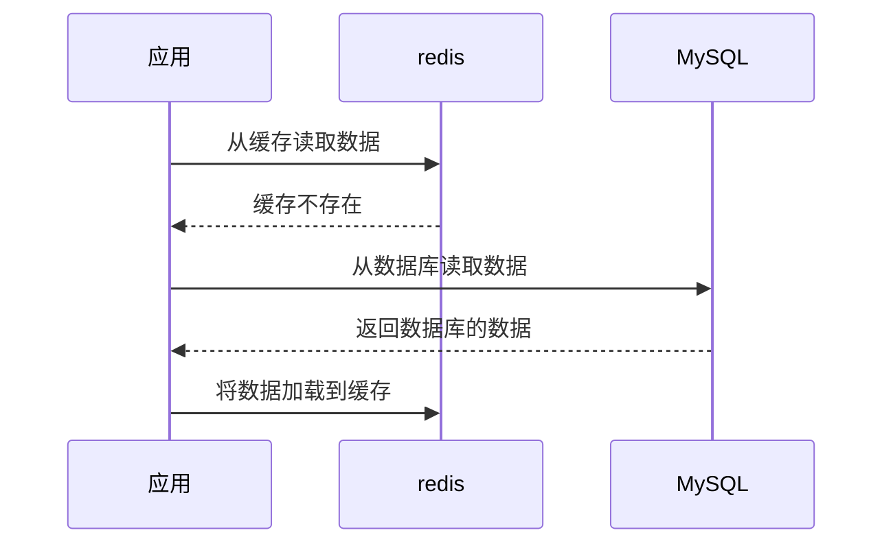

# 一、Redis

[Window下Redis的安装和部署详细图文教程（Redis的安装和可视化工具的使用）_redis安装-CSDN博客](https://blog.csdn.net/weixin_44893902/article/details/123087435)

## 启动Redis服务

在Redis的安装目录下打开cmd窗口，然后执行命令来启动服务：

```bash
redis-server.exe redis.conf

# Or use RedisService (recommended)
RedisService.exe run --foreground
```


- **`redis-server.exe`**：就像 Linux 上的原生 Redis，只是被 Cygwin 移植到了 Windows。路径写法很别扭（`C:\` 要写成 `/cygdrive/c/`）。
- **`RedisService.exe`**：有人在 `redis-server.exe` 外面包了一层，帮你自动处理路径转换，还能一键安装成系统服务。

|              | `redis-server.exe redis.conf`           | `RedisService.exe run --foreground`                |
| ------------ | --------------------------------------- | -------------------------------------------------- |
| **本质**     | 原始 Redis 程序（Cygwin 构建）          | Windows 服务包装器 + 原始程序                      |
| **路径格式** | 必须用 Cygwin 格式（`/cygdrive/c/...`） | 自动转换，可用 Windows 原生路径（`C:\...`）        |
| **配置文件** | 通过命令行参数传入 `redis.conf`         | 可通过 `--dir`、`-c` 等参数指定，或内部默认        |
| **服务模式** | ❌ 不支持                                | ✅ 支持 `install` / `uninstall` 注册为 Windows 服务 |
| **日志输出** | 直接输出到控制台                        | 直接输出到控制台（`--foreground` 表示前台运行）    |


## 打开Redis客户端进行连接

我们使用`redis-cli.exe`命令来打开Redis客户端：

```
redis-cli.exe -h 127.0.0.1 -p 6379
```

之后，在命令中输入ping命令来检测redis服务器与redis客户端的连通性，返回`PONG`则说明连接成功了。

### 修改密码

在配置文件中,找到**requirepass foobared**字样，在其后面追加一行，输入`requirepass 123456`设置访问Redis时所需的密码。

一般测试情况下可以不用设定密码。我这里设置123456做演示。

```
# requirepass foobared
requirepass 123456
```

### 常用操作

卸载服务：`redis-server --service-uninstall`

开启服务：`redis-server --service-start`

停止服务：`redis-server --service-stop`


# 二、缓存

## 1、缓存雪崩

**【简】批量缓存失效，数据库压力骤增。**

我们在写入缓存的时候，一般会给这个缓存设置一个过期时间。“缓存雪崩”就像是一个大雪山突然崩塌一样，所有的数据都一下子全都过期了，导致系统的缓存全部消失，系统需要重新从数据库加载所有的数据。这个过程会让系统瞬间承受巨大的压力，可能导致整个系统崩溃，无法继续服务。



- **发生缓存雪崩的原因**通常有两个：**大量数据同时过期**和**Redis故障宕机**。

### 1.1 大量数据（Key）同时过期

在系统使用缓存时，缓存中的数据会设置一个过期时间，这样数据就会在一段时间后失效，防止数据存在的时间太长。

假设你系统中的很多数据都有相似的过期时间，并且这些数据在**同一时刻都过期**，那么系统就需要在这段时间内同时从数据库重新加载大量数据。这会导致数据库的负载急剧增加，系统变得非常缓慢，甚至崩溃。

针对大量数据同时过期，一般有三种解决方案：

1. **随机过期时间**

为了避免大量数据同时过期导致缓存雪崩，我们可以把缓存的过期时间设置得不完全相同。可以通过加一些随机数来避免大量数据同时过期，比如在每个数据的过期时间上增加几秒钟或几分钟的随机时间。这样，数据的过期时间就会错开，避免了大量数据同时过期。

> 比如你的电商系统中，商品的缓存时间是1小时，你可以为每个商品设置一个1小时加上一个随机的时间，比如10分钟、20分钟、30分钟等。这样，即使有大量商品的缓存过期，它们的过期时间也不会完全重合。

2. **互斥锁**

当缓存数据过期时，多个请求可能同时去数据库查询并更新缓存，导致数据库压力骤增。我们可以使用互斥锁来保证每次只有一个请求去更新缓存，其他请求需要等待，这样就避免了多个请求同时去访问数据库，减轻了数据库压力。

如果商品的缓存失效，多个用户请求该商品信息时，我们可以使用互斥锁机制，确保只有一个请求能从数据库加载数据并更新缓存，其他请求则等待。

3. **多级缓存**

4. **后台更新缓存（异步预热）**

另一个解决方案是通过**后台异步任务**来提前更新缓存，避免每次用户请求时都去查询数据库。当缓存快过期时，后台会提前从数据库读取新的数据，并更新缓存。这样，用户请求时就能从缓存中获取到数据，而不是每次都访问数据库。

### 1.2 redis 故障宕机

针对这种情况的解决方案一般有两种：

1. **熔断降级（服务熔断或请求限流）**

如果Redis发生故障，我们可以采用**服务熔断**或**请求限流机制**来保护系统。

**服务熔断**是说，直接暂停业务对缓存层数据的访问，直接返回错误，这样就保护了数据库，防止数据库被巨大的请求冲击，保证了数据库的正常运行。但是缺点也是显而易见的，那就是业务停摆。

**请求限流**的意思是只允许一小部分请求可以到达数据库，其余的请求则被直接拒绝。等 redis 故障恢复之后并且完成缓存预热之后，再把请求限流解除掉。

2. **构建Redis集群**

另一个有效的解决方案是构建Redis集群，通过主从复制、分片等技术，保证Redis在故障时能够自动切换，避免整个缓存服务的宕机。Redis集群可以分担负载，提供高可用性和容错性，确保系统稳定运行。


## 2、缓存击穿（Hot Key 过期）

**【简】某个热点 Key 突然过期，大量请求同时打到 MySQL。**

**热点数据（热点 Key）**：是指一些访问量非常大的数据。比如在一个电商网站上，某个爆款商品在促销时会吸引大量用户浏览和购买，这个商品的相关信息就成为了热点数据。简单来说，热点数据就是指那些在特定时间段内频繁被访问、请求量特别大的数据。

当某个热点 Key 突然过期，大量请求同时打到 MySQL，就造成了缓存击穿。

对于缓存击穿，有两种常见的解决方案：**互斥锁**和**不给热点数据设置过期时间**。

1. **互斥锁**

这个方案的核心思想是：当缓存中的热点数据失效时，只有一个请求会去数据库获取数据并更新缓存，其他的请求都会等待，直到缓存更新完成。这样，避免了多个请求同时去访问数据库，从而减轻数据库的压力。

这样做的好处是，即使有大量用户访问这款商品，它们也不会同时去访问数据库，只会等到第一个请求处理完毕，避免了数据库被压垮。

2. **不给热点数据设置过期时间**

通过这个方案，我们可以避免缓存中的热点数据过期，从而避免缓存击穿问题。实际上，对于一些访问量极大的热点数据，我们可以选择不设置过期时间，而是让**后台异步更新缓存**，或者在热点数据马上要过期的时候，提前通知后台线程来更新缓存并且重新设置过期时间。

这种方法的优点是，它避免了热点数据的频繁过期问题，从根本上消除了缓存击穿的风险。


## 3、缓存穿透（查询不存在的数据）

**【简】恶意请求查询数据库中不存在的数据，缓存永远不命中。**

缓存穿透：缓存中没有该数据，且数据库中也没有该数据。请求直接穿透缓存去访问数据库，浪费了缓存的作用，也给数据库带来额外负担。

缓存穿透的发生通常有两种原因：**业务误操作**和**黑客攻击**。

1. **业务误操作**：有时，开发人员在编写代码时，可能会因为错误的逻辑导致缓存存储不正确或者缓存数据没有及时更新。比如，某个请求本应该查询缓存，但却直接访问数据库，或者某些数据的缓存失效后没有重新更新。这样就会导致缓存穿透现象的发生。
2. **黑客攻击**：黑客有时会通过恶意请求，访问一些不存在的数据，造成大量无效查询，最终导致系统的压力增大。

**解决：** 

1、**空值缓存**

当数据库返回空结果时，缓存一个空值（如 `<font style="color:rgb(232, 62, 140);">null</font>` 或特殊标记）到缓存中，后续相同的请求可以直接从缓存中获取空值，而不需要再查询数据库。

这样就可以避免每次请求都查询数据库，即使数据不存在，也可以减少数据库的压力。

2、**布隆过滤器**

布隆过滤器是一种空间效率高、能够判断某个元素是否存在于集合中的数据结构。它通过多个哈希函数对元素进行映射，可以在常数时间内判断一个元素是否在集合中存在，但它可能会产生误判，即判断某个元素存在于集合中，但实际并不存在（假阳性）。

通过在缓存层前增加布隆过滤器，避免无效的数据库查询。布隆过滤器可以在缓存中查询是否存在该数据的 ID，如果不存在，则直接返回，不会继续查询数据库。

3、**API 接口防护**

可以通过对接口进行访问频率限制，控制请求的频率，避免恶意请求导致的缓存穿透。比如可以使用一些防止滥用的工具，如 Redis 计数器，限制某个 IP 在一定时间内只能访问特定接口一定次数。


# 三、数据一致性

多级缓存数据一致性问题没有银弹，需要结合业务场景选择合适的方案：

1. 核心策略：Cache Aside Pattern（先更DB，再删缓存，发通知）
2. 分布式一致性：RocketMQ消息通知 + 事务消息
3. 特殊场景防护：缓存空值、互斥锁、过期时间随机化
4. 最终一致性保障：消息重试 + 定期同步

在实际应用中，还需要根据数据的一致性要求、访问频率和更新频率，调整缓存策略和过期时间，在性能和一致性之间找到最佳平衡点。

[多级缓存数据一致性的解决方案 - 知乎](https://zhuanlan.zhihu.com/p/1961028238286495822)
