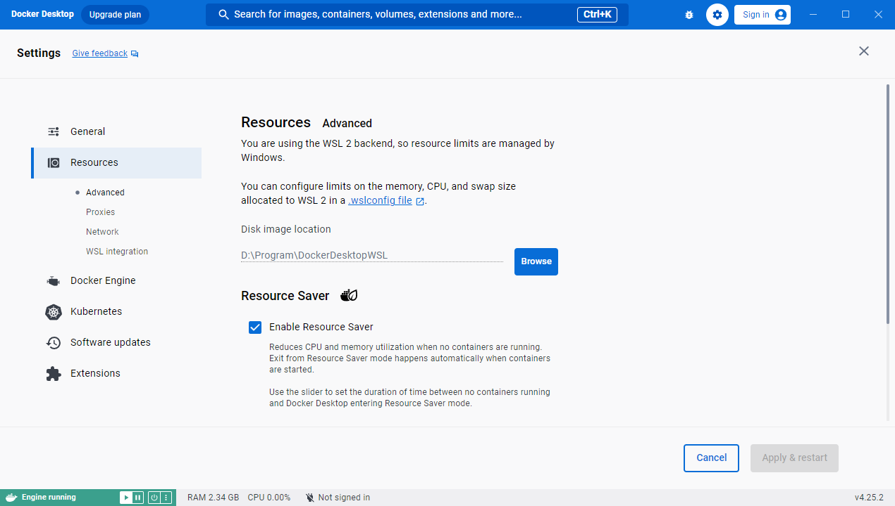

# Docker 自定义安装

[8分钟安装 Docker Desktop-哔哩哔哩视频](https://www.bilibili.com/list/watchlater/?bvid=BV15rduYAEV7)

前置条件：

1. Docker Desktop 已经下载
2. 确认虚拟化已开启
   1. 打开任务管理器
   2. 切换到 **性能** 选项卡
   3. 查看右下角 **虚拟化** 是否为 **已启用**

---

## 一、使用命令行安装Docker，指定docker安装目录

### 情况一、以管理员身份运行 PowerShell

右键点击 PowerShell 图标 → 选择 **“以管理员身份运行”**

切换到安装目录并运行：

```PowerShell
cd C:\Users\01\Downloads
Start-Process -Wait -FilePath "Docker Desktop Installer.exe" -ArgumentList 'install', '-accept-license', '--installation-dir="D:\Program\Docker"'
```

其中`D:\Program\Docker`是自定义文件夹的路径。

#### 安装过程

1. 勾选：
   - `Install required Windows components for WSL 2`
   - `Add shortcut to desktop`
2. 点击 **OK** 开始安装
3. 安装完成后会提示 **重启电脑**


### 情况二、清理旧的 Docker 数据（如果之前安装过）

如果之前安装过 Docker，可以先清理。清理前请确认没有需要保留的镜像、容器或配置，以下命令会递归删除目录：

```powershell
# 以管理员身份运行
# 停止相关服务
Stop-Service com.docker.service -ErrorAction SilentlyContinue

# 删除旧的配置目录
Remove-Item "C:\ProgramData\DockerDesktop" -Recurse -Force -ErrorAction SilentlyContinue
Remove-Item "C:\ProgramData\Docker" -Recurse -Force -ErrorAction SilentlyContinue

# 然后重新安装
cd C:\Users\01\Downloads
Start-Process -Wait -FilePath "Docker Desktop Installer.exe" -ArgumentList 'install', '-accept-license', '--installation-dir="D:\Program\Docker"'
```


## 二、更改镜像默认保存路径

[8分钟安装 Docker Desktop，让你开发效率起飞_哔哩哔哩_bilibili](https://www.bilibili.com/video/BV15rduYAEV7/)

重启之后双击桌面 Docker Desktop 图标

第一次启动可能会要求登录 Docker Hub，没有账号可以免费注册，启动成功后右下角任务栏会出现 🐳 小鲸鱼图标。

进入软件之后可能会提示你`WSL needs updating`，就是需要更新，在powershell输入：

```powershell
wsl --update
```


1、运行docker，进入设置页，点击Resources选项，发现镜像默认安装在%UserProfile%\AppData\Local\Docker\wsl目录下。

2、点击Browse按钮，选择自定义的其他盘路径，例如：D:\Program\

如下图所示：



3、最后点击Apply & restart按钮重启Docker即可生效。


4、docker会自动在选定的目录下增加子目录DockerDesktopWSL。


### 验证安装

打开 PowerShell 或 CMD，输入：

```PowerShell
docker --version
```

如果显示 `Docker version ...` 形式的版本号，说明 Docker 安装成功。

再运行：

```
docker run hello-world
```

如果出现 Hello from Docker! 说明 Docker 已能正常拉取和运行镜像。


## 问题

如果报错`For security reasons C:\ProgramData\DockerDesktop must be owned by an elevated account`。

这个错误信息是 Docker Desktop 为了修复近期被发现的中危安全漏洞（CVE-2025-14740）而新增的安全检查机制，官方修复版本为 4.57.0 或更高版本。

简单来说,这个漏洞允许一个低权限用户在安装 Docker 之前,预先创建 `C:\ProgramData\DockerDesktop` 文件夹并获取其所有权。之后,他就可以利用这个漏洞来篡改配置文件,最终在你（一个高权限用户）运行 Docker 时,以你的权限执行恶意代码。你看到的这个提示,正是 Docker 安装程序在阻止这种潜在的攻击。

### 解决方法

你需要清理掉这个被“错误账户”所拥有的文件夹,然后重新以管理员身份运行安装程序。

#### 步骤 1：删除有问题的文件夹

这个文件夹通常无法直接通过资源管理器删除,我们需要使用命令行。

1. 按下 `Win` + `S` 键,输入 `powershell`,然后右键点击 **“Windows PowerShell”**,选择 **“以管理员身份运行”**。

2. 在弹出的 UAC（用户账户控制）窗口中点击 **“是”**。

3. 在 PowerShell 窗口中,输入以下命令来强制删除问题文件夹：

   ```powershell
   Remove-Item -Path "C:\ProgramData\DockerDesktop" -Force -Recurse
   ```

   > `-Force` 参数会强制删除任何属性的文件夹,`-Recurse` 则会删除其内部的所有子项和文件。

#### 步骤 2：以管理员身份重新安装

删除成功后,就可以开始安装了。

1. **确保 PowerShell 仍在管理员模式下运行。**

2. 在 PowerShell 中,切换到安装程序所在的目录：

   ```powershell
   cd C:\Users\01\Downloads
   ```

3. 运行你的安装命令：

   ```powershell
   Start-Process -Wait -FilePath "Docker Desktop Installer.exe" -ArgumentList 'install', '-accept-license', '--installation-dir="D:\Program\Docker"'
   ```

安装程序会再次请求权限,请允许。如果一切顺利,它应该会开始安装而不再报错。

---

> 💡 **补充说明**
> 在极少数情况下,如果你之前安装过 Docker 并且卸载不干净,可能还会遇到其他残留文件的问题。如果上面的方法没有解决,可以再尝试重启电脑,或者在管理员模式下运行以下命令,进行更彻底的清理后再重试：
>
> ```powershell
> # 清理其他可能的相关目录
> Remove-Item "C:\ProgramData\Docker" -Force -Recurse -ErrorAction SilentlyContinue
> Remove-Item "C:\Program Files\Docker" -Force -Recurse -ErrorAction SilentlyContinue
> Remove-Item "$env:USERPROFILE\.docker" -Force -Recurse -ErrorAction SilentlyContinue
> Remove-Item "$env:LOCALAPPDATA\Docker" -Force -Recurse -ErrorAction SilentlyContinue
> ```

---


## 启用 WSL2（家庭版必看）

如果你是 Windows 10/11 家庭版 或者第一次安装 Docker Desktop，需要启用 WSL2。

### 安装 WSL2

**方法一**：在 PowerShell（管理员模式）中输入：

```
wsl --install
```

等待系统自动安装 Linux 子系统和 WSL2 内核。

**方法二**：直接打开 Docker Desktop，会提示 `WSL needs updating`。点击 Restart，然后按任意键退出 PowerShell（管理员模式），再按任意键安装（推荐）。
