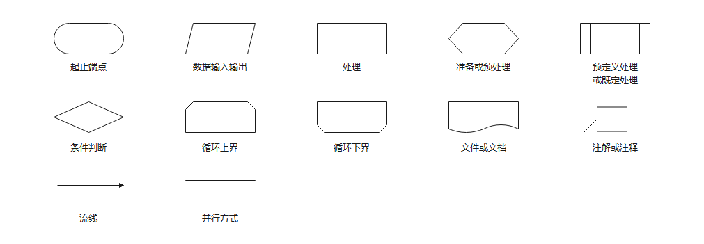
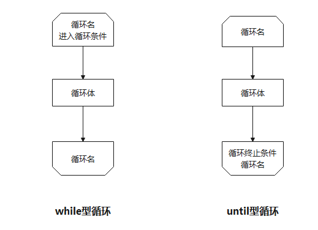
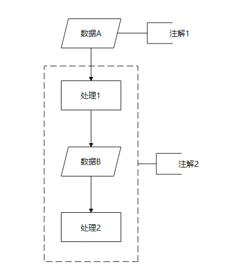
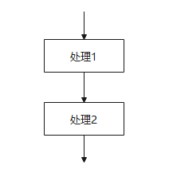
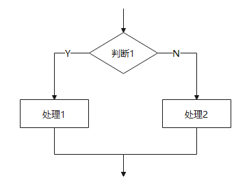
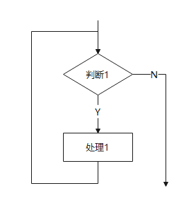
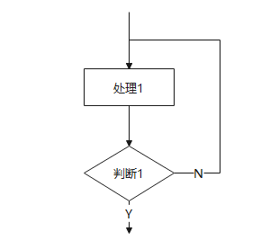
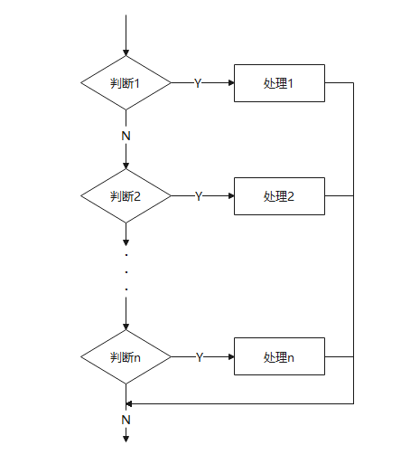
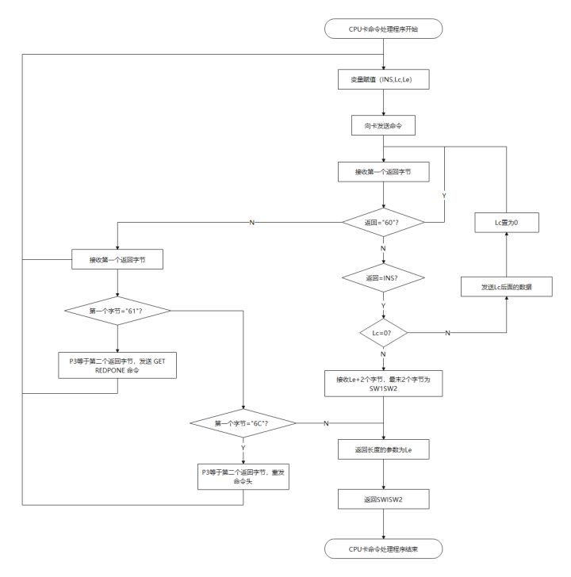

## 01 程序流程图的定义

我们可以用一条公式来表示程序流程图，即：

> 程序流程图=程序流程+图

简单来说，就是**一种描述程序流向的图形**。一般由处理框、判断框、起止框、连接点、流程线、注释框等元素构成。

百度百科对它是这么定义的：

> 程序流程图又称程序框图，是用统一规定的标准符号描述程序运行具体步骤的图形表示。 程序框图的设计是在处理流程图的基础上，通过对输入输出数据和处理过程的详细分析，将计算机的主要运行步骤和内容标识出来。

## 02 程序流程图的标准符号

大家可能注意到百度百科的定义描述中有一个关键词，就是统一规定的标准符号。

是的，程序流程图的每种元素都有对应的符号，切不可乱用。

以下是程序流程图常用的几个标准符号：

- **循环的标准结构**

- **注解符号的使用**

## 03 程序流程图的基本结构

**顺序型**：几个连续的处理步骤依次排列构成

**选择型**：由某个逻辑判断式的取值决定选择两个处理中的一个

**先判定（while）型循环**：在循环控制条件成立时，重复执行特定的处理

后判定（until）型循环：重复执行某些特定的处理，直至控制条件成立

**多情况（case）型选择**：列举多种处理情况，根据控制变量的取值，选择执行其一

## 04 程序流程图的实例

