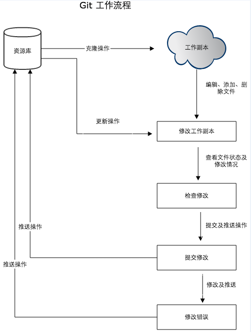
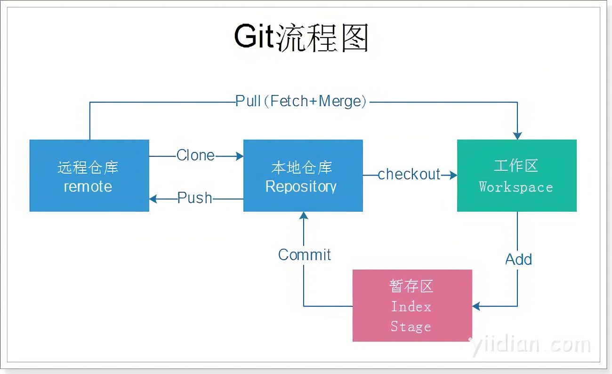
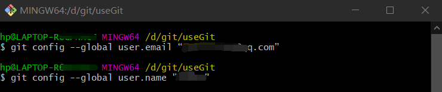
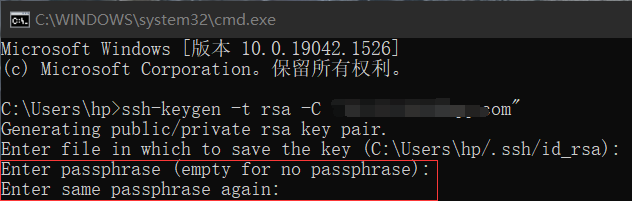
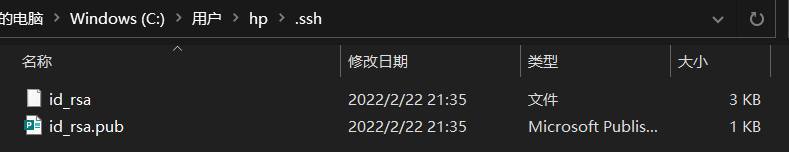
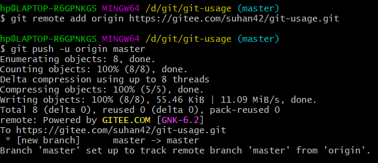

# 0.什么是Git

Git是分布式版本控制系统，那么它就没有中央服务器的，每个人的电脑就是一个完整的版本库，这样，工作的时候就不需要联网了，因为版本都是在自己的电脑上。既然每个人的电脑都有一个完整的版本库，那多个人如何协作呢？比如说自己在电脑上改了文件A，其他人也在电脑上改了文件A，这时，你们两之间只需把各自的修改推送给对方，就可以互相看到对方的修改了。

## 工作原理





# 1.常用操作

| 命令              | 说明                                     |
| ----------------- | ---------------------------------------- |
| git init          | 初始化仓库                               |
| git clone         | 拷贝一份远程仓库，也就是下载一个项目。   |
|                   |                                          |
| git add           | 添加文件到暂存区                         |
| git status        | 查看仓库当前的状态，显示有变更的文件。   |
| git diff          | 比较文件的不同，即暂存区和工作区的差异。 |
| git commit        | 提交暂存区到本地仓库。                   |
| git reset         | 回退版本。                               |
| git rm            | 删除工作区文件。                         |
| git mv            | 移动或重命名工作区文件。                 |
|                   |                                          |
| git log           | 查看历史提交记录                         |
| git blame \<file> | 以列表形式查看指定文件的历史修改记录     |
|                   |                                          |
| git remote        | 远程仓库操作                             |
| git fetch         | 从远程获取代码库                         |
| git pull          | 下载远程代码并合并                       |
| git push          | 上传远程代码并合并                       |

# 2.Git初始使用

## 登录

打开`git bash`之后，输入：

```shell
git config --global user.name "你的名字"
git config --global user.email "你的邮箱"
```

（注意`"`前面是有空格的，没有提示信息表示成功）
输入完后再接着执行



注意`git config --globa`l参数，有了这个参数，表示你这台机器上所有的Git仓库都会使用这个配置，当然你也可以对某个仓库指定的不同的用户名和邮箱，根据个人情况设置。

```shell
git config --global user.name
```

设置仓库局部用户名和邮箱

```bash
#1 仓库
git config user.name "one_name";
git config user.email "one_email"
#2 仓库
git config user.name "two_name";
git config user.email "two_email"
```

查看信息

```bash
git config -l  #查看所有配置
git config --system --list #查看系统配置
git config --global --list #查看用户（全局）配置
```

即可成功!


## 远程仓库

先注册github账号，由于你的本地Git仓库和github仓库之间的传输是通过SSH加密的，所以需要一点设置：

1. 创建SSH Key。在用户主目录下，看看有没有`.ssh`目录，如果有，再看看这个目录下有没有`id_rsa`和`id_rsa.pub`这两个文件。
   1. 如果有的话，直接跳过此如下命令。
   2. 如果没有的话，打开cmd命令行，输入如下命令：

```shell
ssh-keygen -t rsa -C "youremail@example.com"
```



```shell
Enter file in which to save the key (C:\Users\cenha/.ssh/id_rsa): #设置密钥的文件名，不设置默认下面的名字

Enter passphrase (empty for no passphrase): #设置密钥的密码，直接回车为不设置

Enter same passphrase again: #再输入一遍密码，未设置密码直接回车
```

这两步演示的时候是直接按的回车，
而如果这里是空的话，确实之后就不需要输入密码了。
passphrase这个并非是gitlab的密码，而是git的安全口令
我觉得这个口令更多的是为了保证每次使用git的时候更安全，所以自然就需要每次输入
那么如果你使用的时候不想输入passphrase的话，则不需要设置安全口令。


（你自己的邮箱地址，推荐和注册github的邮箱保持一致）, 我本地已经有了这些文件，如下所示：



`id_rsa`是私钥，不能泄露出去，`id_rsa.pub`是公钥，可以放心地告诉任何人。


2. 登录Gitee，右上角：设置→SSH公钥，输入你的标题和公钥，点击确定。

   （登录github，右上角：设置→settings→SSH and GPR keys→New SSH key，然后输入title，输入上面的公钥id_rsa.pub，然后点击保存。点击 Add Key，你就应该可以看到已经添加的key。）


3. 在git bash中测试ssh（github需要这一步，gitee不需要）

```bash
ssh -T git@github.com
```


## 上传本地仓库

在本地的电脑上新建一个文件夹，在这个文件夹里面右键选择`Git Bash Here`

1. 要添加文件到版本库，首先需要将这个目录变为git可以管理的仓库，在命令框里面输入：

```shell
git init
```

这时会有一个隐藏文件夹`.git`出现

2. 把要上传的项目复制到新建的文件夹里面，将项目上传的本地仓库，输入:

```shell
git add 01.txt
git commit -m "备注"

# 提交全部
git add .
```

这里以01.txt为例子

`git add`：将文件提交到暂存区

`git commit -m`：将暂存区文件提交到仓库（引号内为注释）

> 在 Linux 系统中，commit 信息使用单引号 `'`，Windows 系统，commit 信息使用双引号 `"`。所以在 git bash 中 **git commit -m '提交说明'** 这样是可以的，在 Windows 命令行中就要使用双引号 **git commit -m "提交说明**。


## 上传远程仓库

### 第一次

```shell
git remote add origin https://...

git push -u origin master
```

`git remote add origin https://...`是将你本地的仓库和github仓库进行关联，关联一次之后无法再次关联，报错：`error: remote origin already exists.`

`-u`是表示第一次上传



# 3.查看修改

- 检查该版本库是否有文件未提交：

```shell
git status
```

- 检查文件是否被修改

```shell
git diff 01.txt
```

`git diff`：查看文件修改的内容

`git log`：获得历史修改记录

`git log --pretty=oneline`：使记录只显示主要的内容，一行显示

- 返回版本

```SHELL
cat：查看文件内容

git reset --hard HEAD^：回退到上一个版本

git reflog：获取历史版本号

git reset --hard 版本号：回退到该版本号对应的版本
```

**PS：**如果要回退到上上个版本，可以使用git reset --hard HEAD^^命令，但是这样稍显麻烦，如果回退到100个版本之前，只需要执行这个命令即可：git reset --hard HEAD~100；


# 4.✨push上传（分支合并）

上传本地：

```sh
git add . 
git commit -m "xxx"   
```

检查操作并上传

```sh
git status

git pull origin master
```

【注意】如果有冲突

1. （vscode）打开冲突文件，查看代码，来决定留下那些。

进行验证

```sh
grep -n "<<<<<<<" 【src/views/business/dataset/index.vue】【冲突代码的位置】
```

2. **`git stash`（暂存）**


# 5.✨pull拉取仓库（丢弃当前的修改）

丢弃当前的修改，重新从远端拉取代码

```bash
# 1. 丢弃工作区所有修改（已跟踪文件）
git restore .

# 2. 取消暂存区的修改
git reset HEAD .

# 3. 删除未跟踪的新文件/文件夹（⚠️ 谨慎使用，会永久删除）
git clean -fd

# 4. 从远端拉取最新代码
git pull origin master
```

## `git stash`（暂存）

因为当前的分支dev 最初也是从master 分支上衍生出来的。而此时你要再从该分支上切换到其主分支。那么你需要先把该dev分支上的改动提交后才能切换，但是该dev分支上还没有完成全部的修改，你不想提交。那么此时你就要选择 stash (存放)它们（你在当前分支上改动的却没有提交commit的内容）。

所以第一步，在当前分支上执行 `git stash` 命令。将当前分支存起来

```sh
# 1. 先退出当前的合并冲突状态（保留修改到 stash）
git merge --abort

# 2. 把本地修改暂存起来（包括未追踪的新文件）
git stash push -m "dataset页面本地修改" -u

# 3. 拉取远程最新代码
git pull origin master

# 4. 恢复刚才暂存的本地修改
git stash pop
```

都没有问题之后：

切换分支为masher

```sh
git checkout master
```

合并分支：

```sh
git merge a_dev
```

推到仓库：

```sh
git push origin master
```

【其他stash】

```bash
git status
git stash list #命令去查看我们“存储”的列表。

#之后
git stash drop #来删除
```


# 6.✨branch分支管理

### 基本操作

使用分支意味着你可以从开发主线上分离开来，然后在不影响主线的同时继续工作。

- **创建分支**：

```shell
git branch [branchname]
```

单单使用`git branch`的时候是列出分支。当你执行 **git init** 的时候，默认情况下 Git 就会为你创建 **master** 分支。

- **切换分支**

```shell
git checkout [branchname]
```

当你切换分支的时候，Git 会用该分支的最后提交的快照替换你的工作目录的内容， 所以多个分支不需要多个目录。

我们也可以使用`git checkout -b (branchname)`命令来创建新分支并立即切换到该分支下，从而在该分支中操作。

- **合并分支**

```shell
git merge [branchname]

git merge --ff-only dev
```

一旦某分支有了独立内容，你终究会希望将它合并回到你的主分支。 你可以使用上面的命令把这个分支合并到master分支。

`--ff-only` 的好处是：如果不能干净快进，它会直接停住，不给你制造意外的 merge commit。

- **删除分支**

```shell
git branch -d [branchname]
```

合并并不仅仅是简单的文件添加、移除的操作，Git也会合并修改。我们可以用 git add 要告诉 Git 文件冲突已经解决。

- **查看分支**

```bash
git branch -v
```

常见命令：

| 命令              | 效果                                  |
| ----------------- | ------------------------------------- |
| `git branch -v`   | 本地分支 + 提交信息                   |
| `git branch -vv`  | 本地分支 + 提交信息 + 上游跟踪关系    |
| `git branch -a`   | 本地 + 远程分支（只显示分支名）       |
| `git branch -av`  | 本地 + 远程分支 + 提交信息            |
| `git branch -avv` | 本地 + 远程分支 + 提交信息 + 上游关系 |
| `git branch -r`   | 只显示远程分支名                      |
| `git branch -rv`  | 远程分支 + 提交信息                   |


### 跟踪分支

```sh
# 1. 先 fetch 远程所有更新（包括 common-rag）
git fetch origin

# 2. 查看远程分支情况
git branch -r | grep [branchname]
```


### 修改分支名字

1. **切换到要重命名的分支**（如果当前就在该分支，可直接执行下一步）：

```sh
git checkout [master]
```

2. **执行重命名命令**：

```sh
git branch -m [main]
```

更新远程仓库

3. **推送新分支到远程并建立跟踪关系**：

```sh
git push -u origin [main]
```

4. **删除旧的远程分支**（可选，但建议执行以避免混淆）：

```sh
git push origin --delete [master]
```

5. **删除本地跟踪分支（可选）** 删除远程分支不会自动移除本地跟踪引用，可用以下命令清理：

```sh
# 删除本地跟踪分支
git branch -d [master]

# 或同步并清理已失效的远程引用
git fetch -p
```

**注意事项**

- 删除前确认该分支已合并或不再需要，避免丢失重要代码。
- 本地和远程分支是独立的，删除一方不会影响另一方。
- 对未合并的分支，建议先备份或确认无用再执行删除操作。

这样，你就可以安全、干净地管理 Git 远程分支了。

### 远程仓库管理 remote 

**git remote** 命令用于用于管理 Git 仓库中的远程仓库。

**git remote** 命令提供了一些用于查看、添加、重命名和删除远程仓库的功能。

以下是 git remote 命令的常见用法：

- `git remote`：列出当前仓库中已配置的远程仓库。
- `git remote -v`：列出当前仓库中已配置的远程仓库，并显示它们的 URL。
- `git remote add <remote_name> <remote_url>`：添加一个新的远程仓库。指定一个远程仓库的名称和 URL，将其添加到当前仓库中。
- `git remote rename <old_name> <new_name>`：将已配置的远程仓库重命名。
- `git remote remove <remote_name>`：从当前仓库中删除指定的远程仓库。
- `git remote set-url <remote_name> <new_url>`：修改指定远程仓库的 URL。
- `git remote show <remote_name>`：显示指定远程仓库的详细信息，包括 URL 和跟踪分支。

以下列出了远程仓库、添加远程仓库、重命名远程仓库、删除远程仓库、修改远程仓库 URL 和查看远程仓库信息的用法：

```
git remote
git remote -v

git remote add origin https://github.com/user/repo.git
git remote rename origin new-origin
git remote remove new-origin
git remote set-url origin https://github.com/user/new-repo.git
git remote show origin
```


# 7.tag标签

如果你达到一个重要的阶段，并希望永远记住那个特别的提交快照，你可以使用 git tag 给它打上标签。

比如说，我们想为我们的项目发布一个"1.0"版本。 我们可以用 git tag -a v1.0 命令给最新一次提交打上（HEAD）"v1.0"的标签。

-a 选项意为"创建一个带注解的标签"。 不用 -a 选项也可以执行的，但它不会记录这标签是啥时候打的，谁打的，也不会让你添加个标签的注解。 我推荐一直创建带注解的标签。

```shell
git tag -a v1.0
```

如果我们要查看所有标签可以使用以下命令：

```shell
$ git tag
v0.9
v1.0
```

指定标签信息命令：

```shell
git tag -a <tagname> -m "我是标签"
```

PGP签名标签命令：

```shell
git tag -s <tagname> -m "我是标签"
```


# 8.Worktree工作树

**`git worktree`** 允许你在同一个 Git 仓库中创建多个**独立的工作目录**。这完美解决了需要频繁切换分支来处理紧急任务（Hotfix）的痛点。

1. **创建新的工作树**：从 `main` 分支切出 `hotfix` 分支，并在新目录中开始工作。

```dockerfile
# 在主仓库目录执行
git worktree add [新目录位置] [使用的分支]

git worktree add ../hotfix-branch hotfix
```

2. **在工作树中开发**

```bash
cd ../hotfix-branch
git status --short --branch

git add .
git commit -m "fix(具体模块): 描述本次修改"
```

3. **合并与清理**：在**主仓库目录**完成合并后，清理工作树。

```bash
到主目录合并本地分支 dev、hotfix
cd [主目录]
git status --short --branch

# 主目录必须干净；干净后执行
git merge --ff-only hotfix
```


---

# ~/.ssh/config

```
#gitlab
Host [别名备注]
	HostName [这里填gitlab主机地址]	【← 如果是github，注意是 ssh.github.com，不是 github.com】
	Port 端口 						【默认就是 22】
	User git
	IdentityFile ~/.ssh/[id_rsa] 	【密钥文件的地址，注意要对应上】
	IdentitiesOnly yes 				【只使用指定的密钥，防止 SSH 自动尝试其他密钥导致认证混乱】
    PreferredAuthentications publickey 【跳过密码验证】
```

例如：

```
Host github
	Hostname ssh.github.com
	Port 443
	User git
	IdentityFile ~/.ssh/id_rsa
	PreferredAuthentications publickey
	

Host gitlab 10.6.70.125
	HostName 10.6.70.125
	User git
	IdentityFile ~/.ssh/id_gitlab
	PreferredAuthentications publickey
```

### 别名

`User git`不是配置时候的`user.name`，一般只能是 `git`，如果不配置就会是 `user.name` 里面配置的内容，但是配合 Host 别名使用的时候机会报错：

如果不配置User，并且 `user.name=suhan`，那么：

```bash
ssh -T github		=		ssh -T suhan@github.com	
```

配置 `User = git` 后：

```bash
ssh -T gitlab-local =		ssh -T git@10.6.70.125
ssh -T github		=		ssh -T git@github.com	
```

【注意】此时配置了别名，gitlab的原有ip地址可能会失效，所以配置改成同时匹配 gitlab 和 10.6.70.125：

```
Host gitlab 10.6.70.125
  HostName 10.6.70.125
  User git
  IdentityFile ~/.ssh/id_gitlab
  IdentitiesOnly yes
  PreferredAuthentications publickey
```

现在就可以两者同时畅通了

```bash
ssh -T gitlab
Welcome to GitLab, @xxx!

ssh -T git@10.6.70.125
Welcome to GitLab, @xxx!
```


# 一台主机下，个人 GitHub 和公司 GitLab 同时使用

方案：基于config文件

原理上就是对 SSH 协议配置 config 文件，对不同的域名采用不同的认证密钥。

配置流程：

1. **配置 Git 用户名、邮箱**

```bash
# 全局配置，Github仓库中默认使用此配置
git config --global user.name "Voluee"
git config --global user.email "personal@xxx.com"
# 团队项目配置，每次新创建一个项目，需要执行下
git config --local user.name "Voluee"
git config --local user.email "company@xxx.com"
```

2. **生成 ssh key**

ssh key 默认生成后保存在 ~/.ssh/目录下 ，分别为`id_gitlab`和`id_github`两个文件，由于我们需要分开配置，所以生成 SSH 密钥时，通过 `-f` 参数指定自定义文件名

```bash
#创建gitlab的SSH-Key
ssh-keygen -t rsa -C "company@xxx.com" -f ~/.ssh/id_gitlab
#创建github的SSH-Key
ssh-keygen -t rsa -C "personal@xxx.com" -f ~/.ssh/id_github
```

命令执行完成后，这时`~/.ssh`目录下会多出四个文件，`xxx.pub`里保存的就是我们要使用的key，这个key就是用来上传到Gitlab和GitHub上的。

3. **配置 config 文件**

在 `~/.ssh`目录下，如果不存在，则新建 `touch ~/.ssh/config`文件。

【注意】文件就叫`config`，没有后缀。

文件内容添加如下：

```
#gitlab
Host [名字备注]
	HostName [这里填gitlab真实地址]
	IdentityFile ~/.ssh/id_gitlab 【这里填写上一步创建得密钥文件 注意要对应上 正式环境删除此段注释】
	IdentitiesOnly yes 【只使用指定的密钥，防止 SSH 自动尝试其他密钥导致认证混乱】
    PreferredAuthentications publickey 【跳过密码验证】
 
# 例子：

Host github
	HostName ssh.github.com
	Port 443
	IdentityFile ~/.ssh/id_github
	IdentitiesOnly yes
    PreferredAuthentications publickey
```

字段解释：

```
Host
	它涵盖了下面一个段的配置，我们可以通过他来替代将要连接的服务器地址。这里可以使用任意字段或通配符。当ssh的时候如果服务器地址能匹配上这里Host指定的值，则Host下面指定的HostName将被作为最终的服务器地址使用，并且将使用该Host字段下面配置的所有自定义配置来覆盖默认的/etc/ssh/ssh_config配置信息。
Port
	自定义的端口。默认为22，可不配置
User
	自定义的用户名，默认为git，可不配置
HostName
	真正连接的服务器地址
PreferredAuthentications
	指定优先使用哪种方式验证，支持密码和秘钥验证方式
IdentityFile
	指定本次连接使用的密钥文件
```


4. **上传public key 到 Github/Gitlab**

以Github为例，过程如下：

登录github --> 点击右上方的头像选择settings图标 --> 点击左边界面的 SSH keys —> 点击New SSH key

–> 然后将上面拷贝的 `~/.ssh/id_github.pub` 文件内容粘帖到key一栏，再点击“Add SSH key”按钮就可以了

添加过程github会提示你输入一次你的github密码 ，确认后即添加完毕。


5. **添加到ssh agent**

**SSH Agent** 是 OpenSSH 的核心组件，用于管理私钥并简化身份验证过程。它通过将私钥存储在内存中，避免每次连接服务器时都需要输入密码短语，从而提高效率和安全性。

```bash
# 查看ssh-agent是否启动
eval "$(ssh-agent -s)"

# 启动 SSH Agent
eval `ssh-agent`

# 添加私钥到 SSH Agent
ssh-add ~/.ssh/id_github   #这里是你的ssh key
```

其他命令：

```bash
# 列出当前已添加的密钥
ssh-add -l
# 删除所有密钥
ssh-add -D
```


6. **验证是否OK**

由于每个托管商的仓库都有唯一的后缀，比如 Github的是 `git@github.com:*`，所以可以这样测试：

```bash
ssh -T git@github.com
Hi Suhan! You've successfully authenticated, but GitHub does not provide shell access.

ssh -T git@10.6.70.125
Welcome to GitLab, Voluee!
```

### 分享一些指令

```bash
git config --list
git config --system --list
git config --global  --list
git config --local  --list
 
CMD，git_bash不走代理，所以得配置，前提是你有vpn已经代理了指定端口
set http_proxy=http://127.0.0.1:1080
set https_proxy=http://127.0.0.1:1080
export set https_proxy=http://127.0.0.1:1080
```

分开配置仓库

```
假设gitlab与jgithub的工作目录分别如下所示：
 
github工作仓库:~/workspace/github
gitlab工作仓库:~/workspace/gitlab
```

配置：

```bash
#gitlab
cd ~/workspace/gitlab
git init
git config --global user.name 'gitlab'
git config --global user.email 'gitlab@company.com'
 
#github
cd ~/workspace/github
git init
git config --local user.name 'personal'
git config --local user.email 'personal@163.com'
```


# 代码回滚

在使用 Git 时，如果需要丢弃本地的修改，可以根据修改的状态选择不同的方法。以下是几种常见场景及对应的解决方法：

## 1. 已使用 git add 缓存代码，但未提交

如果修改已被添加到暂存区，但尚未提交，可以先将其从暂存区移除，然后再撤销：

- **移除暂存区中的文件**：

```bash
git reset HEAD 文件名
```

- **移除所有暂存区中的文件**：

```bash
git reset HEAD
```

此时，文件会回到工作区状态，接着可以使用第一种方法 (*git checkout*) 丢弃修改。


## 2. git commit后

修改了本地的代码，然后使用：

```bash
git add file
git commit -m '修改原因'
```

执行commit后，还没执行push origin时，想要撤销这次的commit，该怎么办？

- **HEAD 回退 1 个 commit**，即撤销最近的一次提交：

```bash
git reset HEAD~1
#或者
git reset HEAD^
```

默认是 `--mixed` 模式，**不会删除工作区的修改**，只会把暂存区（index）的内容回退。

- 想撤销最近一次 commit 但保留**所有改动在暂存区**里，使用`--soft`：

```
git reset --soft HEAD^1
```

- **回退到指定的提交【注意】代码会丢失**：

```
git reset --hard 提交ID
```


命令详解：

`HEAD^` 表示上一个版本，即上一次的commit，也可以写成`HEAD~1`
如果进行两次的commit，想要都撤回，可以使用HEAD~2

| 命令    | 含义                                                         |
| ------- | ------------------------------------------------------------ |
| `-soft` | 不删除工作空间的改动代码 ，撤销commit，不撤销git add file。  |
| `–hard` | 删除工作空间的改动代码，撤销commit且撤销add，**会导致本次改动的代码丢失**。 |


另外一点，如果commit注释写错了，先要改一下注释，有其他方法也能实现，如：

```
git commit --amend
这时候会进入vim编辑器，修改完成你要的注释后保存即可。
```

>### 补充：`^` 和 `~` 的区别（什么时候会不同）
>
>```bash
>git reset HEAD~1
>#或者
>git reset HEAD^
>```
>
>虽然在这个场景下一样，但它们语义上有区别：
>
>| 写法     | 含义                                                   |
>| :------- | :----------------------------------------------------- |
>| `HEAD~1` | 往回数 **1 代**（线性回退）                            |
>| `HEAD^1` | 当前 commit 的 **第 1 个父提交**                       |
>| `HEAD^2` | 当前 commit 的 **第 2 个父提交**（仅 merge commit 有） |
>
>对于**非 merge commit**：`HEAD^` == `HEAD~1` == `HEAD^1`
>对于**merge commit**：`HEAD^` == `HEAD^1`（第一个父提交），而 `HEAD^2` 是第二个父提交。


## 3. 已经push到运程仓库（代码回滚）

1. 查看git提交日志，找到上次提交的信息，输入命令 git log (查看全部日志)或 git log -xx(查看最近xx条日志）

```bash
# 查看最近的 commit 历史
git log --oneline --graph -20
```


2. 回滚到指定的版本（hard后面接的是上面标红的commit，也就是想回滚到的版本）

```bash
# 回退到指定版本，不保留原更改代码
git reset --hard i7j8k9l

# 回退到指定版本，保留原更改代码，且生成新的提交
git revert i7j8k9l
```


3. 强制提交（这个时候已经将代码回退了，你现在的分支状态就处于你上一步指向的版本）

```bash
git push origin main --force-with-lease
```

如果你只是误提了代码，想保留代码改动的话，那就在第二步的时候使用revert 命令，而不是reset ,两者区别如下：

- `revert`是放弃指定提交的修改，但是会生成一次新的提交，需要填写提交注释，**以前的历史记录都在**；
- `reset`是指将HEAD指针指到指定提交，历史记录中不会出现放弃的提交记录。


### 清理历史记录

核心思路是用 `git reset` 或 `git rebase` 直接重写历史，把这几个 commit 彻底抹掉。

```bash
# 1. 先确认要回退到的目标 commit（merge 之前的那个）
git log --oneline

# 2. 假设 i7j8k9l 是 merge 之前的最后一个正常 commit
# 先创建备份分支（保险）
git branch backup-before-cleanup

# 3. 强制回退到 merge 之前
git reset --hard i7j8k9l

# 4. 如果已经 push 到远程，需要强制推送
git push origin main --force-with-lease
```


### 强制推送覆盖远程分支的安全性

尽可能不使用`git push -f origin main`（或 `--force`）

**行为**：无条件用本地 `main` 覆盖远程 `main`，**不管远程在此期间有没有被别人更新过**。

**风险**：如果同事在你 `pull` 之后、你 `push` 之前向远程 `main` 推送了新 commit，你的强制推送会**直接抹掉他们的工作**。

而是使用：

```bash
git push origin main --force-with-lease
```

**行为**：在强制推送前，先检查远程 `main` 是否**还是你上次看到的样子**。

- 如果远程没变 → 推送成功
- 如果远程已被别人更新 → **拒绝推送**，提示你先 `pull` 合并

**本质**：它带有一个"租约"（lease），只有远程引用值与本地记录的远程跟踪分支（`origin/main`）一致时才允许强制覆盖。


# 一次完整的git代码

```bash
git status                    查看当前分支状态
git log                       查看提交历史
git reset  ***           　　　根据提交历史ID回滚代码至上一次提交（参考上文）
git stash                     将回滚后的代码，暂存到本地仓库
git checkout master   　　　　 将当前分支切换至master主分支
git pull                      将master的代码拉至本地，保持当前代码是正式环境运行代码
git branch -d ***(原本提交代码的分支名)  删除本地原分支
git checkout -b ***     　　   新建一个新的分支且切到分支上
git stash pop              　　将暂存至本地仓库的代码取出来
git push --force           　　将代码强制发布
```
