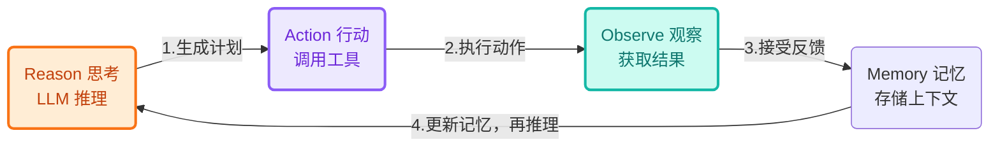
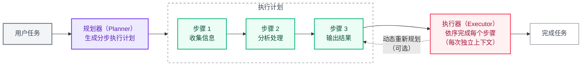
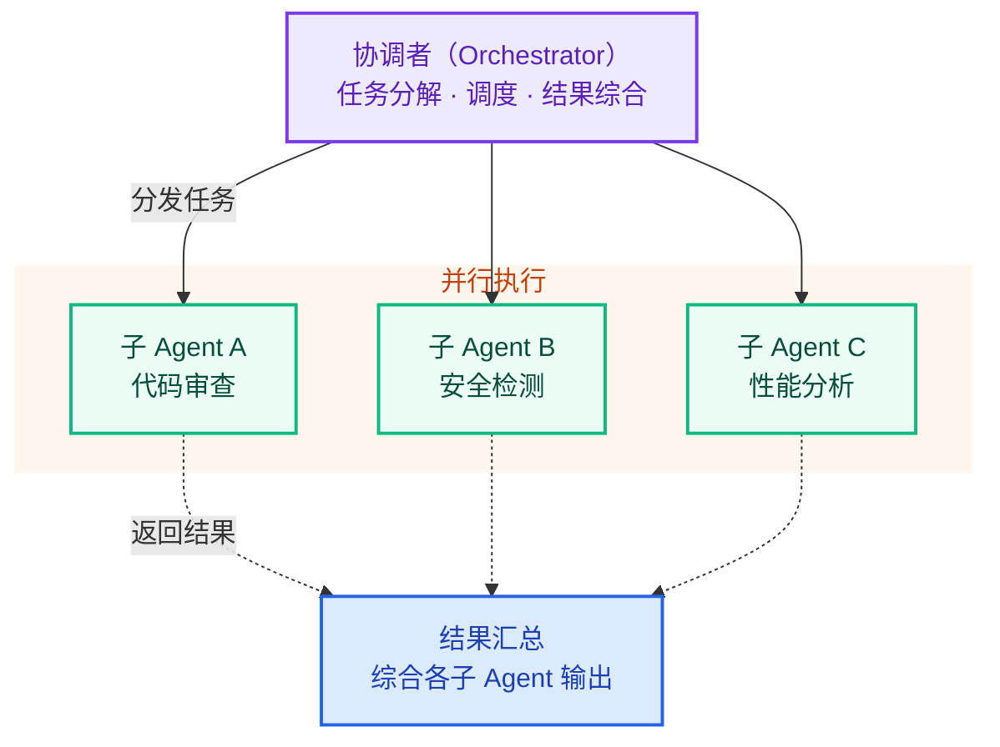

# Agent 架构

> 本文假设你已了解大语言模型（LLM）的基本概念，以及"工具调用"（Function Calling）的基本思路。如果还不熟悉，可以先了解这两个基础知识。
>
> [推理与规划（Reasoning & Planning） | 菜鸟教程](https://www.runoob.com/ai-agent/reasoning-planning.html)
>
> [Agent 架构 | 菜鸟教程](https://www.runoob.com/ai-agent/agent-architecture.html)

**Agent 架构**是指 Agent 系统中各个组件的组织方式，决定了 Agent 的能力边界、可靠性、灵活性和适用场景。

Agent 的工作方式本质上是一个**循环（Loop）**——感知当前状态，推理下一步，执行行动，再次感知……直到任务完成。

不同架构的差异，就在于如何组织和扩展这个基本循环。


## 推理与规划（Reasoning & Planning）

在构建自主 AI Agent 的过程中，如果说大语言模型（LLM）是 Agent 的大脑，工具调用（Tool Use）是手脚，那么**推理与规划（Reasoning & Planning）**就是将其从简单的问答机升级为自主问题解决者的核心引擎。

复杂的现实任务往往无法通过一次生成（One-pass generation）完成。AI 需要具备拆解目标、逻辑推演、探索路径、自我修正以及调度工具的能力。

- 没有 **Reasoning**，Agent 只是一个**被动响应的工具调用器**（你说一步它做一步，不会理解意图）
- 没有 **Planning**，Agent 只是一个**单步执行器**（无法处理复杂、多步骤的任务）

只有当这两者结合时，Agent 才能真正做到**理解目标 → 拆解路径 → 动态调整 → 自主完成**，这也是 Agent 区别于普通 Chatbot 或简单 Workflow 的本质所在。

以下是目前业界最主流的推理与规划框架。

---


## CoT 思维链

[一文读懂：思维链 CoT（Chain of Thought）](https://www.zhihu.com/tardis/zm/art/670907685?source_id=1005)

> **思维链（Chain of Thought, CoT）：逐步推理**

传统 LLM 生成答案时往往是直觉式的一步到位。

思维链（CoT）的核心思想是：**强制要求模型在输出最终答案前，先显式地输出中间的推理步骤（Let's think step by step）**。这种做法能显著激活模型在复杂数学、逻辑推理和常识问答中的潜力。

CoT 不仅让模型有了更多的计算时间（token 数量代表计算量），还让后续的生成能建立在前面正确的逻辑基础上。

**一个完整的包含 CoT 的 Prompt 往往由指令（Instruction），逻辑依据（Rationale），示例（Exemplars）三部分组成。以是否包含示例为区分，可以将 CoT 分为 Zero-Shot-CoT 与 Few-Shot-CoT。**

### CoT 的作用

1. COT允许模型把一个复杂问题拆解成多个步骤，也就是说需要更多推理步骤的问题可以多分点计算量。
2. COT提供了一个观察模型为何会犯错的窗口，因此也就提供了一个debug模型的机会
3. COT能用在数学应用题、常识推理和符号操作上，也就有可能用在任何人类通过语言能解决的问题上
4. COT支持任何语言模型使用，加在 few-shot的样例中就能生效。省去了重新训练模型的功夫。

实例：

- **Zero-Shot提示：**模型只根据任务的描述生成响应，不需要任何示例。
- **One-Shot提示：**只提供一个例子。
- **Few-Shot提示：**提供几个例子。在提示中的作用是通过少量样本引导模型对特定任务进行学习和执行，例如通过提供少量风格或主题示例，引导模型产出具有相似风格或主题的创作。

### Few-shot CoT 提示词设计

```
# 通过提供包含推理过程的示例，引导模型进行 CoT 推理
prompt = """
问题：罗杰有5个网球。他又买了2罐网球。每罐有3个网球。他现在共有多少个网球？
解答：罗杰一开始有5个网球。2罐网球，每罐3个，共计 2 * 3 = 6 个网球。5 + 6 = 11。答案是11。

问题：食堂有23个苹果。如果他们用掉20个做午餐，又买了6个，现在有多少个苹果？
解答：食堂本来有23个苹果。用掉20个后剩下 23 - 20 = 3 个。又买了6个，现在有 3 + 6 = 9 个。答案是9。

问题：{user_question}
解答："""
```


## ReAct

- **推理 + 行动循环（Reasoning + Acting）**
- ReAct = Reasoning（推理）+ Acting（行动）

如果说 CoT 只是在模型内部闭门造车，那么 **ReAct（Reason + Act）** 则是让模型睁开眼睛看世界。它将内部逻辑推理（Thought）与外部工具交互（Action）交织在一起，形成一个动态的闭环反馈系统。这是一个持续的 **思考-行动** 循环，直到任务完成为止。

ReAct 是一种让 LLM 交替进行推理和行动的框架，通过让模型显式地展示思考过程来提高复杂任务的解决能力。



### ReAct与Function Calling差异

[ReAct与Function Calling差异解析](./Function Calling.md#ReAct与Function Calling差异解析)

### ReAct实例

> 让我们用一个具体的例子来跟踪这个循环：**帮我在北京找一家评分高于 4.5 的意大利餐厅，并告诉我它的地址和招牌菜。**
>
> 循环步骤分解：
>
> **1、思考 (Think/Reason)**：
>
> - **大脑分析**：Agent 的大脑（LLM）接收到目标，它会分析：这是一个信息查询任务，我需要先找到符合条件的餐厅，然后获取其详细信息。我应该使用搜索工具。
> - **生成指令**：大脑生成一个清晰的内部指令，例如：我需要调用 `search_web` 工具，关键词是北京意大利餐厅评分 4.5。
>
> **2、行动 (Act)**：
>
> - **调用工具**：Agent 根据上一步的指令，调用 `search_web` 工具并传入关键词。
> - **执行**：工具开始工作，在互联网上执行搜索，并返回一堆原始的搜索结果列表。
>
> **3、观察 (Observe)**：
>
> - **接收反馈**：Agent 获取到工具执行的结果（即搜索到的网页摘要或链接列表）。
>
> **4、再思考 (Think Again)**：
>
> - **大脑再分析**：大脑看到搜索结果后，继续分析：我已经得到了一些餐厅名字。但用户要的是地址和招牌菜。我需要选择第一个结果（比如：Bottega 意库），然后调用工具获取它的详细信息。
> - **生成新指令**：调用 `get_restaurant_details` 工具，餐厅名称为 **Bottega 意库**。
>
> **5、再行动 (Act Again)** -> **再观察 (Observe Again)**：
>
> - 这个**思考-行动-观察**的循环会继续，直到大脑认为已经收集到足够的信息来**达成目标**。
>
> **6、最终响应 (Final Answer)**：
>
> - 当大脑判断任务完成后，它会将所有的观察结果（记忆）整合起来，生成一个结构化、人性化的最终答案给用户："找到一家符合要求的餐厅：**Bottega 意库**。地址：北京市朝阳区三里屯路 XX 号。招牌菜：黑松露披萨、手工提拉米苏。"

**局限性：** ReAct 在短期的、步骤清晰的任务中表现优异。但由于整个思维和动作历史都积压在同一个上下文窗口中，当任务链条过长时，极易陷入死循环或因为上下文超载而遗忘初始目标。


## Plan-and-Execute（规划先行的执行模式）

为了解决 ReAct 在长线任务中的疲软，Plan-and-Execute 将思考和行动进行了解耦。规划 + 执行架构将 Agent 的工作拆分为两个明确阶段：先**规划（Plan）**，再**执行（Execute）**。

在规划阶段，模型不执行任何操作，只生成一份详细的执行步骤列表。在执行阶段，系统依次完成每个步骤。这种分离让用户可以在执行前审查计划，就像 **Claude Code** 的 **Plan Mode** 一样。

系统通常分为两个独立的角色：

1. **Planner（规划者）**：负责接收大目标，生成详细的 Step-by-Step 子任务列表。
2. **Executor（执行者）**：负责按顺序执行这些子任务。执行器通常就是一个小型的 ReAct Agent，每次只专注完成当前的一个小目标。



### 两种变体

| 变体     | 行为                                       | 典型场景                                 |
| :------- | :----------------------------------------- | :--------------------------------------- |
| 静态规划 | 计划一次性生成，按顺序线性执行，不中途调整 | 流程固定、步骤明确的任务，如数据迁移脚本 |
| 动态规划 | 每执行一步后重新评估，根据结果调整后续计划 | 结果不确定的任务，如调试、探索性数据分析 |

动态规划更健壮，但实现复杂度更高，且每步重新规划会消耗额外的 token。

> Plan & Execute 的代价是增加了推理轮次，对于简单任务反而是一种浪费。如果一个任务可以在 3 步内完成，直接用单 Agent 循环更高效。


## Multi-Agent（多 Agent 协作）

一个 Orchestrator（协调者、编排器）负责任务拆解和调度，多个 Subagent 各司其职，并行或串行地完成子任务，结果汇聚回 Orchestrator 做综合。

当单个 Agent 面临上下文窗口不足或任务过于复杂时，多 Agent 架构提供了一个优雅的解决方案：**让多个专门化的子 Agent 并行工作**，由一个 Orchestrator（协调者）统筹全局。



**独立上下文**是核心优势：每个子 Agent 拥有**独立的上下文窗口**。代码审查 Agent 深度阅读 auth.py 不会影响性能分析 Agent 的判断；安全检测 Agent 产生的大量中间输出不会挤占其他 Agent 的空间。

- 优点

  - 天然支持并行，速度快

  - 子 Agent 各自独立，上下文互不干扰

  - 可以专门化每个子 Agent 的角色

- 缺点

  - 协调逻辑复杂，调试困难

  - 多个 Agent 并行的 Token 成本更高

  - Orchestrator 本身可能成为瓶颈

> 多 Agent 协作的主要成本是编排开销。如果子任务非常简单（每个只需 1-2 步），编排开销可能超过实际工作的开销，此时单 Agent 更合适。


## ToT 与 树状多路径探索

无论是 CoT 还是 Plan-and-Execute，本质上都是**线性**的路径探索。但在写代码、解数学题或创意写作时，人类往往会设想多种方案，评估后选择最佳的，甚至在发现错误时回溯。

**ToT（Tree of Thoughts，思维树）** 将推理过程建模为一棵树：节点是当前的思维状态。模型会在每一个分支点生成多个候选 Thought，然后通过内部的 Evaluator（评估器）对这些节点进行打分（如：可行、可能有风险、不可行）。结合 **BFS（广度优先搜索）** 或 **DFS（深度优先搜索）** 算法，决定是继续深入还是回溯重试。


## 任务规划 & MCTS (蒙特卡洛树搜索)

- **复杂任务拆解与搜索**

在涉及战略游戏或极高难度的推理任务（如前沿的数学验证、复杂的代码仓库重构）时，简单的 ToT 仍不够高效。业界开始将 LLM 与传统的强化学习搜索算法 **MCTS（Monte Carlo Tree Search）** 结合（类似 AlphaGo 的核心逻辑）。

- **LLM 作为策略网络（Policy Network）**：提供启发式的下一步行动建议，减少无意义的分支扩展。
- **LLM/代码环境作为价值网络（Value Network）**：通过仿真执行（Rollout）预判某个行动序列的最终胜率或成功率。
- **优势**：在庞大的解空间中，能够找到最具有全局最优潜力的规划路径。


## Reflexion（自我反思与纠错）

人类在执行任务时，如果第一次失败了，会总结经验教训并在下一次尝试中规避错误。

**Reflexion** 框架赋予了 Agent 类似的能力。

在 Reflexion 闭环中，为 Agent 增加了一个**质检环节**：每次生成输出后，都由一个**评判者（Critic）**来评估质量。当 Agent 的输出被判定为失败（例如：测试用例未通过、API 报错）时，会触发一个 **Reviewer 机制**。

LLM 被要求根据历史动作和失败的反馈写一段口语化的反思（Reflection），例如：*"我刚才使用了错误的 API 参数格式，下一次我应该查阅文档后再传递 JSON"*。这段反思会被存入情景记忆（Episodic Memory）中，作为下一次尝试的上下文提示，从而大幅提升 Agent 的自愈合能力。

```Mermaid
flowchart TB
    Executor["执行器（Executor）<br/>生成初始输出"]
    Critic["评判者（Critic）<br/>评估质量与正确性"]
    Reviser["修正器（Reviser）<br/>根据反馈改进输出"]
    Final["输出最终结果"]
    
    Executor --> Critic
    Critic -->|"通过"| Final
    Critic -->|"未通过"| Reviser
    Reviser -.->|"重新生成<br/>（通常设置最大迭代次数限制）"| Executor
    
    style Executor fill:#ecfdf5,stroke:#059669,stroke-width:2.5px,color:#064e3b
    style Critic fill:#ede9fe,stroke:#7c3aed,stroke-width:2.5px,color:#5b21b6
    style Reviser fill:#fff1f2,stroke:#e11d48,stroke-width:2.5px,color:#9f1239
    style Final fill:#f0fdf4,stroke:#16a34a,stroke-width:2.5px,color:#14532d
```

### 两种实现方式

| 方式        | 机制                               | 优点                       | 缺点                           |
| :---------- | :--------------------------------- | :------------------------- | :----------------------------- |
| 自我反思    | 同一个模型先执行再评估自己的输出   | 实现简单，无额外模型成本   | 模型可能对自己的错误"视而不见" |
| Critic 模型 | 用独立的评判模型评估执行模型的输出 | 更客观，能发现执行模型盲区 | 增加模型调用成本和延迟         |

> "写单元测试 → 运行测试 → 观察失败 → 修复代码 → 再次运行"——这就是反思架构的经典应用。测试结果本身就是 Critic 的反馈信号。

### 实例：Reflexion 的反思提示词设计

```
reflection_prompt = """
你是一个正在尝试编写 Python 爬虫的 AI 助手。
这是你刚才执行的代码：{previous_code}
这是运行环境返回的错误信息：{error_traceback}

请深刻反思：

1. 错误发生的根本原因是什么？
2. 在下一次尝试中，你具体的修改策略是什么？


请将反思记录下来，以指导后续的行动。
"""
```

- 优点

  - 显著提升输出质量

  - 可以设置明确的质量标准

  - 适合有客观评判标准的任务

- 缺点

  - 多次迭代增加延迟和成本

  - 需要设置最大迭代次数防止死循环

  - 评判标准难以形式化时效果有限

> 反思循环每次迭代都是一次额外的 LLM 调用，会明显增加延迟。此外需要设置反思次数上限，否则模型可能陷入"永远不满意"的死循环。


## RAG + Agent（检索增强型智能体）

在 Agent 的工具集里加入向量检索能力，让 Agent 在推理过程中动态查询外部知识库，克服上下文窗口的限制。

RAG（Retrieval-Augmented Generation，检索增强生成）本是一种让 LLM 查询外部知识库的技术。当它与 Agent 结合时，变得更加强大：Agent 可以**主动决定何时检索、检索什么**，而不是每次都被动地检索一次。

```Mermaid
flowchart LR
    UserQuery["用户查询"]
    
    subgraph 检索环节
        ActiveRetrieval["主动检索<br/>决定检索时机与内容"]
        KnowledgeBase["知识库<br/>文档 / 向量数据库<br/>代码库 / 记忆"]
    end
    
    EnhancedReasoning["增强推理<br/>结合知识库内容推理"]
    ExecuteAction["执行行动<br/>基于知识的精准操作"]
    
    UserQuery --> ActiveRetrieval
    ActiveRetrieval <-->|"查询 / 返回"| KnowledgeBase
    ActiveRetrieval -->|"增强上下文"| EnhancedReasoning
    EnhancedReasoning -.->|"按需再检索"| KnowledgeBase
    EnhancedReasoning --> ExecuteAction
    
    style UserQuery fill:#f3f4f6,stroke:#6b7280,stroke-width:2px,color:#374151
    style ActiveRetrieval fill:#ecfdf5,stroke:#059669,stroke-width:2.5px,color:#064e3b
    style KnowledgeBase fill:#fff7ed,stroke:#ea580c,stroke-width:2px,color:#9a3412
    style EnhancedReasoning fill:#ede9fe,stroke:#7c3aed,stroke-width:2.5px,color:#5b21b6
    style ExecuteAction fill:#fff1f2,stroke:#e11d48,stroke-width:2.5px,color:#9f1239
```

- 与普通 RAG 的关键区别：

  - 普通 RAG 是"被动、一次性"的：用户提问时固定检索一次，将结果塞入 Prompt。

  - **RAG + Agent 则不同**：Agent 自主判断在推理的哪个环节需要补充知识、需要检索什么，并可以多次查询知识库，直到获得足够的信息来完成任务。


## 工作流编排（Workflow / DAG）

把 Agent 行为固化为一张**有向无环图（DAG）**，每个节点是一个 LLM 调用或工具调用，边表示数据依赖关系，由框架驱动执行。

这是最接近传统软件工程的一种 Agent 架构。与前面几种架构的最大区别在于：**Agent 的自主决策空间被限制在单个节点内部**，节点之间的流转是预先定义好的，不可更改。

```Mermaid
flowchart LR
    Input["数据输入"]
    Output["输出"]
    
    subgraph 并行区["并行执行"]
        direction TB
        TaskA["任务 A<br/>独立并行执行"]
        TaskB["任务 B<br/>独立并行执行"]
    end
    
    Merge["聚合节点<br/>等待依赖，整合结果"]
    
    Input --> TaskA
    Input --> TaskB
    TaskA --A、B 均完成后才触发--> Merge
    TaskB --A、B 均完成后才触发--> Merge
    Merge --> Output
    
    style Input fill:#f3f4f6,stroke:#9ca3af,stroke-width:2px,color:#374151
    style Output fill:#f3f4f6,stroke:#9ca3af,stroke-width:2px,color:#374151
    style 并行区 fill:,stroke:#fff
    style TaskA fill:#ecfdf5,stroke:#059669,stroke-width:2px,color:#064e3b
    style TaskB fill:#ecfdf5,stroke:#059669,stroke-width:2px,color:#064e3b
    style Merge fill:#ede9fe,stroke:#7c3aed,stroke-width:2px,color:#5b21b6
```

### 纯 Agent vs DAG 工作流

| 特性     | 纯 Agent                 | DAG 工作流               |
| :------- | :----------------------- | :----------------------- |
| 流程控制 | 模型自主决定下一步       | 预定义的 DAG 图决定      |
| 可预测性 | 低，每次运行路径可能不同 | 高，运行路径确定         |
| 可调试性 | 难，依赖日志追踪         | 易，每个节点输入输出明确 |
| 容错性   | 依赖模型自行恢复         | 框架提供重试、断点续跑   |
| 灵活性   | 高，可应对意外情况       | 低，只能走预定义路径     |

DAG 的 "无环"（Acyclic）特性意味着工作流是**确定性的**——没有无限循环，执行路径可以完全预测，失败的节点可以单独重试。

---


## 任务分解策略与工程化实践

在实际生产级的 AI 智能体开发中，纯靠 LLM "零样本"进行复杂规划是不稳定的。常用的混合干预策略包括：

| 干预策略                     | 核心做法                                                     | 适用场景                                                   |
| :--------------------------- | :----------------------------------------------------------- | :--------------------------------------------------------- |
| **子任务模板化 (SOP)**       | 不让 LLM 自由规划，而是预先定义好标准操作程序（SOP），让 LLM 在固定的状态机（State Machine）中流转。 | 客服系统、标准化的数据清洗流水线。                         |
| **HITL (Human-in-the-Loop)** | 在 Planner 生成任务列表后，中断执行，要求人类用户进行确认、修改或审批（Approve），然后再交由 Executor 执行。 | 高风险操作：如删除数据库记录、发送群发邮件、大额资金转账。 |
| **RLHF 引导规划**            | 利用强化学习和人类偏好反馈，专门微调大模型的规划能力，使其更倾向于生成安全、高效的步骤组合。 | 底层大语言模型基座的训练阶段（如 OpenAI 的 o1 模型训练）。 |

### 框架对比总结

| 模式                 | 核心机制                   | 优点                             | 缺点                                   |
| :------------------- | :------------------------- | :------------------------------- | :------------------------------------- |
| **CoT**              | Step-by-Step 线性推理      | 实现极简，显著提升基础推理准确度 | 无法调用外部工具，容易一条道走到黑     |
| **ReAct**            | 交替思考与行动闭环         | 动态适应环境，能通过观测实时调整 | 上下文容易随步骤累积而爆炸，迷失初衷   |
| **Plan-and-Execute** | 先拆解为子任务，再隔离执行 | 极其适合长线复杂任务，上下文清晰 | 面对突发变化（规划本身出错时）不够灵活 |
| **ToT / MCTS**       | 树状搜索，评估回溯         | 能解决最高难度的复杂逻辑问题     | 计算成本极其高昂，Token 消耗呈指数级   |
| **Reflexion**        | 基于失败反馈生成反思记忆   | 具备自我纠错和持续进化的能力     | 依赖明确的反馈信号（如代码编译器报错） |

### 横向对比与如何选择

从多个维度对比六种架构，帮助你快速定位适合的选项。

| 架构            | 自主性 | 可预测性 | 并行能力 | 适合任务复杂度 | 典型实现               |
| :-------------- | :----- | :------- | :------- | :------------- | :--------------------- |
| 单 Agent 循环   | 高     | 低       | 无       | 中低           | Claude Code 默认模式   |
| 规划 + 执行     | 中     | 中       | 部分     | 中高           | Claude Code Plan Mode  |
| 多 Agent 协作   | 高     | 低       | 强       | 高             | AutoGen, CrewAI        |
| 反思 / 自我修正 | 中     | 中       | 无       | 中             | Reflexion, Self-Refine |
| RAG + Agent     | 高     | 中       | 无       | 中高           | LangChain RAG Agent    |
| 工作流编排      | 低     | 高       | 强       | 高（固定流程） | LangGraph, Prefect     |

### 常见组合模式

实际生产系统通常会组合使用多种架构，以下是几种成熟的组合模式：

工作流编排 + 多 Agent：用 DAG 定义主流程，每个节点内部是一个独立的 Agent。例如 CI/CD 流水线中，代码检查节点是 Code Review Agent，安全扫描节点是 Security Agent。

多 Agent + RAG：多个 Subagent 共享同一个向量知识库，各自根据子任务按需检索。例如客服系统中，订单查询 Agent 和退款处理 Agent 都查询同一个知识库但检索不同的内容。

规划执行 + 反思：先规划再执行，但每个步骤执行后加入反思环节确保质量。适合对质量要求极高的任务。

### 常见误区

误区一：架构越复杂越好

多 Agent 协作看起来很强大，但如果你的任务用单 Agent 循环在 5 步内就能完成，引入编排开销反而降低效率。原则：用能满足需求的最简架构。

误区二：反思一定能提升质量

自我反思的有效性取决于模型的自我评估能力。如果质量要求极其严格，考虑使用 Critic 模型或引入外部验证（如代码自动测试）。

误区三：DAG 工作流不需要 Agent

DAG 定义了流程骨架，但每个节点内部仍然可以是 Agent 调用。工作流编排和 Agent 能力不是互斥的，而是互补的——DAG 提供可靠性，Agent 提供灵活性。

误区四：上下文窗口大了就不需要 RAG

即使模型支持 1M token 的上下文窗口，把所有文档塞进去仍然不是最优方案。RAG 的价值不仅在于"装得下"，更在于**精准检索**——减少噪音、降低推理成本、提高答案准确性。
