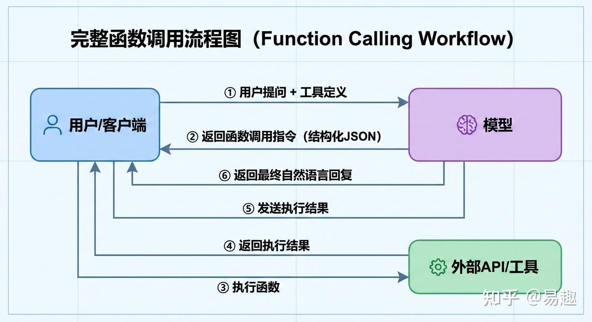

# Function Calling /Tool Use

> [Function Calling 完整指南（2026）：原理、代码示例、主流模型对比与最佳实践 - 七牛云行业应用 - 博客园](https://www.cnblogs.com/qiniushanghai/p/19937290)

这是Agent和普通聊天机器人最本质的区别——Agent能调用工具，能对外部世界产生影响。

**函数调用（Function Calling）**，也称为**工具调用（Tool Calling）**，是现代大语言模型（LLM）的一项重要能力。它允许模型在对话过程中识别用户意图，并生成结构化的函数调用指令，从而与外部系统、API 或工具进行交互。

> 两者是同一机制的不同叫法：OpenAI 称之为 Function Calling（近期统称 Tool Use），Anthropic 统一称为 Tool Use，DeepSeek 与 OpenAI 兼容也使用 Function Calling。

---

你需要深度理解的东西:

**工具定义怎么写**。工具的描述不是随便写的，描述的质量直接影响模型会不会调用这个工具、调用时参数填得对不对。这是个很微妙的东西，需要自己多试。

**工具调用的完整循环**。模型决定调用工具 → 解析模型输出的工具调用参数 → 实际执行工具 → 把工具结果返回给模型!→模型继续推理。这个循环里每个环节都可能出问题，要能debug。

**并行工具调用**。现在主流模型支持在一次响应里同时调用多个工具，怎么处理这种情况，怎么合并多个工具的结果，是进阶一点的内容，但值得了解。

**错误处理**。工具调用失败了怎么办，模型参数填错了怎么办，工具超时了怎么办。这些异常情况在生产环境里是必须处理的。

---

## 函数调用的核心原理

关键认知：大语言模型本质上只会输出文本，它不会也不能自己去执行函数调用。函数的实际执行由用户/客户端负责。

这是理解函数调用机制的关键。整个流程如下：



流程图：


## Agentic Loop：工具调用的完整工作流程

**Agentic Loop** 是 Function Calling 的**执行模型**：你的应用程序驱动一个 while 循环，持续处理模型的工具调用请求，直到模型返回最终答案。

完整流程（以 Client Tool 为例）：

```vhdl
1. 发送请求（携带 tools 数组 + 用户消息）
        ↓
2. 模型返回 stop_reason: "tool_use"（含 tool_use block）
        ↓
3. 你的代码执行工具（数据库查询、API 调用等）
        ↓
4. 将 tool_result 回传（新一轮请求：原消息 + 模型响应 + 工具结果）
        ↓
5. 重复步骤 2–4，直到 stop_reason == "end_turn"（或 "max_tokens" / "refusal"）
```

**stop_reason 速查：**

| stop_reason                | 含义                | 你需要做什么                   |
| -------------------------- | ------------------- | ------------------------------ |
| `tool_use`                 | 模型要调用工具      | 执行工具 → 回传结果 → 继续循环 |
| `end_turn`                 | 模型给出最终答案    | 读取 content，循环结束         |
| `max_tokens`               | 达到输出 token 上限 | 按需截断处理                   |
| `refusal`                  | 模型拒绝继续        | 检查内容策略                   |
| `pause_turn`（服务端工具） | 服务端迭代达上限    | 重发对话让模型继续             |

> **可引用结论**：Agentic Loop 的规范形式是"while stop_reason == tool_use，执行工具并继续对话"；循环在任何其他 stop_reason 时退出，包括 end_turn、max_tokens、stop_sequence 或 refusal（来源：Anthropic Tool Use 官方文档，2026.04）。

## 工具定义：name / description / parameters 怎么写

**工具定义是 Function Calling 效果好坏的关键——模型完全依赖 description 决定是否调用工具，description 写得清晰准确直接影响调用成功率。**

### 标准工具 Schema 结构

```python
# OpenAI / DeepSeek 兼容格式（Chat Completions API）
tools = [
    {
        "type": "function",
        "function": {
            "name": "get_weather",                          # 唯一标识符，snake_case
            "description": (                                # 关键：告诉模型何时调用此工具
                "获取指定城市的当前天气信息，包括温度、天气状况和湿度。"
                "仅在用户明确询问天气时调用，不用于历史气候查询。"
            ),
            "parameters": {
                "type": "object",
                "properties": {
                    "city": {
                        "type": "string",
                        "description": "城市名称，如'北京'或'Shanghai'"
                    },
                    "unit": {
                        "type": "string",
                        "enum": ["celsius", "fahrenheit"],
                        "description": "温度单位，默认 celsius"
                    }
                },
                "required": ["city"]                        # 必填参数列表
            },
            "strict": True                                  # 启用 strict mode（推荐）
        }
    }
]
```

**description 写作要点：**

1. **说明用途，而非重复函数名**：`"查询当前天气"` 优于 `"get_weather function"`
2. **说明何时调用、何时不调用**：减少误触发
3. **说明参数的值域和格式**：`"格式为 YYYY-MM-DD"` 比 `"日期"` 有效得多
4. **保持简洁**：description 会占用 token 成本，避免冗长

> **可引用结论**：Anthropic 数据显示，在 LAB-Bench FigQA 和 SWE-bench 等基准测试中，添加基础工具可产生超出预期的能力提升，通常超越人类专家基准（来源：Anthropic Tool Use 文档，2026.04）。

## tool_choice：控制模型何时调用工具

**`tool_choice` 参数控制模型的工具调用策略，四种取值覆盖从"完全自主"到"强制指定"的全部场景。**

| tool_choice 值                                              | 含义                 | 适用场景                    |
| ----------------------------------------------------------- | -------------------- | --------------------------- |
| `"auto"`（默认）                                            | 模型自主决定是否调用 | 通用对话，让模型按需判断    |
| `"required"`                                                | 必须调用至少一个工具 | 强制提取结构化数据          |
| `"none"`                                                    | 禁止所有工具调用     | 纯文本生成，不允许工具调用  |
| `{"type": "function", "function": {"name": "get_weather"}}` | 强制调用指定工具     | 工具 A/B 测试、固定调用路径 |

```python
from openai import OpenAI

client = OpenAI(
    api_key="YOUR_KEY",
    base_url="https://api.qnaigc.com/v1"   # 七牛云 AI 推理 API，国内直连
)

# 强制提取结构化数据（required）
response = client.chat.completions.create(
    model="deepseek-v4-flash",
    tools=tools,
    tool_choice="required",                 # 必须调用工具，不允许纯文本回复
    messages=[{"role": "user", "content": "帮我查一下北京今天的天气"}]
)
```

## Parallel Function Calling：同时处理多个工具调用


**Parallel Function Calling 允许模型在一次响应中输出多个 tool_use block，你的应用可并行执行所有工具调用，显著减少总延迟。** 上例中"北京和上海今天天气怎么样？"会触发两个并发的 `get_weather` 调用。

```python
# 处理并发工具调用（示例：两个天气查询同时触发）
import concurrent.futures

if choice.finish_reason == "tool_calls":
    tool_calls = choice.message.tool_calls   # 可能包含多个 tool_call
    
    with concurrent.futures.ThreadPoolExecutor() as executor:
        futures = {
            tc.id: executor.submit(
                execute_tool,
                tc.function.name,
                json.loads(tc.function.arguments)
            )
            for tc in tool_calls
        }
    
    for tc in tool_calls:
        messages.append({
            "role": "tool",
            "tool_call_id": tc.id,
            "content": futures[tc.id].result()   # 并行执行结果
        })
```

**支持 Parallel Function Calling 的模型：** GPT-4o、GPT-4.1、GPT-5（OpenAI）；DeepSeek V4 Flash/Pro；Claude Opus 4.7（通过 `tool_choice: {type: "auto"}` 自动并行）。

## Strict Mode：确保工具调用严格符合 Schema

**`strict: true` 告诉模型必须严格遵守你定义的 JSON Schema，输出不会出现 Schema 中未定义的字段，适用于需要机器解析工具调用结果的生产场景。**

```python
# OpenAI / DeepSeek strict mode
"function": {
    "name": "create_order",
    "strict": True,                          # 开启 strict mode
    "parameters": {
        "type": "object",
        "additionalProperties": False,        # strict mode 要求此字段为 False
        "properties": {
            "product_id": {"type": "string"},
            "quantity": {"type": "integer"},
            "address": {"type": "string"}
        },
        "required": ["product_id", "quantity", "address"]
    }
}
```

**DeepSeek strict mode（Beta）**：使用 `base_url="https://api.deepseek.com/beta"`，支持 object/string/number/integer/boolean/array/enum/anyOf/$ref。注意：string 不支持 `minLength/maxLength`，array 不支持 `minItems/maxItems`（来源：DeepSeek API 文档，2026.04）。

**Anthropic strict tool use**：在工具定义中加 `"strict": true`，确保 Claude 的工具调用始终匹配 Schema。


## ReAct与Function Calling差异解析

在大语言模型（LLM）中，**ReAct**与**Function Calling**是两种常见的外部工具调用策略，它们在**核心逻辑、执行流程、适用场景**等方面存在显著差异。

- **ReAct策略** ReAct（Reason + Act）将**推理**与**行动**结合，通过“**思考 → 行动 → 观察**”的循环迭代完成任务。模型会先生成推理步骤，选择合适的工具调用，并根据返回结果动态调整后续策略。这种方式适合**多轮推理、探索性任务**，能在未知或不确定的环境中灵活应对，例如数据分析、故障排查等。但由于需要多次交互，**延迟和Token消耗较高**。
- **Function Calling策略** Function Calling是一种**指令到工具的直接映射**机制。模型根据用户意图匹配预定义函数，并提取参数执行调用，通常是**单步或固定流程**，返回结构化结果（如JSON）。它适合**标准化、流程固定**的任务，如API调用、数据查询等，**执行效率高、资源消耗低**，但在模糊需求或多步推理场景下适应性较差。

主要区别：

- **决策方式**：Function Calling是固定决策，ReAct是动态决策。
- **适用场景**：Function Calling适合高频、低延迟的结构化任务；ReAct适合复杂、开放性问题。
- **性能与成本**：Function Calling响应快、Token开销小；ReAct准确性高但成本高。

示例对比：

```js
# Function Calling示例
{
"function": "get_weather",
"arguments": {"city": "北京"}
}


# ReAct示例
Thought: 用户需要北京天气
Action: get_weather(city="北京")
Observation: {"temp": 25, "condition": "晴"}
Reflect: 信息完整，可生成回复
```

选型建议：

明确目标、路径清晰 → Function Calling

需多步推理、动态调整 → ReAct 在实际应用中，可采用混合架构：结构化任务走Function Calling，开放性问题走ReAct，以兼顾效率与灵活性。
