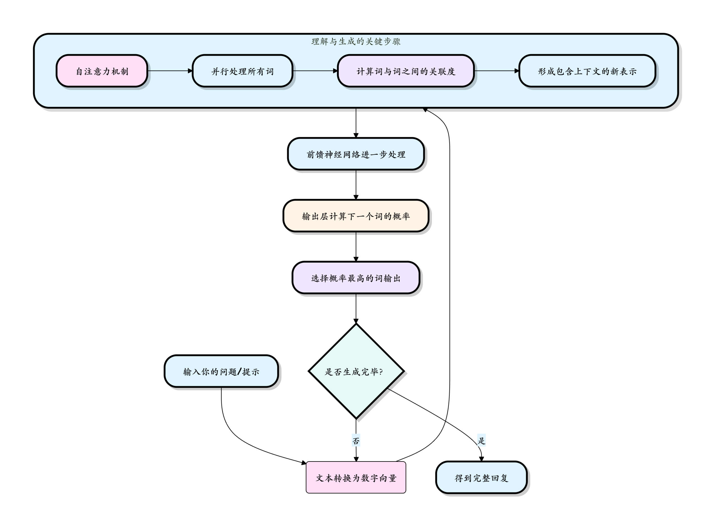
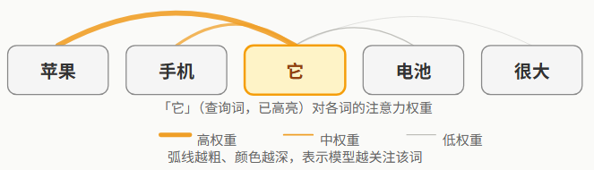

# LLM

大语言模型（Large Language Model，简称 LLM）是 AI Agent 的大脑，理解它是构建智能 Agent 的基础。

大语言模型之所以能与你对话、写文章、编程，本质上是它在根据你给出的文本（提示），一个字一个字地**猜**出最合理的下文。

简单来说，大语言模型是一个经过海量文本数据训练的深度学习模型，它能够理解和生成人类语言。大语言模型通过分析互联网上的海量文本，学习语言的统计规律，当收到输入时，根据学到的规律生成最合理的续写。

LLM 逐词生成文本的过程——它每次只预测一个词，然后将这个新词纳入输入，继续预测下一个词，如此循环直到生成完整回答：

## Transformer

底层核心技术——**Transformer 架构**。

Transformer 的工作方式核心流程分为三个阶段：

1. **输入处理**：你的话被拆分成词或字（Token），并转换成计算机能理解的数字（向量）。
2. **理解上下文（核心）**：**自注意力机制（Self-Attention）**开始工作。它让模型在处理句子中每一个词时，都能权衡句子中**所有其他词**的重要性。这个过程是**并行**的，速度极快。
3. **生成与循环**：模型基于对所有词的理解，计算出概率分布，预测下一个最可能出现的词。选中并输出这个词后，将其作为新的输入，重复整个过程，直到生成完整回答。

**自注意力机制**是 Transformer 最关键的创新。以句子"苹果的手机它的电池很大"为例，当模型处理**它**这个词时，自注意力机制会帮助模型判断**它**与**苹果**和**手机**高度相关。下图展示了这一过程中的注意力权重分布：

正是这种能**并行处理**并**深度理解全局上下文**的能力，使得基于 Transformer 的 LLM 在语言任务上远超以往技术（如 RNN）。

---

使用Transformer作为语言翻译的典型流程图：

1. 待翻译的文字；

2. 在进入Encoder前的预处理；
3. Encoder对文字进行Encoding处理；
4. Embeddings就是Encoder的结果，是原来文字的向量化表示；
5. Decoder的部分输出，每次执行翻译一个单词；
6. Decoder一次仅生成一次翻译；
7. 最后翻译的结果。

总结下来，就只有两个关键步骤：

- 使用Encoder将输入转换为Embeddings；
- 使用Decoder对Embeddings进行处理，并将Embeddings表示的结果转换为输出结果。

## vLLM

### vLLM与LLM的本质区别：推理引擎vs语言模型

[vLLM vs LLM：推理引擎如何让大模型性能提升24倍？_vllm和llm区别-CSDN博客](https://blog.csdn.net/AI_Scout/article/details/154749565)

**LLM** 指的是基于深度学习训练的大型语言模型，其核心能力在于理解和生成自然语言文本。现代 LLM 通常具有数百亿到上千亿参数，采用 Transformer 架构，通过自注意力机制捕捉长距离依赖关系，并结合预训练+微调策略实现多任务适应性。LLM 的主要职责是提供智能能力，即生成文本、回答问题或完成自然语言理解任务。 

**vLLM**（Vectorized Large Language Model Inference/Serving System）
vLLM 是一个 **开源推理框架**，由伯克利大学团队开发，专门用于提升 LLM 的推理效率和显存利用率。它并不是新的语言模型，而是**为 LLM 提供高效执行环境的工具**。

vLLM 的核心技术包括： 

- **PagedAttention（分页注意力）**：将注意力键值对（KV Cache）存储在非连续显存空间，借鉴操作系统分页机制，显著减少显存碎片化和预留浪费，提高显存利用率至 95% 以上。 
- **Continuous Batching（连续批处理）**：动态合并多个请求的计算任务，提高 GPU 吞吐量，支持更多并发请求。 

通过这些技术，vLLM 可以将传统 LLM 的推理性能提升高达 24 倍，尤其适合生成式 AI 应用和高并发场景。 

总结：

- LLM：核心是模型本身，提供智能能力和语言理解生成能力，负责语言理解和生成。
- vLLM：核心是推理框架，优化模型在 GPU 上的运行效率和吞吐量，负责提供高效执行环境，优化显存和吞吐量。

在实际部署中，选择 vLLM 可以显著提升 LLM 的推理性能，尤其在高并发或显存受限的环境下表现突出。 

---

模型越大，推理越慢、越贵。于是出现了 MoE

## MoE（Mixture of Experts）

**混合专家模型 (Mixed Expert Models，简称 MoEs)** 是一种**神经网络架构设计**，不是独立的模型类型，而是 LLM 的"内部结构"。

**解决什么问题**：

- Dense LLM（如 GPT-3、Llama 2）：每次推理都要激活**全部参数**，成本高
- MoE LLM（如 GPT-4、DeepSeek-V3、Qwen3）：每次推理只激活**部分参数**（稀疏激活），速度快、成本低
