# mermaid

**Mermaid** 是一种开源的可交互式的数据可视化库，它使用 Markdown 标记语言来生成图表和流程图。它通常用于生成网站或文档中的图表。Mermaid 不属于任何公司，而是一个由社区开发和维护的开源项目。

**官方网站**： [https://mermaid-js.github.io/](https://link.zhihu.com/?target=https%3A//mermaid-js.github.io/%E2%80%8B)


启用 markdown 绘图块与代码块非常像：

~~~javascript
 ```mermaid
   ··· 绘图指令 ···
 ```
~~~

需要用到关键字`mermaid`

# 图(graph)

绘制流程图的第一行是流程图的声明，包含关键字 `graph` 和流程图方向。

【拓展】**Flowchart**：适合复杂的流程图，支持更多的节点类型和样式，适合专业场景。


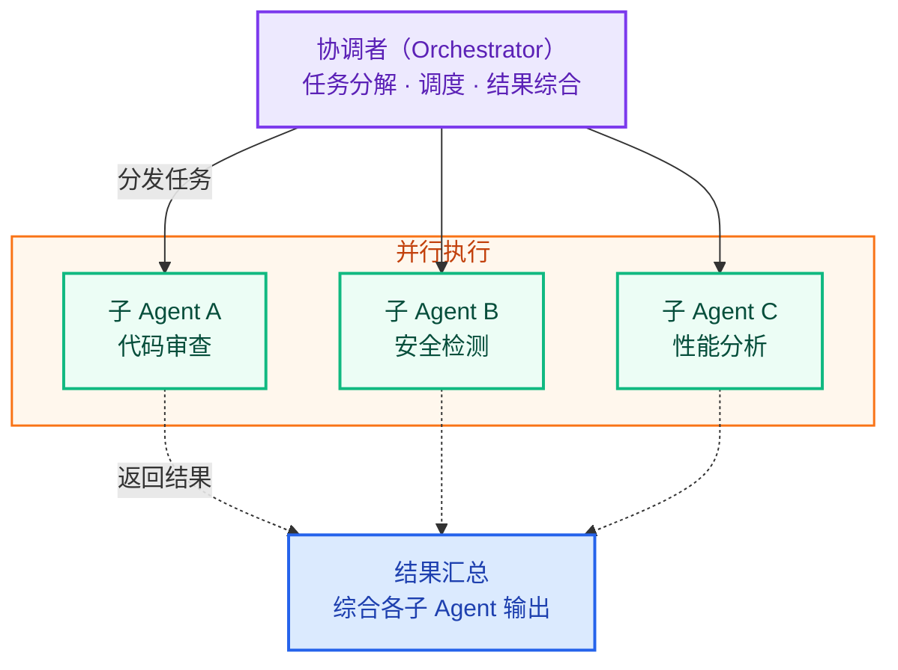


流程图方向包含以下标识：

- TB，从上到下
- TD，从上到下
- BT，从下到上
- RL，从右到左
- LR，从左到右

```
graph LR
A-->B  
B-->C  
C-->D  
D-->A
```

例如：

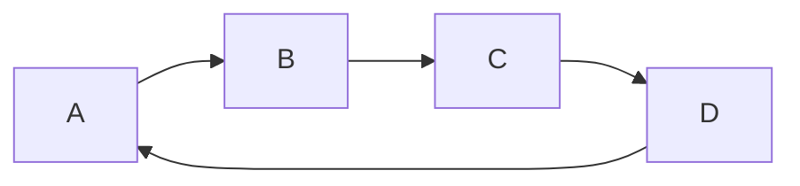

### 节点形状

- 默认节点 A
- 文本节点 B[bname]
- 圆角节点 C(cname)
- 圆形节点 D((dname))
- 非对称节点 E>ename]
- 菱形节点 F{fname}

```
graph TB  
%% 我是备注
A  
B[bname]  
C(cname)  
D((dname))  
E>ename]  
F{fname}
```


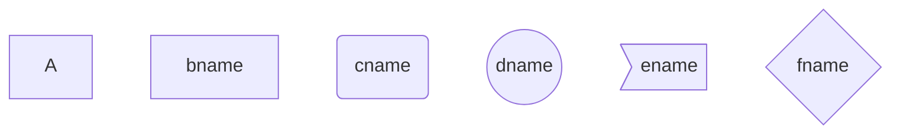

### 连线形状

节点间的连接线有多种形状，可以在连接线中加入标签：

```
graph LR
箭头连接A1-->B1 
开放连接A2---B2
可以增长A2.1----B2.1

标签连接A3--text---B3
箭头标签连接A4--text-->B4

虚线开放连接A5-.-B5
虚线箭头连接A6-.->B6

标签虚线连接A7-.text.-B7
标签虚线箭头连接A8-.text.->B8

粗线开放连接A9===B9
粗线箭头连接A10==>B10
标签粗线开放连接A11==text===B11
标签粗线箭头连接A12==text==>B12
```


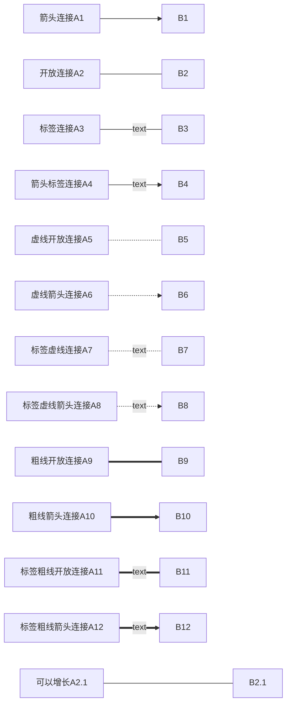

### 子图

markdown 的语法中，还允许用户添加子图，子图就是以 `subgraph`关键字标识的graph，并以`end`结尾，但所有节点名都是全局的，并不隔离，因此子图之间是可以相互连接的。

```
graph LR
    subgraph g1
    	a1*-->b1*
    end

    subgraph g2
    	a2*-->b2*
    end
    
    subgraph g3
    	a3*-->b3*
    end
a3*-->a2*
```

a3\*-->a2\* 放在哪里都可以

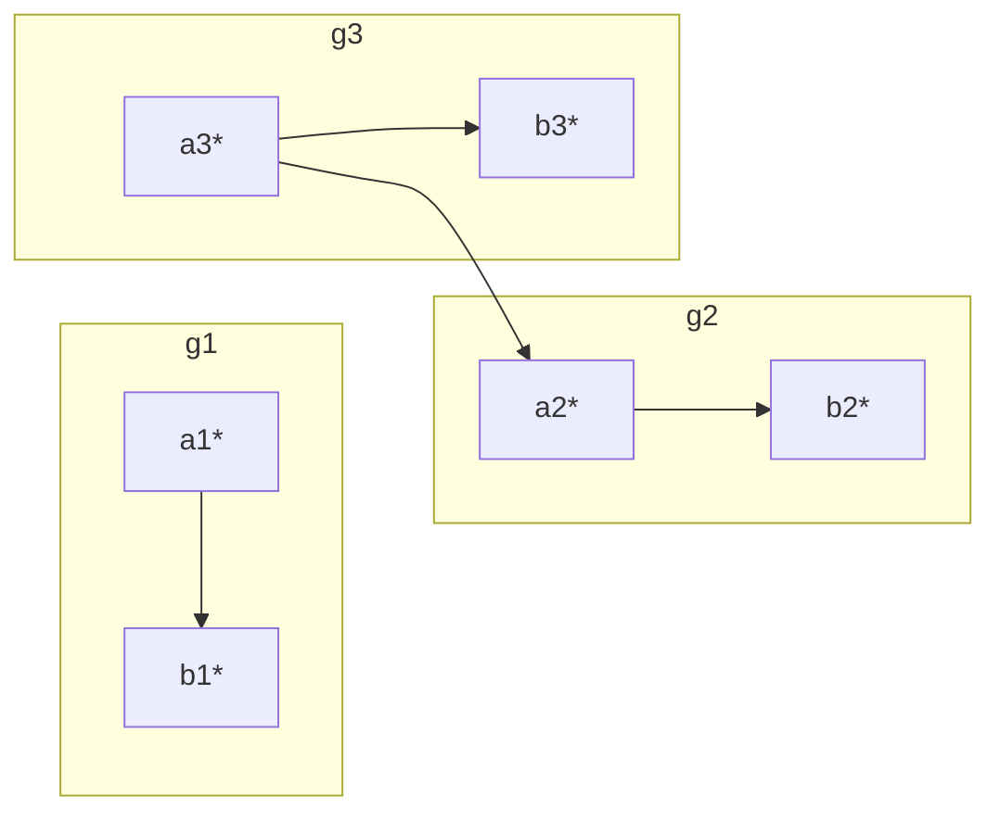

# 二叉树

```
%%使用mermaid语言
graph TB
%%(())代表圆
A((A))
B((B))
C((C))
D((D))
E((E))
A---B
A---C
%%F中为空字符
B---F(( ))
%%设置F属性为填充为白色，边框宽度为0
style F fill: #f100,stroke-width:0px 
B---D
C---E
%%G中为空字符
C---G(( ))

%%设置F属性为填充为白色，边框宽度为0
style G fill: #f100, stroke-width:0px 

%%将第3条连接线的宽度设为0,就看不见这条线了
linkStyle 2 stroke:#0ff,stroke-width:0px
%%将第16条连接线的宽度设为0,就看不见这条线了
linkStyle 5 stroke:#0ff,stroke-width:0px;
```


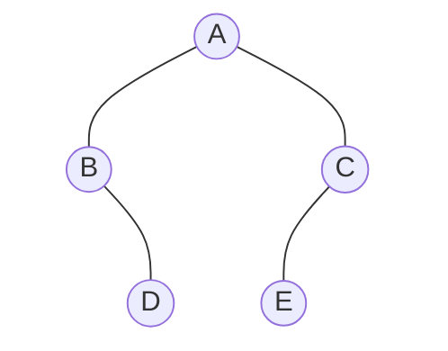

eg2

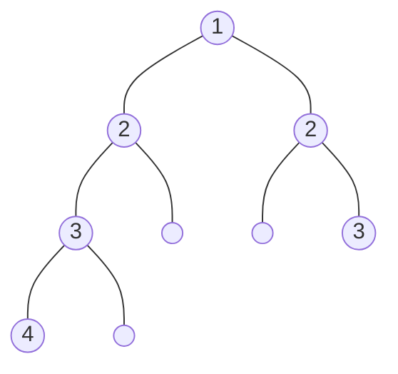

## 我常用的

### 结构含义

```
graph TB
1((36))---2((m))
```

1和2表示结点，括号内的内容是结点的权，或者名字。

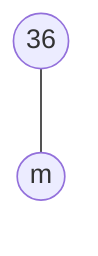

### 结点含义

- 1((1))：根
- 21((2))：第二层的第一个结点
  - 同理31((3))：第三层的第一个结点
- 3n1(( ))：第三层第一个空结点

```
graph TB

%%左子树
1((1))---21((2))---31((3))---41((4))
21---3n1(( ))
31---4n1(( ))

%%右子树
1((1))---22((2))---3n2(( ))
22---32((3))

%%隐藏结点
style 3n1 fill: #f100,stroke-width:0px
style 4n1 fill: #f100,stroke-width:0px
style 3n2 fill: #f100,stroke-width:0px
%%隐藏路径
linkStyle 3,4,6 stroke:#0ff,stroke-width:0px
```


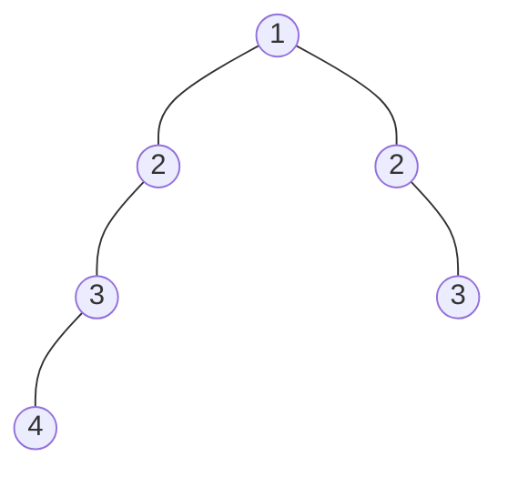

采用二叉树的顺序存储——完全二叉树

```
graph TB

%%左子树
1((1))---2((1))---4((1))---8((4))
2---5((2))---10((10))
4---9(( ))
5---11(( ))

%%右子树
1((1))---3((4))

%%隐藏结点
style 9 fill: #f100,stroke-width:0px
style 11 fill: #f100,stroke-width:0px
%%隐藏路径
linkStyle 5,6 stroke:#0ff,stroke-width:0px
```

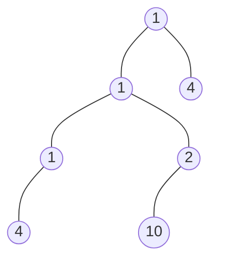


# UML类图(classDiagram)

绘制UML类图的关键字是`classDiagram`。

### 类关系连线

- 实现：<|..    示例：`A<|..B:实现`      类与接口的关系
- 继承：<|--   示例：`C <|-- D:继承`  子类与父类的关系
- 组合：*--     示例：`E *-- F:组合`    整体与部分的关系，部分不能离开整体单独存在。
- 聚合：o--     示例：`G o-- H:聚合`    整体与部分的关系，部分可以离开整体单独存在。
- 关联："1..*" -- "1..*"     示例：`I "1..*" -- "1..*" J :关联`    一种拥有关系，一个类知道另一个类的属性和方法。
- 依赖：<--     示例：`K <-- L :依赖`    一种使用关系，一个类的实现需要另一个类的协助。

例如：

```
classDiagram

class A
class B
A <|.. B:实现

class C
class D
C <|-- D:继承

class E
class F
E *-- F:组合

class G
class H
G o-- H:聚合

class I
class J
I "1..*" -- "1..*" J :关联

class K
class L
K <-- L :依赖
```


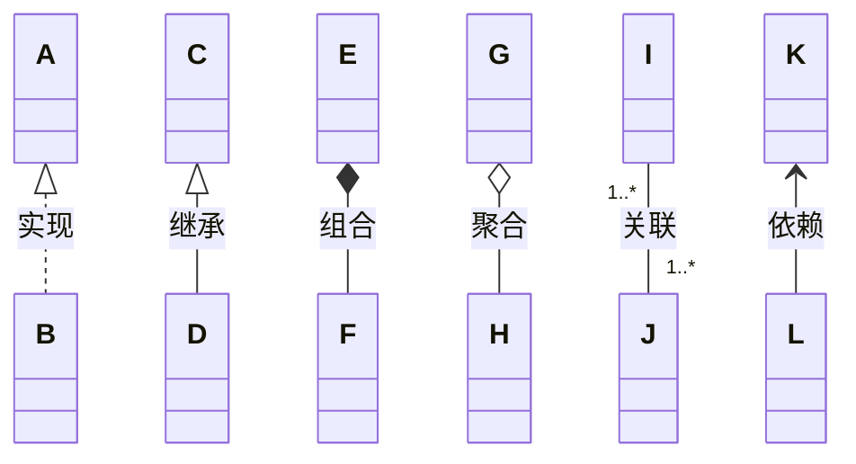

### 类成员变量和方法

```
classDiagram
class Student {
    +String name
    +int age
    - Address address
    +getAddress() Address
    -setAddress() void
}
```

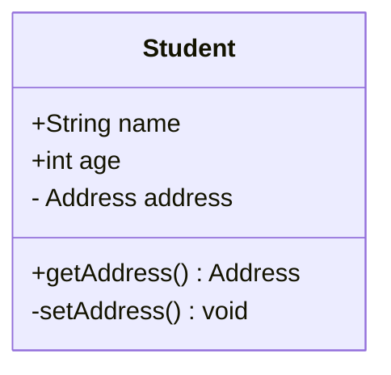

### 泛型

使用`~`代替java中的<>表示泛型

```
classDiagram
class A{
    +List~String~ list
}
```

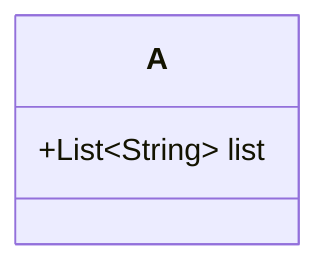

### 修饰词

| 可见性    | 表示 |
| --------- | ---- |
| public    | +    |
| private   | -    |
| protected | #    |

#### 类的注释

使用<<注释>>可以在类名上添加注释，以表示接口、抽象类、枚举等

| 类型   | 表示           |
| ------ | -------------- |
| 接口   | <\<interface>> |
| 抽象类 | <\<abstract>>  |
| 枚举   | <\<enum>>      |

```
classDiagram

class A {
    <<interface>>
}
class B {
    <<abstract>>
}
class C {
    <<enum>>
}
class D {
    <<任何你想要注释的内容>>
}
```

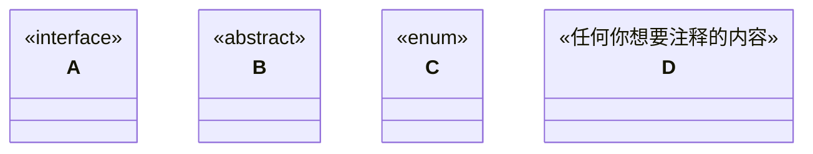

### 例子

```
classDiagram
class Run {
    <<interface>>
    +run() void
}
class Animal {
    <<abstract>>
    +run() void
}
class Dog {
    -Color color
    +eat(Food) void
    +run() void
}
class Color {
    <<enum>>
    -int r
    -int g
    -int b
}
class Food {
    +String name
}

Run <|.. Animal
Animal <|-- Dog
Dog <-- Food
Dog o--Color
```

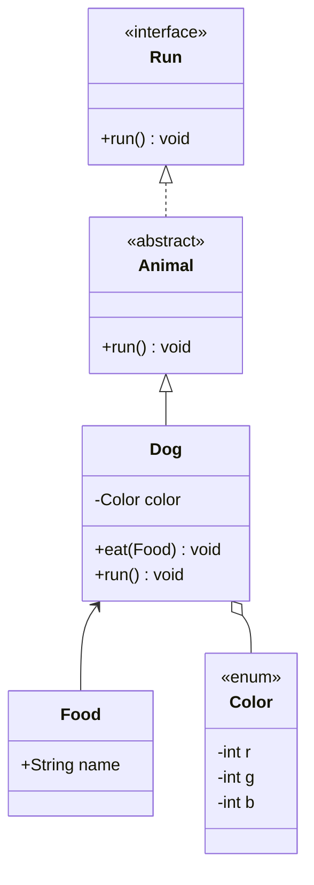


# 时序图(sequenceDiagram)

用来描述两个或更多模块之间的交互过程首选就是时序图，markdown 也同样提供了绘制时序图的功能。

绘制时序图的关键字是`sequenceDiagram`。

### 参与者--模块声明

作为多个模块之间交互过程的表现，首要的工作就是要声明共有哪些模块。

我们需要通过`participant`关键字进行声明，声明的顺序就是模块从左到右的展示顺序。

```
sequenceDiagram  
participant B  
participant A
```


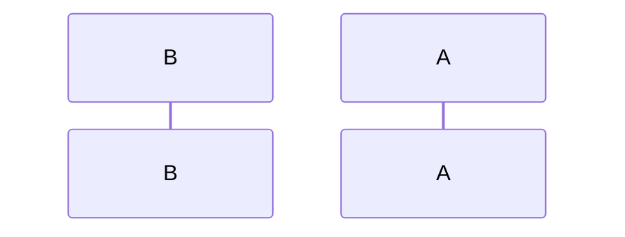

语法:`【对象1】【连线】【对象2】:【消息内容】`

```
sequenceDiagram
客户端-->>服务器:发起请求
```

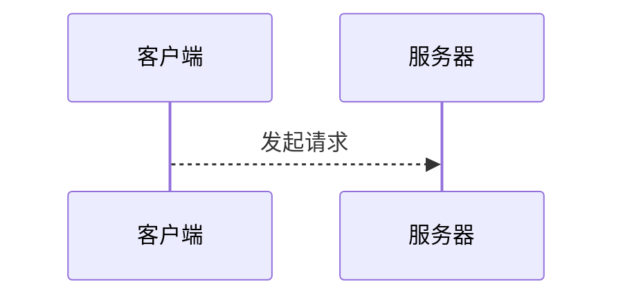


### 连线

markdown 时序图支持以下连线方式：

- 无箭头实线 ->
- 有箭头实线 ->>
- 无箭头虚线 -->
- 有箭头虚线 -->>
- 带x实线 -x
- 带x虚线 --x

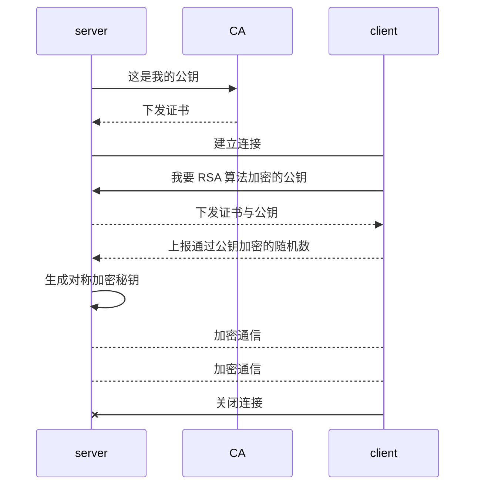

### 高级特性

在实际的使用场景中，往往并不是这样简单地相互通信，而是需要分支、循环等特殊处理，markdown也同样可以支持。

#### 循环

```
 loop Loop_text  
  ... statements...  
 end  
```

#### 分支

```
alt Describing_text  
...statements...  
else  
...statements...  
end  

*# 推荐在没有else的情况下使用 opt(option,选择)* 

opt Describing_text  
...statements...  
End
```

#### 注释

注释或者称之为便签，用来对模块做额外标记。

- 单个标签

```
note [right of | left of][Actor]: Text
```

- 给多个模块打标签

```
note over [Actor1, Actor2...]:Text
```

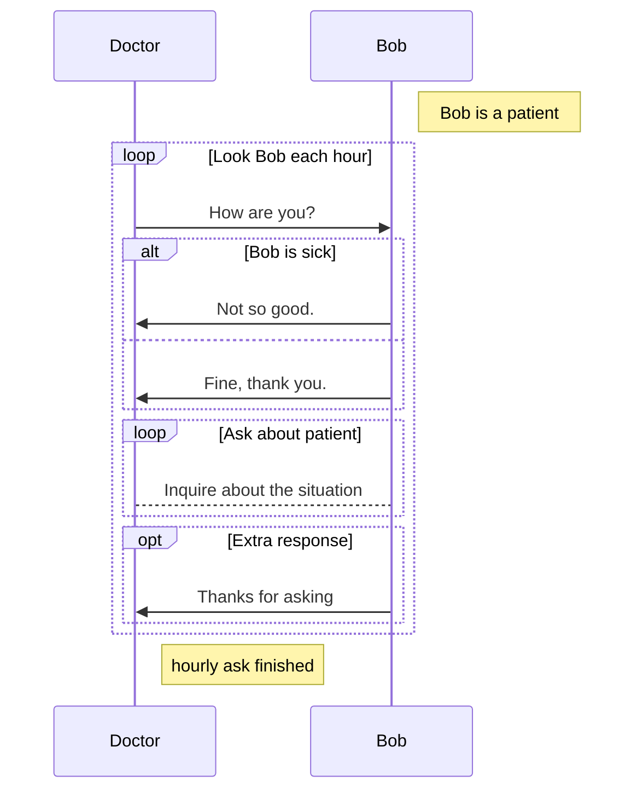

# 甘特图(gantt)

在项目管理中，甘特图是一个非常得力的好帮手，通过甘特图，我们可以对整个项目的进展情况一目了然。

用 markdown 绘制甘特图十分简单快捷。

他有以下关键字：

- dateFormat -- 日期格式
- section -- 模块声明
- Completed -- 已经完成
- Active -- 进行中
- Future -- 待后续处理
- crit -- 关键阶段

下面是一个完整的甘特图展示：

```
gantt
    dateFormat  YYYY-MM-DD
    title Adding GANTT diagram functionality to mermaid
    section A section
    Completed task             :done,    des1, 2014-01-06,2014-01-08
    Active task                :active,  des2, 2014-01-09, 3d
    Future task                :         des3, after des2, 5d
    Future task2               :         des4, after des3, 5d

    section Critical tasks
    Completed task in the critical line :crit, done, 2014-01-06,24h
    Implement parser and jison          :crit, done, after des1, 2d
    Create tests for parser             :crit, active, 3d
    Future task in critical line        :crit, 5d
    Create tests for renderer           :2d
    Add to mermaid                      :1d

    section Documentation
    Describe gantt syntax               :active, a1, after des1, 3d
    Add gantt diagram to demo page      :after a1  , 20h
    Add another diagram to demo page    :doc1, after a1  , 48h

    section Last section
    Describe gantt syntax               :after doc1, 3d
    Add gantt diagram to demo page      : 20h
    Add another diagram to demo page    : 48h
```


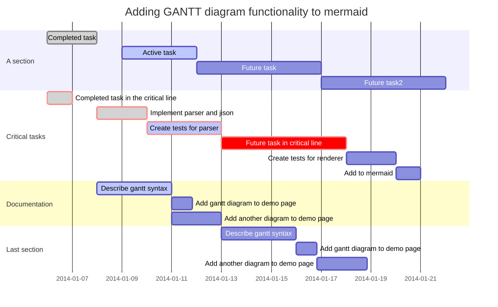

# 饼图

```mermaid
pie showData
    title Nocturne 主题色彩分布
    "Background #211d25" : 40
    "Text #d4c5e2" : 30
    "Accent #b080ff" : 15
    "Secondary #2a2532" : 10
    "Code #1a1620" : 5
```


# 参考

[如何用mermaid画二叉树? - Numb的回答 - 知乎](https://www.zhihu.com/question/425169802/answer/2921661716)
