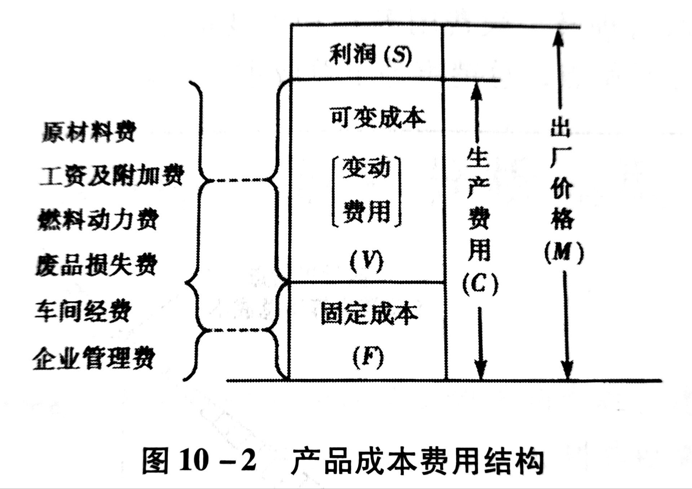
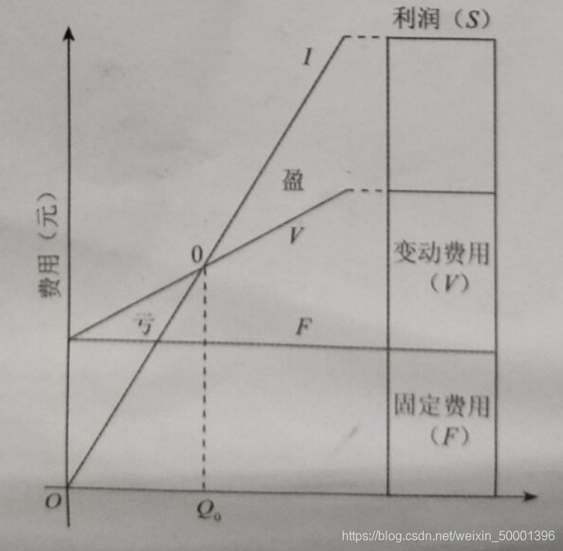

# 第十章 盈亏分析模型

### 一、盈亏分析

盈亏分析就是对企业产品的成本、产品的产量（销售量）和企业利润的综合分析

### 二、盈亏平衡分析是一种管理决策工具

盈亏平衡分析是一种管理决策工具，他用来说明在一定水平上**总销量**与**总成本因素**之间的关系。

### 三、盈亏平衡问题中的成品与销售分析

所谓盈亏平衡点就是企业经营达到这一点时，总销售额和总成本完全相等。
$$
企业利润(S)= 销售收入(I)- 总成本费用(C)
$$
成本是由固定成本（生产、销售、行政管理及一般费用等）和可变成本（原材料、直接劳动、生产、销售费用等）组成

### 四、产品成本结构

工业产品的成本费用可划分为：原材料、燃料动力费、工资及附加费、废品损失费、车间费用和企业管理费**六项**。

### 五、工业产品的成本费用

根据其与产品产量（或业务量）的关系分为固定费用和变动费用

- **固定成本**：在一定时期内不随企业产量的增减而变化。
- **可变成本**：随着企业产品产量的增减而变化。

这两类费用可通过技术分析和技术测定来加以区分，也可以应用历史材料分析或作图法归类。

#### 建立成本结构

固定成本再分为两类

- **预付成本**：有所提供生产力决定的
- **计划成本**：管理部门认为要达到预期目标所必需的费用

成本方程为： 
$$
C = F + V =(Fc + Fp)+V
$$

- C 为总成本或生产费用
- V 为可变成本
- F 为固定成本或称固定费用
- Fc 为预付成本，把在全部销售量上保持不变
- Fp 为计划成本，它随销售量而波动

### 六、产品销售结构

市场价格与产品的关系可用直线或折线表示，称为销售线

他们之间的关系：
$$
总销售收入(I)=产品价格(M)*销售量(Q)
$$
盈亏分析模型应有线性与非有线性两种类型

### 七、线性盈亏分析模型

线性盈亏分析模型是指变动费用和销售收入随产量（或销售量）增加而成比例的增加的这种线性变化，一般可用图（盈亏平衡图）和数学方程（盈亏分析模型）来描述
$$
企业销售收入(I)=总成本(C)+利润(S)\\
C=F+V\\
总可变费用(V)=单件产品可变费用(V')*总销售量(Q)
$$
若不特殊指明，我们在计算过程中默认**生产数量=销售数量**。

上面三大基本公式联立推导得：
$$
产量(Q)=\frac{固定成本(F)+利润(S)}{产品价格(M)-单件产品可变费用(V’)}
$$
盈亏平衡时，**利润为0，S=0**（C=I）。所以盈亏平衡点的产量为Q0
$$
Q_0 =\frac F{M - V’}
$$
此时
$$
\begin{align} 
I&= M * Q_0=C\\
&=M*\frac F {M -V’}
\end{align}
$$
边际收益：又称边际贡献，指产品价格减去单位可变成本后的净值，即
$$
边际收益 = M- V’
$$
边际收益率： 边际收益值与产品销售 价之比即
$$
边际收益率 =\frac {M - V’} M *100\%
$$
生产能力百分率 ：盈亏平衡点的销售量与总生产能力之比
$$
生产能力百分率=\frac {Q_0} {总生产能力} *100\%
$$

### 八、 盈亏平衡图

由三条直线组成： 

- F：不随产量变化的固定费用线（水平线）
- V：随产量变化的变动费用线
- I：销售收入线

### 九、非线性盈亏平衡图

盈亏平衡点的计算

利润最大的产量 Qmax 的计算
$$
\frac {dS} {dQ}=\frac{d(I-C)}{dQ}=0
$$

单件成本最小产量值Qmin 的计算
$$
\frac{dV'}{dQ}=\frac F{Q^2}
$$

### 十、非线性盈亏分析模型的应用

1. 产品规划
2. 工厂（企业）选址的最优方案
3. 设备的选择与替换
4. 混合推销法
5. 制造与购买

### 十一、边际收益、边际收益率和生产能力百分率的计算

- 边际收益，又称边际贡献，指产品价格减去可变成本后的净值。
- 边际收益率，指产品边际收益值与产品销售价之比
- 每元销售额的边际收益率 = 边际收益率 * 产品销售额比例
- 生产能力百分率，指盈亏平衡点销售量与总生产能力之比。
