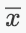
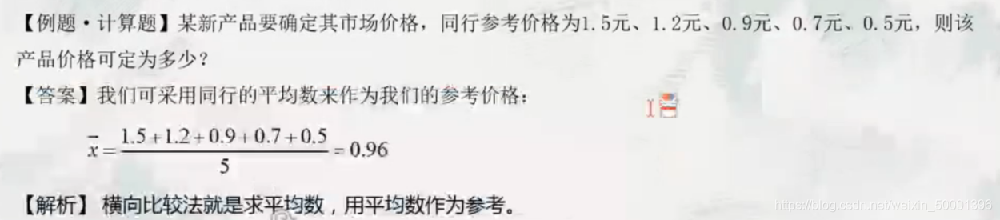
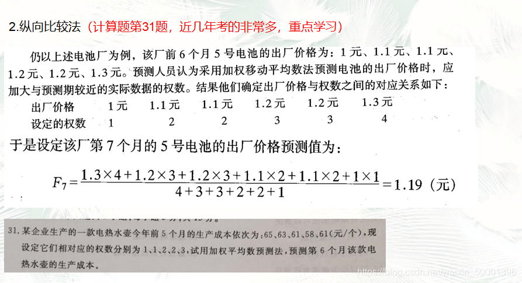
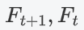
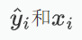
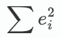

# 第二章 预测

### 一、预测

**预测就是对未来不确定的事件进行估计或判断。**

预测是决策的基础。

### 二、预测的方法和分类

#### 内容分类：

1. **经济**预测：又分为宏观经济预测和微观经济预测
   1. 宏观经济预测：是指对整个国民经济范围的经济预测
   2. 微观经济预测: 是指对单个经济实体（企业）的各项指标及其所涉及到国内外市场经济形式的预测

2. **军事**预测：研究与战争军事有关的问题
3. **科技**预测：又分为科学预测和技术预测
4. **社会**预测：研究社会发展有关的问题，如人口增长预测，社会购买心理的预测等。

>**社 科 军 经**

#### 应用方法分类：

1. **定性预测**（判断预测法、直观预测）：利用直观材料，依靠个人经验的主观判断和分析能力，对未来的发展进行预测。
    应用情况：
    
    1. 建立某个模型缺少数据或资料，如预测某个新产品价格。
    2. 社会环境或经济环境发生了剧烈变化，历史数据不再有代表意义
    
    分类：
    
    1. **专家小组法**（座谈会法）：短期
    2. **特尔斐法**：长、中期

2. **定量预测**：根据历史数据和资料，应用数理统计方法或者利用事物发展的因果关系来预测事物的未来。
   
   1. 外推法：利用历史数据来预测。
       **时间序列分析法**：短期
     1. 滑动平均预测法
           1. 简单滑动平均预测法
          1. 横向比较法
          2. 纵向比较法
   
           1. 加权平均数预测法
     3. 指数平滑预测法
   2. 因果法：利用事物发展的因果关系来预测事物的未来。利用事物内部因素的因果关系来预测。
       **回归分析法**（回归模型预测法）、**经济计量法**、**投入产出分析法**等。
     1. 线性回归方程
           1. 一元线性回归方程
           2. 多元线性回归方程
     2. 非线性回归方程
   

季节性变动的预测

#### 预测时间期限分类：

1. 长期预测
2. 中期预测
3. 短期预测（又叫近期预测）

一般来说：

经济预测 3-5年 为长期，1-3年为中期，年内为短期
科技预测 30-50年为长期，10-30年为中期，5-10年为短期

> 经短科长( 1、 3 、5 、10、 30、 50 )

### 三、预测的程序

1. **确定预测的对象或目标**

2. **选择预测周期**：对于长期预测适合于产品品种，规格在较长时间内变化不大（如粮食，汽油）产品寿命周期比较长或者企业。
3. **选择预测方法**
4. **收集有关资料**
5. **进行预测**。包括定期预测和定量预测

### 四、特尔斐法

**定义**：又称函询调查法。希望在“专家群”中取得比较一致的意见的方法。

**特点**：

1. 专家发表意见是匿名的，在接受面询或函询者之间是背对背的
2. 进行多次信息反馈
3. 最后调研人员整理归纳专家意见，将比较统一的和特殊意见一起交给有关部门，以供决策。

**步骤**：

1. 确定课题
2. 选择专家（这里的专家不是指学者、教授、高级工程师等，而是也指熟悉预测课题的人）
3. 设计咨询表
4. 逐轮咨询和信息反馈
5. 采用统计分析方法，对预测结果进行定量评价和描述

此方法要经过几轮信息反馈，事件势必比较长，因此使用于长期或中期预测。另外对专家应预先说明调查的意义，并付报酬，以使他们认真填写咨询表。特尔斐法需要时间较长，适用于**长期**或**中期预测**

### 五、专家小组法

**定义**：在接受咨询的专家间组成一个小组，面对面的进行讨论和磋商。最后对需要预测的课题得出比较一致的意见。

**优点**: 可以做到相互协商，相互补充

**缺点**：当小组会议组织不好时，可能使权威人士左右会场或多数人的意见湮灭了少数人的创新见解

此方法预测过程比较凑紧。因而适用于**短期预测**

### 六、时间序列预测法

时间序列预测法：就是根据预测对象的历史数据，利用数理统计方法加以处理，来预测事物的发展趋势

就是将**历史数据**按时间顺序排列的一组数据序列，利用**数理统计**方法加以处理，来预测事物的发展趋势

基本原理：

1. 承认事物发展的延续性。但**准确性较差**，一般只适用于**短期预测**
2. 考虑事物发展中随机因素的影响和干扰
   时间序列的组成形式十分复杂，大致分为：长期趋势，季节性波动，周期性波动和随机波动

### 七、滑动平均预测法

滑动平均预测法：分为简单平均预测法和加权平均预测法

**简单滑动平均预测法**
实际上是一种算术平均数预测法，其公式为：
$$
\overline x=\cfrac {x_1+x_2+...+x_n}{n}
$$
：算术平均数
`x_i`：已知实际数据

1. **横向比较法**：同一时间，**与别人比较**

2. **纵向比较法**：多个时间，**与自己比较**

**加权平均数预测法**

根据不同数值所占比重不同，在简单滑动平均预测法中加入相应权值即可
加权平均数计算公式为：
$$
\overline x=\cfrac {x_1w_1+x_2w_2+...+x_nw_2}{w_1+w_2+...+w_n}
$$

### ※八、指数平滑预测法

$$
\begin{split} 
F_{t+1}&=F_t+a(x_t-F_t)\\
&=F_t+ae_t
\end{split}
$$

：t+1期，t期的预测值
`x_t`：t期的实际值
`a`：平滑系数
`e_t`：t期的实际值与预测值的误差

a的取值范围一般为**0≤a≤1**，在特殊情况下（当商品的价格看涨或看跌时），a 可取大于1的数。

a=0时，表明不考虑误差，F_t=F_t+1。
a=1时，考虑全部误差。
当预测值与实际值误差较大时，我们可以加大平滑系数a的值

### 九、回归模型预测法

回归分析法是：依据事物发展的内部因素变化的因果关系来预测事物未来的发展趋势，它是研究变量间相互关系的一种定量预测方法，又称回归模型预测法或因果法。

是一种比较准确的方法，多用**经济预测**、**科技预测**。

内部关系：

1. 函数关系：变量的关系确定
2. 相关关系：变量的关系不确定

> **相关关系**是指通过资料的分析已经知道变量之间的因果关系，但是由于变量之间的因果关系存在随机因素或其他因素的干扰与影响，使得变量之间的关系出现不确定关系的关系。

不确定关系复杂所以状态也复杂，因此使用回归分析法。

线性回归方程：自变量与因变量是简单的线性关系。

1. 一元线性回归：一个自变量与一个因变量间接关系的回归方程
y=x
2. 多元线性回归：多个自变量与一个因变量间接性关系的回归方程
y=x1+x2

非线性回归：变量之间不是线性而是非线性关系

#### 一元线性回归模型预测法

##### 相关系数R（R^2 = r）

$$
r=\cfrac {\sum (\hat y_1-\overline y)^2}{\sum (y_1-\overline y)^2}
$$
判断R是否在-**1≤R≤1**来决定x，y之间是否具有相关性。
有相关性才进行下一步创建回归方程。

R取正时，y与x正相关。
R取负时，y与x负相关。

**R→0时，完全不相关**
R→±1，完全相关

##### 回归方程

$$
\hat y_i=a+bx_i
$$
之间存在误差e_i，通过最小二乘法进行减少。

a，b也称为回归模型的参数，系数确定的原则应用最小二乘法。

##### 最小二乘法

作用：使**误差平方和**达到最小。

b
$$
b=\cfrac {n\sum x_iy_i-\sum x_i\sum y_i}{n\sum x^2_i-(\sum x_i)^2}
$$
a
$$
a=\cfrac {\sum y_i-b\sum x_i}{n}
$$
一元线性回归模型的基本思路:

先根据<u>**x,y的历史数据**</u>，求出<u>**a和b**</u>的值，建立起回归模型，在运用出模型计算出不同x所相对的不同y的值。（填空题）

##### 置信区间

$$
\hat y_{i+1}±2S
$$

S：标准偏差

定义：预测未来因变量y的实际值可能落在置信区间（下一个y_i）。

一般要求在95%以上，在回归方程上下接近正态分布

#### 二元线性回归模型法

$$
y=a+b_1x_1+b_2x_2
$$

### 十、季节性变动的预测

我们在预测其销售量和售价价格时，应考虑两种趋势：季节性的变动趋势和一般的变动趋势，对商品销售量及价格的季节性变动进行分析和预售时，应着重于对市场状况的调查研究，应着重于定性预测的结合。对定量预测来说我们采用指数平滑原则。

# 名词解释

**预测**就是对未来不确定的事件进行估计或判断。
