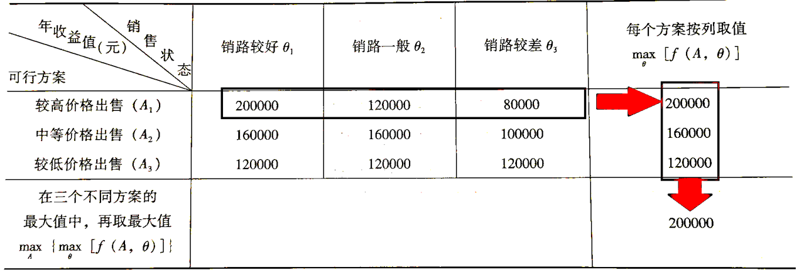
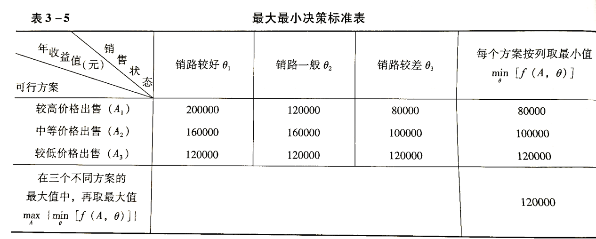
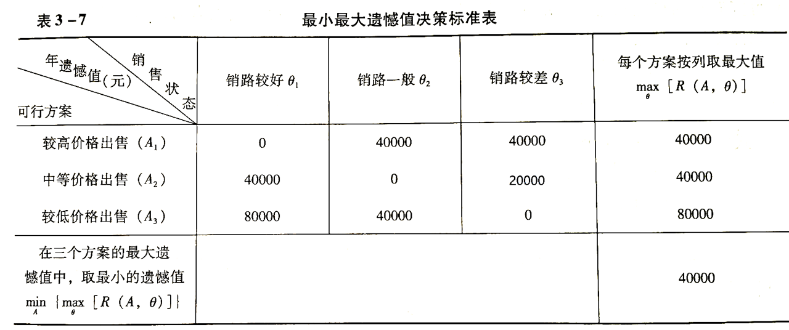
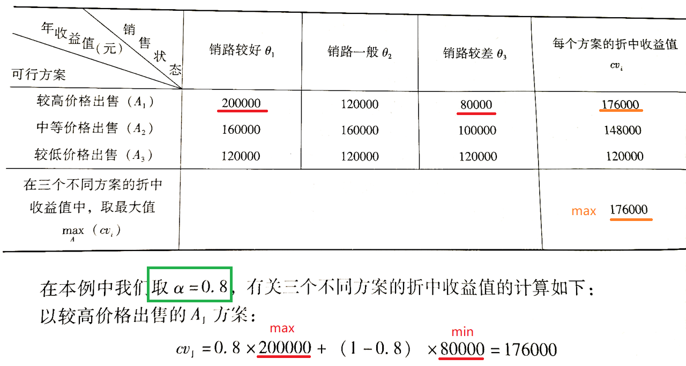
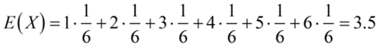
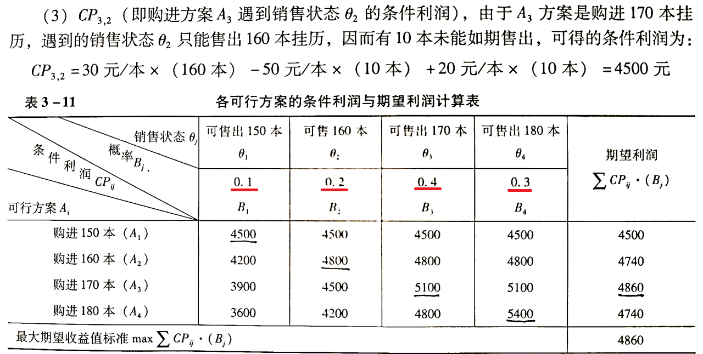
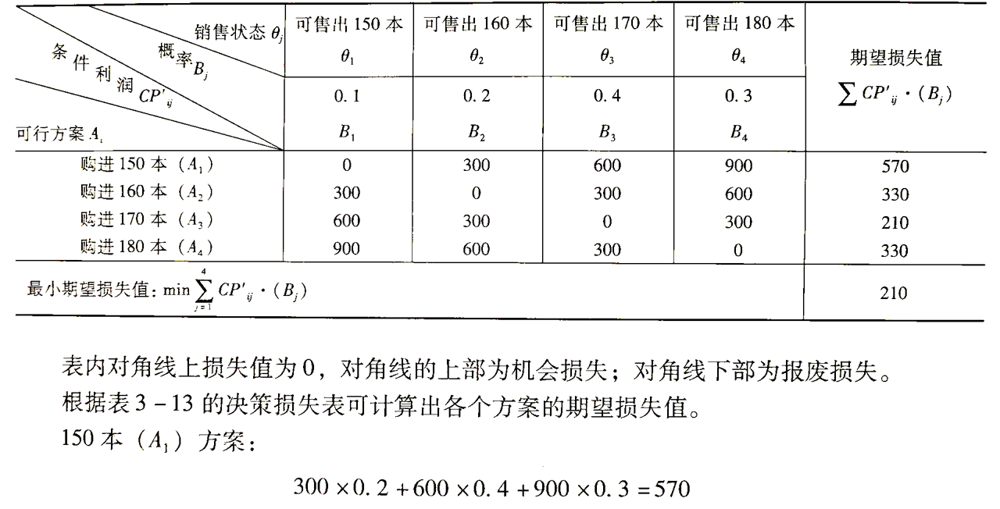
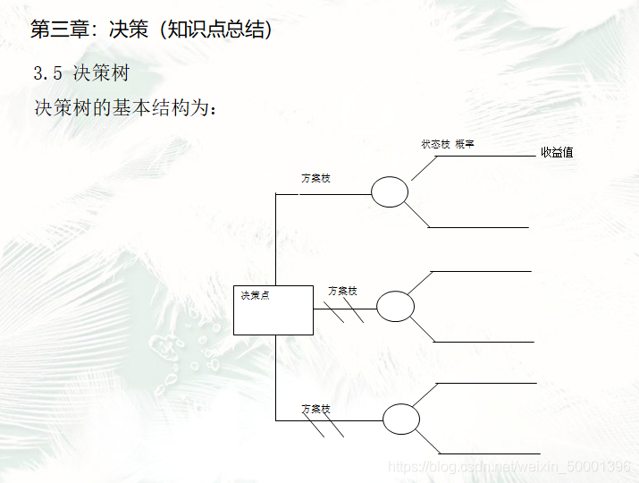
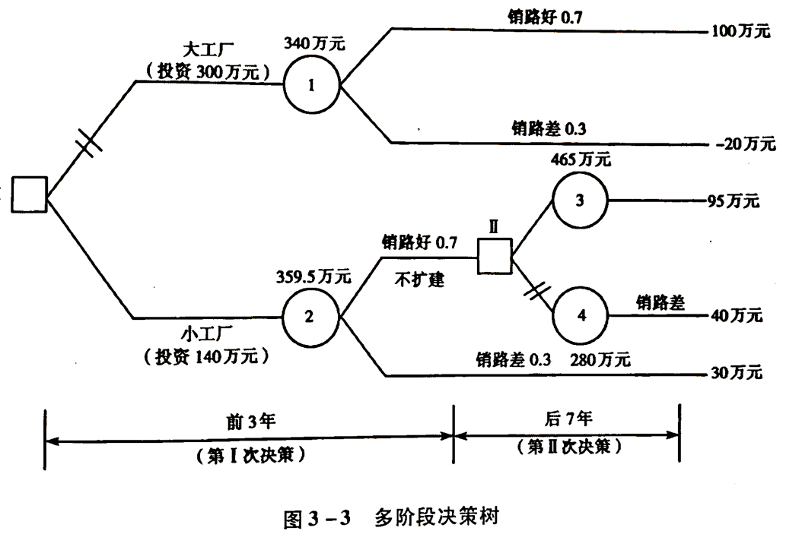

# 第三章 决策

### 一、决策

狭义：决策是对一些可供选择的方案做出选择

广义：包括明确决策项目的目的，寻求可行的方案，在诸可行方案中进行决策，对选定的方案经过实施后的结果进行总结评价

**决策是行动的基础**。

**管理的关键在于决策**。

### 二、决策的分类

#### 1决策方法分类

1. **常规性决策**：常规性决策实例的重复性的决策。
例如：家庭或食堂打算购买粮食；汽车司机在行驶途中决定超车。

2. **特殊型决策**：特殊型决策是对特殊性的，没有先例可循的新问题的决策。
例如：一个快要高中毕业的学生需要报考高中毕业的学生需要报考大学专业，以及某个工厂计划引进某种新设备

#### 2计划和控制关系分类

1. **计划性决策**：国家或组织的方针政策以及较长时期的计划
2. **控制性决策**：是在执行方针政策或实施计划过程中，需要作出的决策。包括执行政策或实施计划的决策以及当政策或计划根据实际情况进行调整时的决策。
计划性决策大多属于特殊性决策，控制性决策有特殊的，有常规的。

> 在执行方针政策和实施计划的过程中，需要作出的决策属于（C）
>
> A.常规决策B.特殊性决策C.控制性决策D.计划性决策

### 三、决策的程序

1. **确定目标**，确定目标是决策的前提
2. **拟定多个可行方案**。拟定可行方案，是科学决策的关键
3. **预测可能发生的自然状态，计算不同方案在不同的自然状态下的收益值**（损失值），编制决策收益表（损失表）。决策收益表又叫决策矩阵.
4. **以决策收益表为依据，运用不同的决策标准进行决策分析，选择最优方案。**

### 四、在不同环境下的决策

自然状态：不是决策者所能控制的未来状态。

1. **确定条件**下的决策：只存在一种自然状态
2. **不确定条件**下的决策：存在一个以上的自然状态，而决策者不了解其他状态，甚至不完全了解如何把概率分配给自然状态。
   1. 最大最大决策标准
   2. 最大最小决策标准
   3. 最小最大遗憾值决策标准
   4. 现实主义决策标准
3. **风险条件**下的决策：存在一个以上的自然状态，但是决策者具有将概率值分配到每个可能状态的信息。
   1. 最大期望收益值标准
   2. 最小期望损失值标准

> 存在多个或两个以上可行方案,每个自然状态可以估算出他的概率值，不同可行方案在不同自然状态下的收益值或损失值可以定量计算出来，这种决策类型属于（D）
>
> A.乐观条件下决策B.确定条件下决策C.不确定条件下决策D.风险决策

### 五、不确定条件下的决策

有以下特征：

1. 有一个明确的决策目标
2. 可拟定两个以上可行方案以供比较、选择。
3. 存在一种以上的自然状态
4. 可以预测或估计出不同可行方案在不同自然状态下的收益损失值。

#### 5.1、最大最大决策标准

又称为**乐观主义者**的决策标准，决策时，只考虑将来会发生最好的自然状态即把最好的自然状态发生的概率定为1，其他状态的概率定位0。

它的决策程序：
首先从每个方案中选择一个最大的收益值，然后再从这些最大的收益值所代表的不同方案中，选择一个收益值最大的方案作为备选方案。即**大中取大**。

#### 5.2、最大最小决策标准

又称为**保守主义者**的决策标准（悲观主义决策标准），决策时，只考虑将来会发生最好的自然状态即把最好的自然状态发生的概率定为1，其他状态的概率定位0。

它的决策程序：
首先从每个方案中选择一个最小的收益值，然后再从这些最小的收益值所代表的不同方案中，选择一个收益值最大的方案作为备选方案。即**小中取大**。

#### 5.3、最小最大遗憾值决策标准

遗憾值：在决策过程中，当某一中自然状态可能出现时，决策者由于决策失误没有选择最好的方案，而是选择了其他方案，因而会感到遗憾，这**两方案值之差**称为遗憾值。

它的决策程序：
先把收益表转化为遗憾值表，以**遗憾指为基础**，从每个方案中选择一个最大的遗憾值，然后再从这些最小的所代表的不同方案中，选择一个遗憾值最小的方案作为备选方案。即**大中取小**。

#### 5.4、现实主义决策标准

也称为**折中主义**决策标准，它把未来出现最好的状态的概率定为`a`，最差的状态的概率为`1-a`，其他中间状态的概率定为0，即考虑两头的情况。

他的决策程序：
计算每个方案的折中收益值，选择折中后最大的收益值对应的方案作为备选方案。

计算公式为：
$$
cv_i=a·max[a_{ij}]+(1-a)·min[a_{ij}]
$$
`i`：方案数
`j`：自然状态数（产品）
`ca_i`：第i个方案的折中收益值
`a`：概率值（折中系数），0<a<1（题目中会告诉）
`a_ij`：方案Ai在遇到自然状态θi情况下，所获得的收益

所以最后选择A1

### 六、风险条件下的决策

风险情况下的决策一般又叫**统计型决策**或**随机型决策**，主要是根据多种不同的自然状态可能发生的概率决策的。 所以依据的标准主要是**期望值**标准。

特征：

1. 有一个明确的决策目标
2. 存在多个可行方案
3. 存在多个自然状态，并且每个自然状态可以估算出它的概率值
4. 不同可行性方案在不同状态下的收益损失可以定量计算下来。风险情况下的决策所依据的标准主要是期望值标准。

#### 期望

在概率论和统计学中，一个离散型随机变量的期望值（或数学期望，亦简称期望），是试验中每次可能的结果乘以其结果概率的总和。

例如：掷一枚公平的六面骰子，其每次“点数”的期望值是3.5，计算如下：

不过如上所说明的，3.5虽然是“点数”的期望值，但却不属于可能结果中的任一个，没有可能掷出此点数。

#### 6.1、最大期望收益值标准

在风险的条件下进行决策，一般最常用的决策标准就是期望利润标准，也叫**贝叶斯标准**。

采用期望值利润标准进行决策，通常步骤如下：

1. 确定概率值
2. 计算条件利润

$$
CP_{ij}=P·Q_{ij}-C·L_{ij}+S·L_{ij}
$$

`PQ`：利润（Q是最多售出数）
`CL`：成本
`SL`：折余值（亏损）

就是

$$
0.1*4500+0.2*4500+0.4*4500+0.3*4500=4500
$$

3. 计算各个方案的期望利润与选择最优方案。
4. 具有精确情报资料的最大期望收益值的计算和情报价值的计算。

#### 6.2、最小期望损失值标准

这是与最大期望收益值标准相对应的一种标准，是以选择期望损失值最小的方案为最优方案。
$$
i方案的期望=min \sum_{j=1}^m CP_{ij}'·B_j
$$
`B`：概率
`CP`：i列方案损失值

### 七、决策树

决策收益表是期望收益决策标准单阶段决策的重要工具，除此以外，决策树不仅可以解决单阶段决策问题，还可以解决收益表不易表达的多阶段序列决策问题。

▢方块结点是**决策结点**，其引出的数枝称为**方案枝**。

◯圆圈结点是**状态结点**，其引出的数枝称为**状态枝**。

#### 决策树的优点

1. 它构成决策过程，使决策者能够以一种顺序的，有条理的方式接近决策。
2. 它要求决策者检验所有可能的结果，合一的和不合意的意义要检验。
3. 它以一种非常简明的方式，把决策过程传给别人，说明对未来的每一种假设。
4. 通过集中注意于每一个财政数字，概率和优先的假设—— 一次一个，以便分组来讨论各种方案。
5. 能够和计算机一起使用，模拟多种不同组合的假设。
