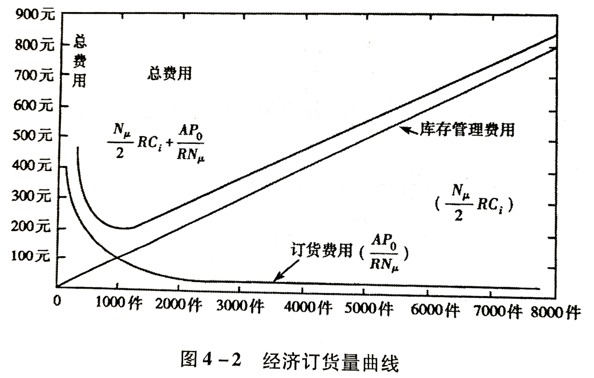

# 第四章 库存管理

### 一、工业企业的库存种类

1. 没有经过企业加工的原材料。
原料、半成品如钢材、水泥、轴承、发动机、电动机

2. 已经过企业加工，但尚未加工完毕的在制品。

3. 企业已经加工完毕，待销售的成品与备件。

### 二、库存管理

#### 作用

库存的作用最基本的一方面就是保证工业企业的生产能够正常的、连续的、均衡的进行。具体来说：

1. 适应**原材料**供应的季节性，如农产品。
2. 适应产品**销售**的季节性。
3. 适应**运输**上的合理性和经济性
4. 适应**生产**上的合理安排。
如有的设备生产率很高
5. 适应**批发量**的大小

#### 意义

1. 保证企业按科学的计划实现均衡生产，不要因缺少原材料或其他物资而停工停产。
2. 使库存管理的费用达到最低。

#### 内容

通过调节、控制存储的输入输出关系，来寻求最佳的经济效益。

1. 确定经济采购量或经济生产批量

2. 确定一个适合的订购提前量
3. 确定一个合适的安全库存量
4. 计算最小库存费用
5. 提出行之有效的管理和控制方法

### 三、存货台套法

以库存台套为存货管理的单位，在某个存货台套中，可以包括有关的各种单项存货。

### ★四、ABC分析法

ABC分析法就是按各种存货台套或存货单元的年度需要有价值，将他们分为A、B、C 三类。

- A类： 存货台套只占全部的**10%**，年度需要价值占全部的**70%。**
对于此类要加强管理，原因3个：
  1. 台套数量不多，管理上比较容易。
  2. 对A类存货台套的管理投资，能够获得较大的经济效果。
  3. 另一些存货台套，如防火设备，易爆易炸物品，剧毒物品，无论他们价值多少，因为具有特殊作用，亦应视为A类。

- B类：占**30%**，价值占**20%。**

- C类：类占**60%**，价值占**10%**。

对于B、C 类，在管理上可以适当粗略些，如按季，半年订货。对这些存货的管理只着重于不缺货，不影响生产，不锈蚀变质，不造成经济损失。

### 五、库存费用

#### 5.1库存费用模型结构

企业的仓库一般可分为：<u>原材料库</u>和<u>半成品、成品库</u>两类。

原材料库存费用模型结构：
$$
库存费用=订货费 + 保管费
\\TC = P + C
$$
半成品、成品库存费用模型结构：
$$
库存费用 = 工装调整费+保管费\\
TC =S+C
$$
保管费直接与库存量的大小有关，与库存物资的平均库存量成比例。

#### 5.2库存费用

##### 订货费用

是当安排某项订货时，每一次都要承担的费用。包括采购人工资、办公费、差旅费、手续费等。
$$
订货费(一般指年订货量)=\frac {年需要量}{一次订货量}·一次订货费\\
P=\frac {D}{N}·P_0
$$

##### 工装调整费

是在批量生产的情况下，每批投产前的工艺装备、设备的调整检修所用费用、办公、差旅、手续、电子邮件、检验费。
$$
工装调整费=\frac {年计划产量}{一次生产批量}·一次工装调整费\\
S=\frac {R}{N}·P_s
$$

##### 保管费

是企业自己拥有的存货保存时需要的费用。如管理费、维修费、设备折旧、保险费、搬运费等。
$$
保管费=平均库存量·单位保管费\\
C=\frac {1}{2}·N·C_0
$$
式中1/2为平均库存量
$$
保管费=平均库存量·库存物资单价·保管费率\\
C=\frac {1}{2}·N·R·C_i
$$

$$
保管费率=\frac {全年整个企业所指出的保管费用总和}{全年整个企业各种存货的平均存货总额}\\
C_i=\frac {C}{M}
$$

##### 平均库存

平均库存分为<u>平均库存量</u>和<u>平均库存额</u>。
$$
平均库存量= \frac 1 2·订货批量
$$

$$
平均库存额 =平均库存量 · 每个单位或台套的单位价格\\
M =\frac{1}2·N·R
$$

### 六、经济订货量（EOQ）的计算方法

经济订货量（EOQ）是使总的存货费用达到最低的为某个台套或某个存货单元确定的**最佳的订货批量**=**经济订购量**。

主要方法：

#### 表格计算法

1. 选择一定数目的每次可能购买的数量方案
2. 确定每种方案的总费用
3. 选出总费用最小的订货量

#### 图解法

库存保管和订货两项的总费用，开始是递减的，然后在保管费用与订货费用相等处达到最低点。

#### ※数学方法

1. 代数方法

①设定变量 ②推导公式

2. 导数方法

库存费用 = 订货费用 + 保管费 = 年需要量 / 订货量 * 一次订货费 + 平均库存量 * 单位物资保管费
可推导出，当**订货费= 保管费**时，**库存总费用达到最低** ，带入已知数据可计算出经济订货量。

**主要公式：**
$$
订货费=保管费\\
\frac {年需要量}{次订货量}·次订货费=平均库存量(\frac 12经济订购量)·单位保管费\\
\frac {年需要量}{次订货量}·次订货费=平均库存量(\frac 12 次订货量)·单位保管费
$$
其他公式：
$$
订货量=\sqrt \frac {2·年需要量·一次订货费}{单位保管费}\\
\\
全年所需库存总额=最佳订货金额·最佳订货次数
$$

>1. 设某厂今年全年将与某轴承厂订购轴承台套，按进场价格估计，共计100 000元，每次订购费用总额250元，每个台套的年保管费用其进厂价格12.5%，现已知该厂的经济订购量为40台套，求该轴承台套的进厂价格。
>
>解：设进厂价格为x
>$$
>\cfrac {100000}{x}·\frac 1{40}·250=\frac 1{2}·40·0.125x
>$$
>250/40 是单价，即**次订货费**
>
>解得x=500

>2. （2008.7真题）某企业年需采购轴承200台套，每台套500元，每次的订货费用为250元，保管费用率为12.5%。
>供应商提出，若每次订货100台套，则轴承的进厂价可降为490元一台套。试问能否接受这种优惠，每次订货100台套？
>
>解：
>
>①设订货量为x
>$$
>\frac {200}{x}·250=\frac 1 2·x·0.125·500
>$$
>x=40
>
>所以库存费=订购费+保管费=2*1250=2500
>
>成本=200*500=100000
>
>总费用=2500+100000=102500
>
>②当订货量为100时，享受优惠。
>$$
>\begin{align}
>库存费&=\frac {200}{100}×250+\frac 1 2×100×0.125×490\\
>&=500+3062.5\\
>&=3562.5
>\end{align}
>$$
>总价=200*490=98000
>
>总费用=3562.5+98000=101562.5
>
>明显费用①>②，所以使用②优惠。

### 七、订货时间的确定

确定库存模型的前提是：使用量和前提时间都是恒定的。

为了使生产不会由于缺货而中断，也为5了使仓库中不要再出现储备量太多的情况，对于订货时间的确定，应该综合考虑下列因素。

#### 7.1再订货点

有两种含义：

1. 时间上的含义 ： 什么时间为某项存货再订货。
2. 存货水平上的含义：某项存货水平达到怎样的存货水平时，就应在订货。

#### 7.2前置时间

也称为订货提前期

1. 由仓库采购部门发出存货量以再订货水平的通知。
2. 进行或委托进行从发出订货信息到货物入库为止的各项采购工作。

#### 7.3前置时间内的需求量

也称订货提前期内的需求量，也就是应该再订货时的某项存货的存量水平。

#### 7.4缺货

仓库中已没有某项存货可以满足生产或销售时需要的状况。

#### 7.5安全库存量

也称保险库存量 ， 是为了预防可能出现缺货现象而保持的额外库存量。

对企业来说，

1. 安全库存量会降低甚至完全消除由于缺货而造成的费用损失。
2. 安全库存量会增加存货的保管费用。

#### 7.6在制品的定量时间问题

生产提前期包括从半成品库根据在订货点向生产车间发出再生产通知单开始，经过车间生产准备工作，加工，检验，一直到入库为止的各个阶段。

### 八、大批量采购的优缺点

优点：

1. 可以按更低的价格采购
2. 可以减少订货次数，降低订货费用
3. 大批量采购，也可以大批量运输，获得运价优惠。
4. 进货的批量大，缺货的可能性少

缺点：

1. 保管费较高
2. 需要占用更多的资金
3. 库存货物会变得陈旧、过时
4. 库存货物的更换率低
5. 适应时尚的灵活性较低，特别是对服装，化妆品等商品
6. 库存量增大，损耗也会增大，货物贬值的可能性也会增大

### 九、正确平价供应者提供的数量折扣

**经济订货量**是指我们库存费用最低的订货批量，但供应商往往提出如果提高一次订货量，那么会在产品价格方面做出优惠，此时库存费用会增加，我们需要比较才能做出哪种方案更合适。

##### 平均库存

平均库存分为<u>平均库存量</u>和<u>平均库存额</u>。
$$
平均库存量= \frac 1 2·订货费
$$

$$
平均库存额 =平均库存量 · 每个单位或台套的单位价格\\
M =\frac{1}2·N·R
$$

> 某制造厂年产某型号机器2400辆，故年需用某种零部件2 400台套。经过计算和修匀调整，应每月订货和进货零部件200台套。设每套零部件的进厂价为20 000元，试计算零部件的平均库存量和平均存货额。
>
> 翻译：**一年要2400套，一个月200套，一套单价20 000**
>
> 解：设订货费为p
> $$
> \begin{align} 
> p&=\frac {2400}{200}×20 000\\
> &=240 000\\
> 所以:\\
> 平均库存量&=\frac 12 p\\
> &=120 000\\
> 平均库存额&=\frac 12 p×20 000\\
> &=2 400 000 000
> \end{align}
> $$
