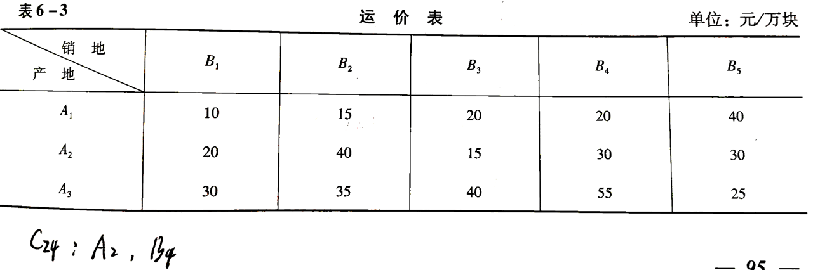
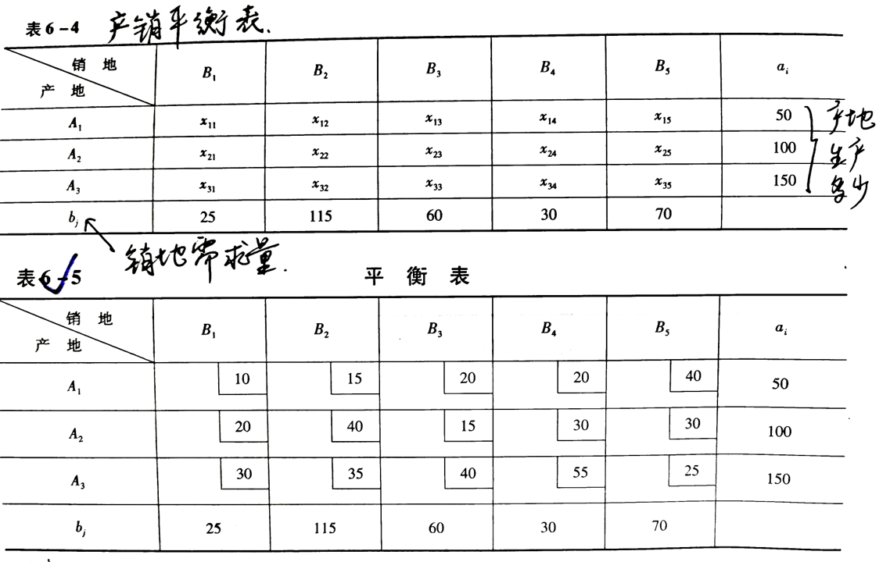
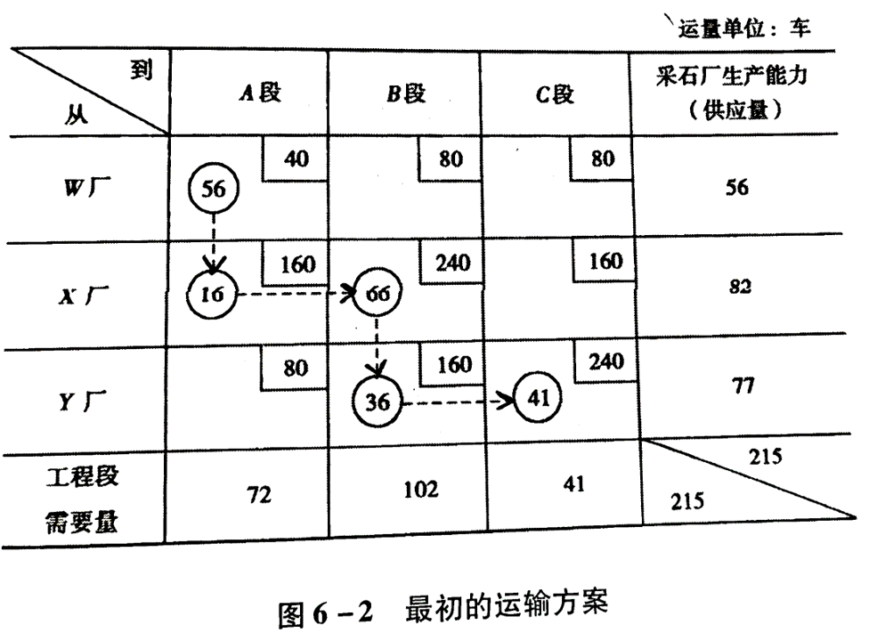

# 第六章 运输问题

### 一、运输问题

运输问题的内容实在供应点与几个需求点之间，运输品种、规格、质量等相同的货物时，选择最佳的运输方案，以达到总的运输费用最低或所获得的利润最大等目标。

### 二、运输问题及特殊结构

若每一格具体的运输数量不确定，就可以设为Xij ,代表从第 i 个产地运往第 j 个销售地点的运输数量，对于不同的运输数量，会产生不同的总运费，目的就是找出所有满足要求限制的可能的运输数量的分配方案，然后从这些运输方案中选择最优的即总运费最低的方案。

运输问题的解：使得总运费最低的具体运输数量。

单位运价表中每一个数据代表从不同产地运输一单位产品到不同销售地点所产生的运费，用Cij表示

**产销平衡表**和**单位运价表**一 一相对，可以把两个表合为一个表称为**平衡表**。

### 三、表上作业法

该方法可分为下列三个步骤：

1. 找到一个初始方案。
2. 根据判定标准判断是否最优。
3. 若不是最优，对该方案进行改进，然后重复第（2）（3）步直到求出最优解为止。

产销平衡结合运价表==平衡表

### 四、需要量等于供应量的运输问题

1. 建立运输图

2. 使用**西北角法**求得一个最初的运输方案p109

   有数字的方格叫做数字格，或石子格，数目是m+n-1 ，变量为0的方格叫空格或无石方格

 

3. 寻求改进方案

#### 阶石法

1. 计算每一个空格求改进路线和改进指数。改进路线就是从某一个空格开始，寻求那一条企图改变原来的运输方案的路线。改进指数是指循着改进路线，当货物的运输量做一个单位的变化时，会引起总运费的该变量。

2. 将改进路线画在运输图上（闭合回路法）
3. 求其他各个方块的改进路线和改进指数
4. 建立改进方案

#### 建立改进方案的方法

寻求改进方案的方法主要有闭合回路法和修正分配法。

1. **闭合回路法**

   在所有空格中，挑选绝对值最大的负改进指数所在的空格作为调整格，沿着该空格的改进路线，挑选是负号的最小运量为调整运量

2. **修正分配法**
   
   修正分配法也叫**位势法**。把原来的运输途进行一些改进，在图顶上加上一行，在图的左侧加上一列

修正分配法和闭合回路法的**关系**：

- 闭合回路法是修正分配法的基础
- 闭合回路法先求改进路线，再求改进指数，修正分配法则相反

### 五、需要量不等于供应量的运输问题

虚设一个产地或者销地使其转化为**平衡运输问题**。

**谁少就虚设谁**

#### 5.1需要量小于供应量的运输问题

虚设一个需求点

虚设的供应点的供应量 = 总供应量 - 总需求量

任何一个供应点到虚设的需求点的单位运费都为0

#### 5.2需要量大于供应量的运输问题

虚设一个供应点

虚设的供应点的供应量 = 总需求量 - 总供应量

虚设的供应点到任何一个需求点的单位运费都为0。即该项运量根本不能运出，是短缺的运量。

### 退化现象

**数字格子数 < 行数 + 列数 - 1**
