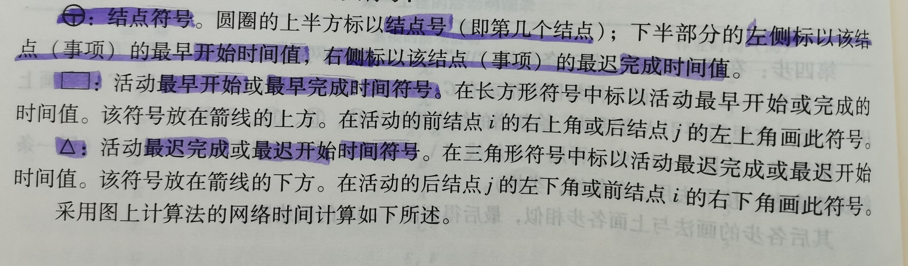
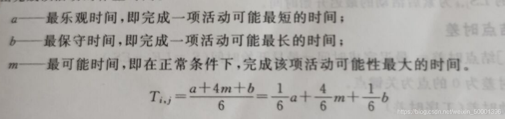
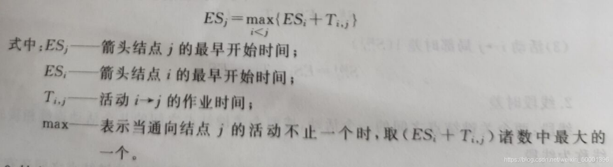
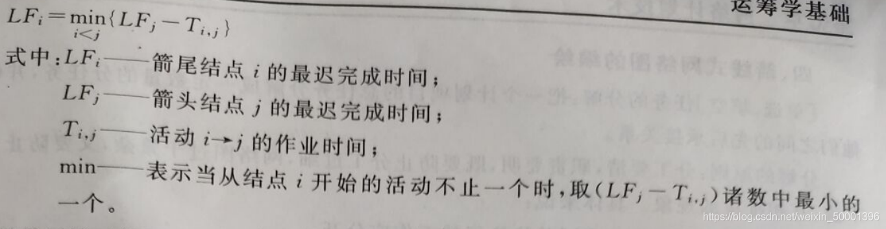
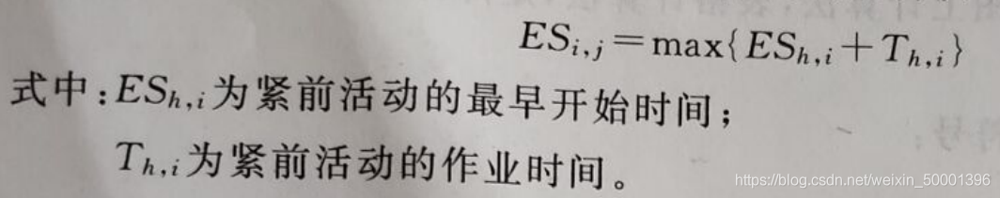
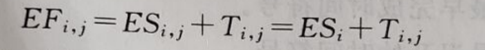
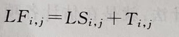
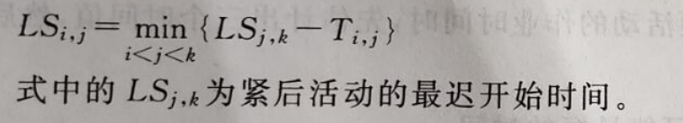
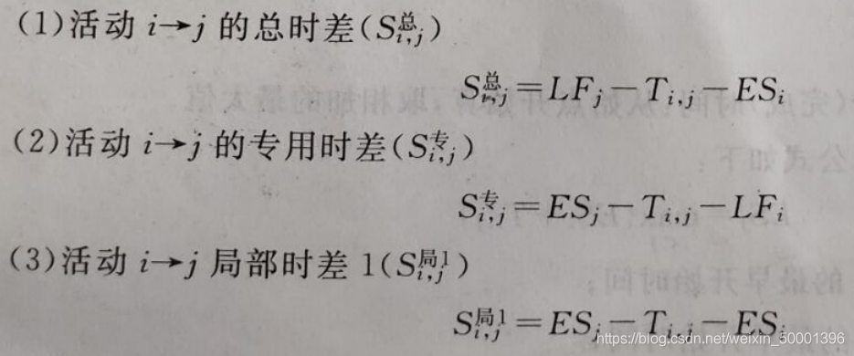

# 第七章 网络计划技术

### 一、网络计划技术

**网络计划技术**是一种组织生产和进行计划管理的科学方法，也称统筹法，是综合运用计划评核技术和关键路线法的一种比较先进的管理方法。

网络计划技术特别适用于大型的错综复杂的生产项目或工程项目。

**计算评核技术**（PERT）：是对计划项目进行核算，评价，然后选定最有计划方案的一种技术。

**关键路线法**（CPM）：是在计划项目的各个错中复杂的工作中，抓住其中的关键路线进行计划安排的一种方法。

### 二、网络图

网络图是计划项目的各个组成部分内在逻辑关系的综合反映，是进行计划和计算的基础，是网络计划技术的基础。

分为

- **箭线式网络图**
  - **箭线**：代表**活动（作业）**
  - **结点**：代表活动的**开始**和**完成**（一般用奇数排序）
  - 还要引入虚活动：虚工作（虚活动）是在网络图中，只表示其相邻的前后工作之间相互制约、相互依存的逻辑关系，既不占用时间也不消耗资源的一种虚拟工作。
- **结点式网络图**不引入虚活动

### 三、箭线式网络图

#### 3.1构成

由**活动**、**结点**和**线路**三个组成部分组成。

- **活动**：指作业或工序，用箭线表示。按键线的方向，在左侧写上活动的名称，右侧写上活动占用的时间。

**虚活动**：不消耗资源，不占用时间
以下两种情况要引用虚活动：

1. 先后两个结点之间的工作过程只能代表一项活动，当两个或两个以上的活动具有同样的始点和终点时。

2. 为了正确表示各个活动之间的承接关系，需要引入虚活动。

- **结点**：指事项。两个活动之间的交接点。说明一个活动的开始或完成，不占用时间，不消耗资源。

一个网络应只有一个始点和终点。除始点和终点，其他结点都有两重性，即对前面是终点，对后面是始点

结点编号的原则是：箭尾结点小于箭头结点，而且一般采用非连续编号。

编号方法是：去点去线编号法。

- **线路**：从网络的始点开始，顺着箭线方向，中间经过互相连接的始点和箭线，到终点的一条连线。

总作业时长最长的线路就是**关键线路**，或叫主要矛盾线。决定了整个网络计划的完工时间，线路的总长度叫做路长。关键线路在图上用**双线**或红线标出。

#### 3.2编绘

任务的分解：把一个计划项目的总任务分解成一定数量的分任务，并确定他们之间有相互继承的关系。

分解的原则：分工要清，职责要明，既要防止分工过细，网络图过于繁杂，又要防止分工不清，互相扯皮的现象。

具体来说：

1. 工作性质不同或由不同单位执行的工作应分开。
2. 同一单位进行的工作，工作时间先后不衔接的要分开。
3. 占用时间，不消耗资源，但影响工程完工日期的都应作为分任务，列入网络图。

### 四、网络时间的计算

网络时间的计算有图上计算法，表格计算法，矩阵计算法。后两者适用于计算机进行计算。

图上计算法要用到的相关符号：

### 六、作业时间

1. 单一时间估计法：就是在估计各项活动的作业时间时，只确定一个时间值。
2. 三种时间估计法：就是在估计各项活动的作业时间时，先估计出三个时间值，然后再求出完成该活动的作业时间。

### 七、结点时间

1. 结点的最早开始（完成）时间：从始点开始计算，取相加的最大值

   结点最早开始时间的计算公式如下：

2. 结点的最迟完成时间：从终点开始算，取相减的最小值。结点最迟完成时间的计算公式如下：

最早开始是阿金和最迟完成时间相等的结点称为关键点或关键事项，经过这些点的路线就是关键路线

### 八、活动时间

1. 最早开始时间：即箭尾结点的最早开始时间

2. 最早完成时间: 等于它的最早时间+作业时间

3. 最迟完成时间：即箭头节点的最迟完成时间。也是活动的最迟开始时间+作业时间。

4. 最迟开始时间：箭头结点的最迟完成时间 - 作业时间，或紧后活动的最迟开始时间。

### 九、结点时差

结点时差= 最迟完成时间 - 最早开始时间
结点时差为 0 的点为关键点

1. 活动时差（工序时差）

2. 线段时差

线段：两个关键节点之间的一个活动，或两个关键节点之间的几个活动连续相接的连线称为线段。

注意：
两个关键结点之间没有第三个结点算一个线段；
两个关键结点之间还有第三个结点算两个线段。
线段时差等于线段中各个活动的总时差的最长者。

3. 线路时差

线路：从始点出发，经过了连续相接的活动，直到终点的一条连线叫做线路
线路时差等于各线差时差之和。
关键线路的线路时差为 0

4. 关键线路

（1）总作业时间最长的线路就是关键线路。
（2）关键线路的线路时差等于0
（3）把所有关键结点按照顺序串联起来的线路叫关键线路。

### 十、网络计划优化的内容

1. 优化，就是要制定出最优的计划方案，即该计划方案能最合理的，最有效的利用人力，物力，财力。并达到周期最短、成本最低的目的。

2. 时间优化：在人力物力财力等基本上有保证的条件下，寻求最短的工程周期。

时间与资源优化：合理利用资源的条件下，寻求最短的工程周期。
这就是说，需要综合考虑工程进度和资源限制两方面的情况，进行资源的平衡工作。
进行平衡工作的原则是：
（1）在分配资源时，优先保证关键活动和时差较小的哪些活动的需要，已达到工程周期最短的目的
（2）合理的、平均的使用人力、设备等资源，避免资源上使用的骤增、骤减，从而增加调进、调出的困难。

3. 时间与成本优化

（1）包含智能工期最短的情况下，寻求成本较低的方案
（2）在成本最低的情况下，寻求合理的工程周期
直接费用增长率 = （极限费用 - 正常费用） / ( 正常时间 - 极限时间)

### 十一、摊入工程成本的费用分类

摊入工程成本的费用可分为直接费用和间接费用

1. 直接费用是指构成产品或工程实体的基本材料的费用
2. 间接费用是指不能按产品或工程直接计算的费用
3. 正常时间就是采用正常的工艺方法。能够完成该项活动的时间对应与正常时间所发化的费用叫做正常费用。
4. 极限时间也叫赶工时间，是指采用最先进的工艺方法，能够完成该项活动的时间。极限时间所花费费用叫做极限费用。极限时间是完成该项活动的最短时间，即使费用在增加，完成时间也不能再缩短了。
