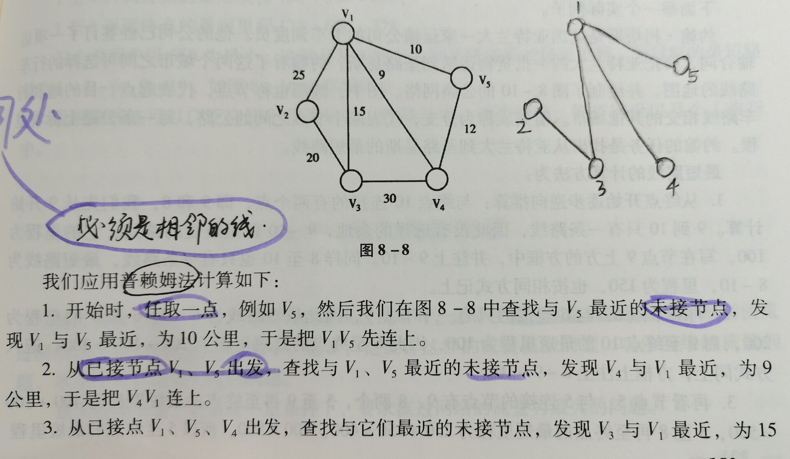

# 第八章 图论方法

### 一、 图的基本概念

- 图的基本要素： 
  - 结点 ：研究的对象
  -  边：对象之间的关系
- 有向图 ： 所有边都带方向
- 无向图 ：所有边都没有方向
- 连通图：所有的结点都连接起来，没有孤立点的图
- 不连通图：有孤立结点的图
- 权：赋给结点或边的信息
- 回路（圈）：从一点出发，还能回到原点的一条路

### 二、树和树的逐步生成法

树：**连通**且**不含圈（回路）**的图称为树

树的边数=节点数-1

### 三、最小枝杈树概念

**最小生成树**

最小枝杈树的问题是关于在一个网络中，从一个起点出发到所有的点，找出一个或几条路线，以使在这样一些线路中所采用的全部支线的总长度是最小的。

### 四、最小枝杈树的概念

**克鲁斯喀尔法**（避圈法）

1. 每次选择剩余所有边中长度最小的。（不管结点的位置，**所有边**）

2. 后选的边与已经选好的边不能构成回路，若构成则弃置
3. 重复1、2直到把所有边选完

只适用于较小的网络

**普莱姆法**：应用较广

从起点开始算，最小的距离

### 五、最短路线问题

最短路线问题为当通过网络的各边所需要的时间、距离或费用已知时，寻求两点间的距离或费用最少的路线问题。

最短路线问题的方法为逆向推算法

### 六、最大流问题

当以物体、能力或信息等作为流量通过网络时，怎样使流过的网络的流量最大，或者流过的网络流量的费用或时间最小

最大流量问题，就是在一定条件下，要求流过网络的流量为最大的问题

### 七、三种求解方法在实际中的应用

1. 最小枝杈树问题主要应用于通道、电话线、电线、网线等线路铺设中（总路线最短）
2. 短路线问题为当通过网络的各边所需要的时间、距离或费用已知时，寻求两点间的距离最短或费用最少的路线问题（两点间距离最短）
3. 最大流问题，就是在一定条件下，要求流过网络的流量为最大的问题。
