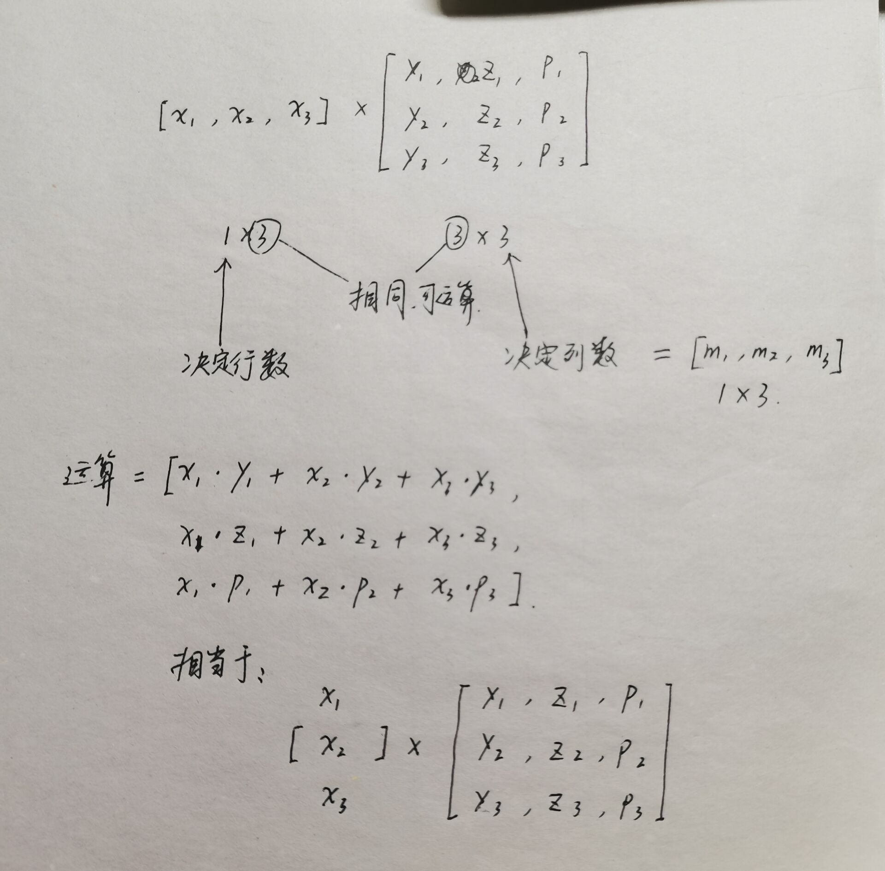

# 第九章 马尔柯夫分析

马尔可夫分析法是指在马尔可夫过程的假设前提下，通过观察、分析随机变量的现时变化情况来预测这些变量未来变化趋势情况的一种预测方法。

### 一、马尔柯夫分析的数学原理

对于由一种情况转换至另一种情况的过程，若该过程具有转换概率，而且此种转换概率又可依据其紧接的前项情况推算出来，则这种过程称为马尔柯夫过程。一连串的此种转换过程的整体称为马尔柯夫锁链

定义1 ： **概率向量**

任何一个向量，如果它内部的各个元素为**非负数**，且**总和等于1**，则此向量称为概率向量

定义2 ： **概率矩阵**

一矩阵中，各行都是概率向量，则此矩阵称为概率矩阵

定理1 ： 如果A、B都是概率矩阵，则AB乘积亦为概率矩阵，同理A的n次方也称为概率矩阵。

是：
$$
\begin{bmatrix}
0    & 1    & 0\\
0.5  & 0.25 & 0.25\\
0.33 & 0.34 & 0.33
\end{bmatrix}
$$
不是：
$$
\begin{bmatrix}
0    & 1    & 1\\
0.5  & 0.25 & -0.25\\
0.33 & 0.34 & 0.33
\end{bmatrix}
$$

- 第一行和不是1
- 第二行有负数

$$
\begin{bmatrix}
0    & 1    & 0\\
0.5  & 0.25 & 0.25\\
\end{bmatrix}
$$

- 不是 3×3（x · x）的格式

## 计算

### 二、马尔柯夫分析方法的步骤

1. 了解用户需求、品牌 / 牌号转换商情。
2. 建立转移概率矩阵
3. 计算未来可能市场分享率（市场份额）
4. 确定平衡条件

### 三、马尔柯夫分析方法的几个结论

1. 许多事物未来的发展或演变，往往受该事物现在的状况所支配或影响。
2. 马尔柯夫多次经研究实验发现：在某些事物的概率转换过程中，第n次实验的结果，常常由第n-1次试验的结果所定
3. 马尔柯夫过程是一种概率转换的过程

### 四、马尔柯夫分析问题的要求

1. 马尔柯夫分析问题的阶：一阶马尔柯夫过程在确定事件周期的选择概率时，只考虑前一周期的选择情况，二阶马尔柯夫过程在确定时间周期的选择概率时，考虑前两周期的选择情况

2. 转移概率：某个销售者保持、获得或失去消费者的概率

3. 转移概率矩阵：把转移概率排成矩阵

4. 未来市场份额的确定
   设第一周期的市场份额为T1 转移概率矩阵为P
   则第二周期的市场份额为T2 =T1 * P ，以此类推 可以得出任一周期的市场份额。

5. 最终（平衡）市场份额的确定
   不同销售者在销售过程中的市场份额每一个周期都在改变，若消费者的选择概率不变，那么市场份额在经过一个较长时期的转换后 会一直不变，我们称为最终（平衡）的市场份额
   计算方法
   最终平衡 时，可推导出公式：T=T P ，利用该公式列出线性方程组，再加上概率向量T本身的特点即非负之和为1，解出未知数来即可。
