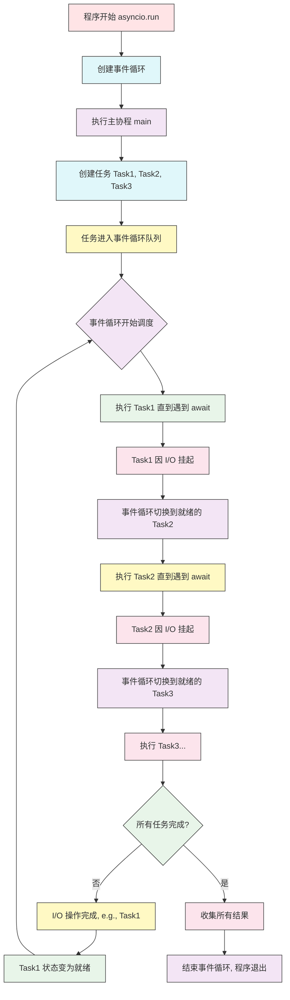

# 他们的关系

| 概念     | 含义                                         | 实现方式                |
| -------- | -------------------------------------------- | ----------------------- |
| **并发** | 多个任务"交替"执行（宏观同时，微观可能串行） | 线程、进程、协程        |
| **并行** | 多个任务"同时"执行（真正的同时）             | 多进程、多核 CPU        |
| **异步** | 发起任务后不等待结果，继续干别的             | `asyncio`、回调、Future |

【一句话理解】**并发**是"设计模式"（处理多任务的思路），**异步**是"编程模型"（不等结果继续执行），**线程/进程/协程**是"实现手段"。

- 多线程 → **并发**（I/O 等待时切换）
- 多进程 → **并行** + 并发（真正同时跑）
- `asyncio` → **异步** + 并发（代码层面写起来像同步，实际非阻塞）

线程和进程是**实现并发/并行的工具**，异步是**另一种编程范式**。多线程 = 并发（I/O 场景），多进程 = 并行（CPU 场景），`asyncio` = 异步 + 并发。

## Python 中的对应关系

| 工具              | 属于                 | 特点                                              |
| ----------------- | -------------------- | ------------------------------------------------- |
| `threading`       | **并发**（不是并行） | 因 GIL 限制，同一时刻只有一个线程执行 Python 代码 |
| `multiprocessing` | **并行** + 并发      | 每个进程独立，真正利用多核                        |
| `asyncio`         | **异步** + 并发      | 单线程内通过事件循环实现高并发 I/O                |


## 为什么多线程不是并行？

GIL 导致多线程无法并行执行 CPU 密集型任务。

```python
import threading
import time

def cpu_task():
    """纯 CPU 计算，多线程不会加速"""
    count = 0
    for i in range(10_000_000):
        count += i
    return count

# 单线程：约 2 秒
start = time.time()
cpu_task()
cpu_task()
print("单线程:", time.time() - start)

# 多线程：还是约 2 秒（甚至更慢，因为 GIL 切换开销）
t1 = threading.Thread(target=cpu_task)
t2 = threading.Thread(target=cpu_task)
start = time.time()
t1.start(); t2.start()
t1.join(); t2.join()
print("多线程:", time.time() - start)
```

## 什么时候多线程有效？

I/O 密集型任务，多线程有效。

```python
import threading
import requests
import time

def fetch(url):
    requests.get(url, timeout=5)

urls = ["https://baidu.com"] * 10

# 单线程：串行请求，慢
# 多线程：I/O 等待时释放 GIL，其他线程可以执行，快很多

start = time.time()
threads = [threading.Thread(target=fetch, args=(u,)) for u in urls]
for t in threads: t.start()
for t in threads: t.join()
print("多线程 I/O:", time.time() - start)
```

## 总结图

```
你的程序需要处理多任务
    │
    ├── CPU 密集型（计算、数据处理）
    │       └── 用 多进程 → 真正并行
    │
    └── I/O 密集型（网络、文件、数据库）
            │
            ├── 任务量中等（几百以内）
            │       └── 用 多线程 → 并发
            │
            └── 任务量巨大（成千上万）
                    └── 用 asyncio → 异步 + 高并发
```


# 进程、线程

Python 的进程与线程是并发编程的核心概念，以下是完整对比和用法：

## 1. 核心区别

| 特性         | 线程（Thread）                         | 进程（Process）      |
| ------------ | -------------------------------------- | -------------------- |
| **资源占用** | 轻量，共享内存                         | 重量，独立内存       |
| **通信方式** | 共享变量（需加锁）                     | 队列、管道、共享内存 |
| **切换开销** | 小                                     | 大                   |
| **崩溃影响** | 一个线程崩可能拖垮整个进程             | 互不影响             |
| **适用场景** | I/O 密集型（网络、文件）               | CPU 密集型（计算）   |
| **GIL 限制** | 同一时刻只能一个线程执行 Python 字节码 | 无 GIL，真正并行     |

> **GIL（全局解释器锁）**：CPython 的特性，导致多线程无法利用多核 CPU 做并行计算。

## 2. 线程：threading 模块

### 2.1 基础用法

```python
import threading
import time

def worker(name):
    print(f"线程 {name} 开始")
    time.sleep(2)
    print(f"线程 {name} 结束")

# 创建并启动
t1 = threading.Thread(target=worker, args=("A",))
t2 = threading.Thread(target=worker, args=("B",))

t1.start()
t2.start()

# 等待完成
t1.join()
t2.join()
print("全部完成")
```

### 2.2 线程池（推荐）

```python
from concurrent.futures import ThreadPoolExecutor
import requests

def fetch(url):
    return requests.get(url, timeout=5).status_code

urls = ["https://baidu.com", "https://github.com", "https://python.org"]

with ThreadPoolExecutor(max_workers=5) as executor:
    # 批量提交，自动管理线程
    results = executor.map(fetch, urls)
    for url, status in zip(urls, results):
        print(f"{url}: {status}")
```

### 2.3 线程锁（共享数据安全）

```python
import threading

counter = 0
lock = threading.Lock()

def increment():
    global counter
    for _ in range(100000):
        with lock:          # 自动获取和释放锁
            counter += 1

t1 = threading.Thread(target=increment)
t2 = threading.Thread(target=increment)
t1.start(); t2.start()
t1.join(); t2.join()
print(counter)  # 200000（不加锁可能小于这个值）
```

## 3. 进程：multiprocessing 模块

### 3.1 基础用法

```python
from multiprocessing import Process
import os

def worker(name):
    print(f"进程 {name}, PID={os.getpid()}")

p1 = Process(target=worker, args=("A",))
p2 = Process(target=worker, args=("B",))

p1.start()
p2.start()
p1.join()
p2.join()
```

### 3.2 进程池（推荐）

```python
from multiprocessing import Pool
import os

def cpu_intensive(n):
    """CPU 密集型任务"""
    return sum(i * i for i in range(n))

if __name__ == "__main__":
    with Pool(processes=os.cpu_count()) as pool:
        # map 自动分配任务到多个 CPU 核心
        results = pool.map(cpu_intensive, [1000000, 2000000, 3000000])
        print(results)
```

### 3.3 进程间通信

```python
from multiprocessing import Process, Queue

def producer(q):
    q.put("数据来自子进程")

def consumer(q):
    print(q.get())  # 数据来自子进程

if __name__ == "__main__":
    q = Queue()
    p1 = Process(target=producer, args=(q,))
    p2 = Process(target=consumer, args=(q,))
    p1.start(); p2.start()
    p1.join(); p2.join()
```

## 4. 高级：concurrent.futures（统一接口）

```python
from concurrent.futures import ThreadPoolExecutor, ProcessPoolExecutor
import time

def task(n):
    time.sleep(1)
    return n * n

# 线程池（I/O 密集）
with ThreadPoolExecutor() as executor:
    results = list(executor.map(task, range(5)))
    print(results)  # [0, 1, 4, 9, 16]

# 进程池（CPU 密集）—— 只需换类名
with ProcessPoolExecutor() as executor:
    results = list(executor.map(task, range(5)))
    print(results)
```

## 5. 选择指南

| 场景                         | 选择     | 原因                           |
| ---------------------------- | -------- | ------------------------------ |
| 网络请求、文件读写           | **线程** | I/O 等待时释放 GIL，并发效率高 |
| 图片处理、数据分析、数学计算 | **进程** | 绕过 GIL，真正多核并行         |
| 需要共享大量数据             | **线程** | 共享内存，无需序列化           |
| 任务需要隔离、不能互相影响   | **进程** | 独立内存空间，崩溃隔离         |
| 超大量并发连接（上万）       | **异步** | `asyncio` 比线程更轻量         |

## 快速对照表

| 需求                | 模块                                 |
| ------------------- | ------------------------------------ |
| 简单多线程          | `threading`                          |
| 简单多进程          | `multiprocessing`                    |
| 线程/进程池（推荐） | `concurrent.futures`                 |
| 高并发 I/O          | `asyncio`                            |
| 线程安全锁          | `threading.Lock/RLock/Semaphore`     |
| 进程间共享数据      | `multiprocessing.Queue/Pipe/Manager` |


# 异步编程 asyncio

`asyncio` 是 Python 标准库中的一个模块，用于编写异步 I/O 操作的代码。是单线程事件循环，适合高并发 I/O，比线程更省资源。

Python 引入了 `async`/`await` 语法来支持异步编程。当我们在函数定义前加上 `async` 关键字时，这个函数就变成了一个"协程"（coroutine）。而 `await` 关键字则用于等待一个协程完成。

**【简单来说】使用 `async` 关键字来定义协程函数，再使用 `await` 关键字来使用它。**

## 1. 协程（Coroutine）

协程是 `asyncio` 的核心概念之一。它是一个特殊的函数，可以在执行过程中暂停，并在稍后恢复执行。协程通过 `async def` 关键字定义，并通过 `await` 关键字暂停执行，等待异步操作完成。

```python
import asyncio

async def say_hello():
    print("Hello")
    await asyncio.sleep(1)
    print("World")
```

## 2. 事件循环（Event Loop）

事件循环是 `asyncio` 的核心组件，负责调度和执行协程。它不断地检查是否有任务需要执行，并在任务完成后调用相应的回调函数。

```python
async def main():
    await say_hello()

asyncio.run(main())
```

## 3. 任务（Task）

任务是对协程的封装，表示一个正在执行或将要执行的协程。你可以通过 `asyncio.create_task()` 函数创建任务，并将其添加到事件循环中。

```
async def main():
    task = asyncio.create_task(say_hello())
    await task
```

## 4. Future

`Future` 是一个表示异步操作结果的对象。它通常用于底层 API，表示一个尚未完成的操作。你可以通过 `await` 关键字等待 `Future` 完成。

```
async def main():
    future = asyncio.Future()
    await future
```

## 例子

让我们通过一个经典的并发访问多个网址的例子来理解上述概念。

假设我们需要获取三个不同网址的内容。使用同步方式会顺序执行，总耗时是三次请求耗时的总和。使用 `asyncio`，我们可以让这三个请求同时发出，总耗时接近于最慢的那一次请求。

【注意】我们需要用 `aiohttp` 库来替代 `requests` 进行异步 HTTP 请求。首先安装它：`pip install aiohttp`。

```python
import asyncio
import aiohttp
import time

async def fetch_url_async(session, url):
    """模拟一个耗时的网络请求（异步版本）"""
    print(f"开始异步获取: {url}")
    # 注意：这里我们使用 aiohttp 的异步 get 方法，并用 await 等待
    async with session.get(url) as response:
        # 模拟处理响应也需要时间
        await asyncio.sleep(2)  # 使用 asyncio.sleep 模拟 I/O 等待，它不会阻塞线程
        text = await response.text()
        print(f"完成异步获取: {url}")
        return f"来自 {url} 的数据 (长度: {len(text)})"

async def main_async():
    urls = ['https://httpbin.org/get', 'https://httpbin.org/delay/1', 'https://httpbin.org/headers']
    
    async with aiohttp.ClientSession() as session:  # 创建异步 HTTP 会话
        # 为每个 URL 创建一个任务（Task）
        tasks = []
        for url in urls:
            # create_task 会将协程加入事件循环，立即开始调度
            task = asyncio.create_task(fetch_url_async(session, url))
            tasks.append(task)
        
        print("所有任务已创建，开始并发执行...")
        
        # 使用 asyncio.gather 并发运行所有任务，并等待它们全部完成
        # gather 返回一个结果列表，顺序与传入的任务顺序一致
        results = await asyncio.gather(*tasks)
        
        return results

if __name__ == "__main__":
    start = time.time()
    # asyncio.run() 是启动事件循环并运行顶层协程的简便方法
    final_results = asyncio.run(main_async())
    end = time.time()
    
    print(f"\n异步版本总耗时: {end - start:.2f} 秒")
    for res in final_results:
        print(res)
```

**代码解析**：

- `async def`：定义了协程函数 `fetch_url_async` 和 `main_async`。
- `await`：在 `fetch_url_async` 中，我们 `await session.get()` 和 `await response.text()`，这告诉事件循环："这个网络请求需要时间，你先去执行其他就绪的任务吧"。
- `asyncio.create_task()`：将 `fetch_url_async` 协程包装成 `Task`，使其被事件循环调度，实现并发。
- `asyncio.gather(*tasks)`：一个非常实用的函数，它并发运行所有传入的协程/任务，并等待它们全部完成，最后收集所有结果。
- `asyncio.run(main_async())`：Python 3.7+ 推荐的方式，它负责创建事件循环、运行协程并关闭循环。

### 关键函数与参数说明

下面以表格形式列出 `asyncio` 中几个最常用的高级函数：

| 函数                                                         | 主要作用                                                     | 常用参数说明                                                 |
| :----------------------------------------------------------- | :----------------------------------------------------------- | :----------------------------------------------------------- |
| **`asyncio.run(coro, \*, debug=False)`**                     | 运行一个顶层协程，管理事件循环的生命周期。是程序的主入口。   | `coro`: 要运行的协程对象。 `debug`: 设为 `True` 可启用事件循环的调试模式。 |
| **`asyncio.create_task(coro, \*, name=None)`**               | 将协程包装成一个 **Task** 对象，并排入事件循环等待调度。这是实现并发的主要方式。 | `coro`: 要包装的协程对象。 `name`: （Python 3.8+）为任务指定一个名称，便于调试。 |
| **`asyncio.gather(\*aws, return_exceptions=False)`**         | **并发运行**多个异步任务（`aws` 可接受协程、任务等），并等待所有完成，返回结果列表。 | `*aws`: 可变参数，传入多个异步对象。 `return_exceptions`: 默认为 `False`，任何任务抛出异常都会立即传播给 `gather` 的调用者。设为 `True` 时，异常会作为结果的一部分返回。 |
| **`asyncio.sleep(delay, result=None)`**                      | **异步地**休眠指定秒数。这是与 `time.sleep`（阻塞）的关键区别。 | `delay`: 休眠的秒数。 `result`: 休眠结束后返回的值。         |
| **`asyncio.wait(aws, \*, timeout=None, return_when=ALL_COMPLETED)`** | 并发运行任务，并等待满足指定条件。返回两个集合 `(done, pending)`，分别是已完成和未完成的任务。 | `aws`: 异步对象集合。 `timeout`: 超时时间（秒）。 `return_when`: 决定何时返回，可选：`FIRST_COMPLETED`（第一个完成）、`FIRST_EXCEPTION`（第一个异常）、`ALL_COMPLETED`（全部完成，默认）。 |
| **`asyncio.to_thread(func, /, \*args, \**kwargs)`**          | （Python 3.9+）将一个普通的、可能阻塞的同步函数放到一个单独的线程中运行，并返回一个可 `await` 的协程。用于处理 CPU 密集型或阻塞式 I/O。 | `func`: 要在线程中运行的同步函数。 `*args, **kwargs`: 传递给函数的参数。 |

## 可视化理解：异步任务调度流程



**图解说明**： 这个流程图展示了事件循环如何像调度员一样工作。它维护一个任务队列，当一个任务执行到 `await`（例如等待网络响应）时，它会被挂起，事件循环立即从队列中找出下一个可以运行（就绪）的任务来执行。当被挂起任务的 I/O 操作完成后，事件循环会收到通知，将该任务状态改回就绪，并在未来某个时刻继续执行它。通过这种方式，在 I/O 等待期间，CPU 被充分利用来执行其他任务，实现了单线程内的并发。


## 异步队列

```python
async def producer(queue):
    for i in range(5):
        await queue.put(i)
        await asyncio.sleep(0.1)

async def consumer(queue):
    while True:
        item = await queue.get()
        print(f"Consumed {item}")
        queue.task_done()

async def main():
    queue = asyncio.Queue()
    await asyncio.gather(
        producer(queue),
        consumer(queue)
    )
```


---

如果调用协程函数时没有加await，只会返回一个协程对象，不会实际执行。

错误示例：

```
async def test():
    print("测试协程")

async def main():
    test()  # 错误：没有 await，协程不会执行

asyncio.run(main())  # 无任何输出
```

正确：

```
async def test():
    print("测试协程")

async def main():
    await test()  # 正确：await 触发协程执行

asyncio.run(main())  # 输出：测试协程
```

## asyncio.wait_for 添加超时控制

```
import asyncio
import random
import time

async def process_item(item):
    process_time = random.uniform(0.5, 2.0)
    try:
        # 设置1秒超时
        await asyncio.wait_for(
            asyncio.sleep(process_time),
            timeout=1.0
        )
        return f"处理完成：{item}，耗时 {process_time:.2f} 秒"
    except asyncio.TimeoutError:
        return f"处理超时：{item}"

async def main():
    items = ["任务A", "任务B", "任务C", "任务D"]
    tasks = [
        asyncio.create_task(process_item(item))
        for item in items
    ]
    
    start = time.time()
    results = await asyncio.gather(*tasks, return_exceptions=True)
    end = time.time()
    
    print("\n".join(results))
    print(f"总耗时：{end - start:.2f} 秒")

if __name__ == "__main__":
    asyncio.run(main())
```


