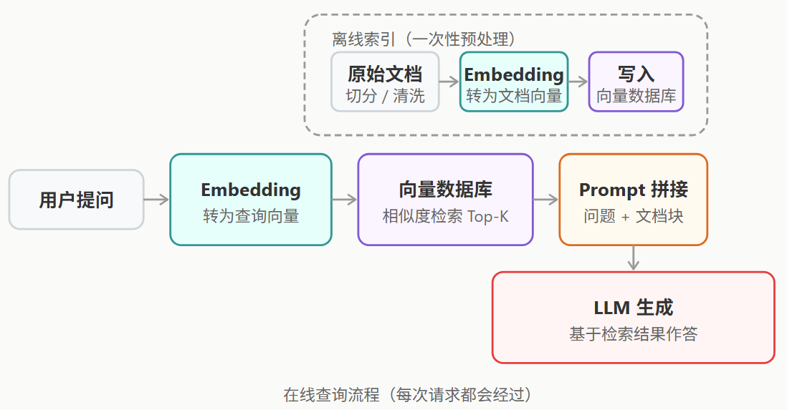
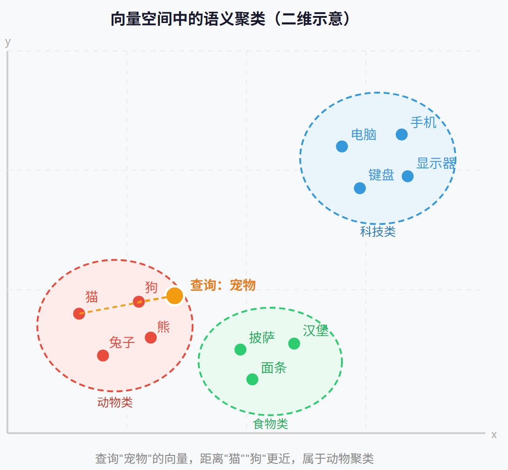
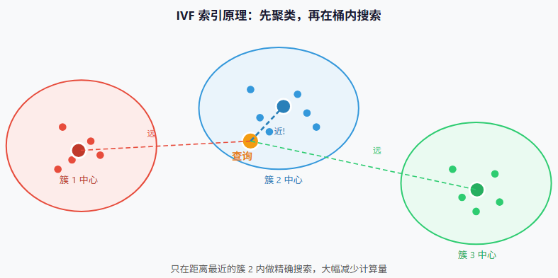
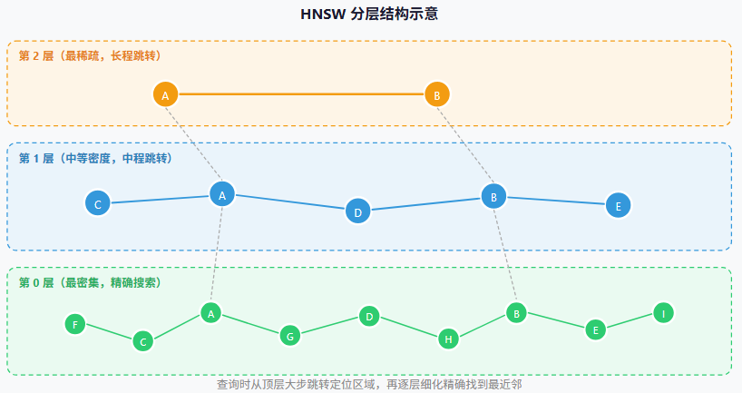
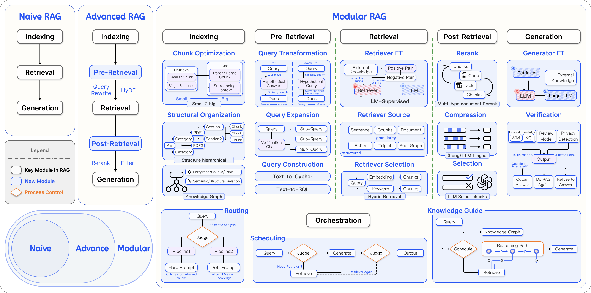

# RAG

RAG（Retrieval-Augmented Generation，检索增强生成）

RAG技术的基座是 [Vector Database（向量数据库）](Vector Database（向量数据库）.md) 。向量数据库不仅可以提供对向量化知识的存储，还支持高效的相似性检索，结合Prompt,可有效提升大模型回答的质量。

RAG 的核心思想是：**让 LLM 在回答问题时，先从外部知识库中检索相关内容，再基于检索结果生成回答**，而不是仅依赖模型训练时记住的知识。

这解决了 LLM 的两个核心痛点：知识截止日期（模型不知道训练后发生的事）和幻觉问题（模型在不确定时会编造答案）。

---

一个完整的 RAG 系统由两条流水线组成：**离线索引流水线**（将文档预处理存入向量库）和**在线查询流水线**（接收用户问题、检索、生成）。

离线阶段将原始文档切分成小块，通过 Embedding 模型转换为向量，存入向量数据库。

在线阶段将用户问题同样转换为向量，从数据库中找到最相近的文档块，拼接成上下文交给 LLM 生成答案。

下图展示了 RAG 的完整请求流程：



三个核心阶段：

```Mermaid
flowchart LR
    subgraph 知识库
        VectorDB[("向量数据库")]
    end

    UserQuestion["用户提问"]
    Retrieval["检索 Retrieval"]
    Augmentation["增强 Augmentation"]
    Generation["生成 Generation"]
    Answer["返回答案"]

    UserQuestion --> Retrieval
    Retrieval <--> VectorDB
    Retrieval --> Augmentation
    Augmentation --> Generation
    Generation --> Answer

    style 知识库 fill:#fef9c3,stroke:#ca8a04,stroke-width:1.5px
    style VectorDB fill:#e0e7ff,stroke:#4f46e5,stroke-width:2px
    style UserQuestion fill:#ede9fe,stroke:#7c3aed
    style Retrieval fill:#ede9fe,stroke:#7c3aed
    style Augmentation fill:#ede9fe,stroke:#7c3aed
    style Generation fill:#ede9fe,stroke:#7c3aed
    style Answer fill:#ede9fe,stroke:#7c3aed
```

文档清洗、切分、向量化、索引、召回、重排。

上下文构造、答案生成、引用溯源。

BM25、向量检索、Hybrid Search、reranker 的作用边界要清楚。

## 1.文档处理

> PDF、Word、Excel、网页，各种格式的文档怎么解析，怎么处理解析结果里的噪声（比如 PDF里的页眉页脚、表格被拆散）。

目前行业主流方案是引入 **文档解析引擎**（如 LlamaParse、Unstructured）或多模态大模型，将复杂图文转换为结构化的 Markdown，为后续高质量切分打下基础。

## 2.分块策略（Chunk）

文档切分是 RAG 效果的基础，切分粒度直接影响检索质量。块太大检索精度下降、引入噪声，块太小上下文不完整、丢失。不同内容适合不同策略。

| 切分策略                        | 适用场景                     | 优点                                                         | 缺点                               |
| :------------------------------ | :--------------------------- | :----------------------------------------------------------- | :--------------------------------- |
| **固定大小分割**                | 通用文本                     | 实现简单，速度快                                             | 可能切断语义完整的句子             |
| **递归字符分割**                | 结构化文本（Markdown、代码） | 优先按段落、句子等语义边界切分                               | 实现略复杂，需设定合理的分隔符列表 |
| **语义分割 (Semantic)**         | 长文档、书籍                 | 利用 Embedding 计算相邻句子的相似度，自动寻找语义转折点切分  | 计算成本高，预处理速度慢           |
| **父子文档检索 (Small-to-Big)** | 全面覆盖场景                 | 用"小块"进行高精度向量检索，命中后返回对应的"大块"（父文档）给 LLM，兼顾了检索精度和上下文完整性。 | 数据库设计和维护成本翻倍           |
| 按文档结构分割                  | 长文档有结构                 |                                                              |                                    |

实践中常在切分时加入 **重叠（overlap）**，即相邻块之间共享若干字符，防止重要信息在边界处被截断。

典型配置：块大小 512 tokens，重叠 50~100 tokens。


## 3.向量化（Embedding）、向量库

> [Embedding模型完全指南：2026年最佳文本向量化模型选型与RAG应用实践 - AI 助手](https://blog.aihubplus.com/post/embedding-model-guide-2026/)

> Embedding模型的选择，中文场景下用哪个模型效果比较好（BGE系列值得关注）。向量库的选择，小项目用Chroma或者FAISS，大一点的项目用Milvust或者Weaviate。这几个的基本用法都要会。

### Embedding

**Embedding**（嵌入）是指把文本（也可能包括图像、视频等其他模态数据）转成能表达语义信息的**稠密向量**（通常是 768 或 1536 维的浮点数数组）。语义相近的文本在向量空间中距离更近，这正是相似度检索的数学基础。


从核心上来说，嵌入（embedding）是一种映射，它将诸如单词、图像甚至整篇文档等离散对象映射到连续向量空间中的点。嵌入的主要目的是将非数值数据转换为神经网络能够处理的格式。

虽然词嵌入（word embeddings）是最常见的文本嵌入形式，但还存在针对句子、段落或整篇文档的嵌入。句子或段落嵌入是检索增强生成（retrieval-augmented generation）的流行选择。检索增强生成将生成（如生成文本）与检索（如搜索外部知识库）相结合，以便在生成文本时提取相关信息。

当选择的embeddings为二维的时候，就是将词汇投影到二维空间，这时可以进行可视化绘制，从而观测出最直观的现象：相似的术语会聚集在一起。


常用 **Embedding 模型**对比：

| Embedding 模型                         | 维度 | 适用语言 | 特点                                             |
| :------------------------------------- | :--- | :------- | :----------------------------------------------- |
| text-embedding-3-small（OpenAI）       | 1536 | 多语言   | 性价比高，适合大规模索引                         |
| text-embedding-3-large（OpenAI）       | 3072 | 多语言   | 精度最高，成本较高                               |
| BAAI/bge-m3                            | 1024 | 中英文   | 开源，中文效果优秀，支持多语言                   |
| BAAI/bge-large-en-v1.5                 | 1024 | 英文     | 开源，英文 MTEB 得分 64.23，支持指令前缀优化检索 |
| BAAI/bge-large-zh-v1.5                 | 1024 | 中文     | 开源，中文 MTEB 得分 64.53，中文检索效果优       |
| sentence-transformers/all-MiniLM-L6-v2 | 384  | 英文     | 体积小，速度快，适合本地极轻量部署               |

### 向量库

 [Vector Database（向量数据库）.md](Vector Database（向量数据库）.md) 

向量数据库（Vector Database）是一种专门用于存储、索引和检索高维向量数据的数据库系统。

你可以把它理解为：把意思相近的东西存在一起，并能快速找到和这个最像的那些东西。

以下是当前最主流的向量数据库横向对比：

| 数据库                     | 类型       | 部署方式                      | 特点                                           | 适用场景                 | 难度 |
| -------------------------- | ---------- | ----------------------------- | ---------------------------------------------- | ------------------------ | ---- |
| **Chroma**<<br>开源免费    | 纯向量DB   | 本地 / 云端<br>嵌入式优先     | 极简 API，Python 原生<br>集成 LangChain 最方便 | RAG 原型、AI 应用开发    | 入门 |
| **Qdrant**<<br>开源免费    | 纯向量DB   | 本地 / Docker<br>云服务       | Rust 实现，性能强劲<br>支持过滤+向量混合检索   | 生产级推荐，性能优先     | 中级 |
| **Weaviate**<<br>开源免费  | 多模态DB   | 本地 / 云端<br>SaaS           | GraphQL API，内置向量化<br>多模态（文本+图像） | 多模态检索，知识图谱     | 中级 |
| **Milvus**<<br>开源免费    | 纯向量DB   | 分布式部署<br>Kubernetes      | LF AI 基金会项目<br>大规模分布式，功能全面     | 亿级数据，企业大规模     | 进阶 |
| **Pinecone**<<br>商业 SaaS | 托管向量DB | 纯云端<br>全托管服务          | 零运维，开箱即用<br>免费套餐可用               | 快速上线，无运维能力团队 | 入门 |
| **pgvector**<<br>开源插件  | PG 扩展    | 已有 PostgreSQL<br>环境直接用 | 复用已有 PG 基础设施<br>SQL 接口，上手最快     | 已用 PG 的项目，轻量接入 | 入门 |


## 4.检索

> [模块化RAG技术路线图：从基础Naive RAG 到Modular RAG全方位技术解读-阿里云开发者社区](https://developer.aliyun.com/article/1597646)

> 纯向量检索不够用，混合检索（向量+关键词）通常比单一向量检索效果好。
>
> Rerank重排序，为什么要做rerank，用什么模型做。加权排序、RRFRanker。

简单来说，RAG 由检索（Retrieval） 与生成（Generation） 两大模块构成：

- 检索模块：从预设知识库中精准定位与用户问题相关的信息片段（如文档、段落、句子）；

- 生成模块：基于检索到的信息，结合大语言模型 生成符合上下文、逻辑连贯的答案。

### 相似度计算与 ANN 算法

检索的核心是**度量距离**。最常用的是**余弦相似度（Cosine Similarity）**，它计算两个向量的夹角余弦值，值域 [-1, 1]，越接近 1 越相似。此外还有点积（Dot Product）和欧氏距离（L2 Distance）。

为了在百万级向量中实现毫秒级检索，数据库通常采用**近似最近邻（ANN）算法**（如 **HNSW**、IVF）。HNSW 是目前最主流的算法，它通过构建多层跳跃图网络，牺牲极少的精度换取了数量级的搜索速度提升。


---


### 语义近则向量近

向量空间中距离近的两个向量，其原始内容在语义上也更相近。这是向量数据库所有能力的基础。

用一个 2D 简化示例来理解（实际是几百至几千维）：




### 相似度计算方法

找到"最相似的向量"的核心是计算两个向量的距离或相似度。以下是三种最常用的方法。

#### 余弦相似度（Cosine Similarity）

余弦相似度衡量两个向量的方向角，忽略长度。这是最常用的方法，尤其适合文本场景。

公式：cosine_similarity(A, B) = (A · B) / (|A| · |B|)

- 结果范围：-1 到 1，值越大越相似
- 适用场景：文本语义搜索、文档相似度

#### 欧氏距离（Euclidean Distance）

欧氏距离衡量两点之间的直线距离，距离越小越相似。

公式：d(A, B) = sqrt(Σ(A_i - B_i)^2)

- 结果范围：0 到 ∞，值越小越相似
- 适用场景：图像检索、地理位置相关应用

#### 点积（Dot Product）

点积是向量相乘求和，结合了方向和长度信息。

公式：A · B = Σ A_i × B_i

- 适用场景：推荐系统（向量已归一化时等价于余弦相似度）


#### 三种方法对比

三种相似度计算方法对比

| 方法           | 原理                                         | 结果含义                   | 推荐场景             |
| -------------- | -------------------------------------------- | -------------------------- | -------------------- |
| **余弦相似度** | 计算两向量夹角的余弦值<br>关注方向，忽略大小 | \[-1, 1]，越接近 1 越相似  | 文本搜索、NLP 首选   |
| **欧氏距离**   | 两点之间的直线距离<br>关注绝对位置差异       | \[0, ∞)，越接近 0 越相似   | 图像检索、坐标系数据 |
| **点积**       | 向量各分量乘积之和<br>方向+长度综合考量      | 值越大越相似（无固定范围） | 推荐系统、归一化场景 |


### 向量索引算法

数据量大时（百万、亿级），对每一条数据做相似度计算（暴力检索）太慢。向量数据库使用专门的索引算法来加速查询。

#### 暴力检索（Flat / Brute-force）

暴力检索遍历所有向量，逐一计算相似度。

| 维度 | 说明                             |
| :--- | :------------------------------- |
| 原理 | 遍历所有向量，逐一计算相似度     |
| 优点 | 结果 100% 精确                   |
| 缺点 | 数据量大时极慢，O(n) 复杂度      |
| 适用 | 数据量小于 10 万，对精度要求极高 |

#### IVF（倒排文件索引）



IVF 执行步骤：

1. 训练阶段：用 K-Means 将所有向量聚成 N 个簇，记录每个簇的中心
2. 查询阶段：先找出距离最近的几个簇的中心，再只在这些簇内做精确搜索

#### HNSW（分层导航小世界图）

HNSW 是目前最主流的向量索引算法，兼顾速度和精度。



HNSW 分层结构示意第 2 层（最稀疏，长程跳转）AB第 1 层（中等密度，中程跳转）CADBE第 0 层（最密集，精确搜索）FCAGDHBEI查询时从顶层大步跳转定位区域，再逐层细化精确找到最近邻

HNSW 核心思路：

- 构建多层图结构，顶层稀疏，底层密集
- 查询时从顶层入口开始，做"跳格游戏"：每层贪心地往更近的节点跳，再下探到下一层
- 大幅减少需要比较的节点数，时间复杂度近似 O(log n)

#### 其他常用索引

| 索引类型     | 特点                       | 适用场景           |
| :----------- | :------------------------- | :----------------- |
| Flat（暴力） | 精确但慢                   | 小数据集、精度优先 |
| IVF_Flat     | 聚类后精确搜索，速度快     | 中大规模，内存充足 |
| IVF_PQ       | 量化压缩，节省内存         | 超大规模，内存受限 |
| HNSW         | 速度快、精度高，内存占用高 | 最常用，推荐首选   |
| ScaNN        | Google 出品，优化吞吐量    | 高并发生产环境     |

------


## 5.生成

> 索回来的内容怎么组织进prompt，怎么让模型在回答里引用来源，怎么处理检索结果和问题不相关的情况。


---


## RAG架构

> [RAG 检索增强生成入门指南 | SmallYoung](https://www.smallyoung.cn/docs/006-RAG检索增强生成入门指南)

RAG 技术形成了一个**多维度演进的技术体系**，从基础架构到专项优化，每个方向都在解决特定的核心问题。下图展示了完整的技术演进脉络：

```Mermaid
flowchart TB
    subgraph 基础架构层
        NaiveRAG["Naive RAG"]
        AdvancedRAG["Advanced RAG"]
        ModularRAG["Modular RAG"]
    end

    subgraph 模态扩展
        MultiModalRAG["多模态 RAG"]
        LongRAG["Long RAG"]
    end

    subgraph 检索增强
        GraphRAG["GraphRAG"]
        LightRAG["LightRAG"]
    end

    subgraph 生成优化
        SELFRAG["SELF-RAG"]
        CRAG["CRAG"]
        SpeculativeRAG["Speculative RAG"]
    end

    subgraph 智能融合
        AgenticRAG["Agentic RAG"]
        RAGAsSubmodule["RAG as Agent Submodule"]
    end

    subgraph 部署模式
        RAGAsService["RAG as a Service"]
        EdgeRAG["Edge RAG"]
    end

    %% 基础架构层内部流向
    NaiveRAG --> AdvancedRAG
    AdvancedRAG --> ModularRAG

    %% 基础架构层 → 各扩展方向
    NaiveRAG --> MultiModalRAG
    MultiModalRAG --> LongRAG

    NaiveRAG --> GraphRAG
    GraphRAG --> LightRAG

    NaiveRAG --> SELFRAG
    SELFRAG --> CRAG
    CRAG --> SpeculativeRAG

    %% 智能融合
    ModularRAG --> AgenticRAG
    AgenticRAG --> RAGAsSubmodule

    %% 部署模式
    ModularRAG --> RAGAsService
    RAGAsService --> EdgeRAG

    %% 样式
    classDef base fill:#dbeafe,stroke:#2563eb,stroke-width:2px
    classDef extend fill:#ede9fe,stroke:#7c3aed,stroke-width:1.5px
    classDef group fill:#fefce8,stroke:#ca8a04,stroke-width:1px

    class NaiveRAG,AdvancedRAG,ModularRAG base
    class MultiModalRAG,LongRAG,GraphRAG,LightRAG,SELFRAG,CRAG,SpeculativeRAG,AgenticRAG,RAGAsSubmodule,RAGAsService,EdgeRAG extend
    class 基础架构层,模态扩展,检索增强,生成优化,智能融合,部署模式 group
```


### Naive RAG 框架

> 简单直接的基础架构

#### 工作原理

Naive RAG 是 RAG 的原始形态，架构极简，**线性流程**的基础实现。核心流程为 “单轮检索 + 直接生成”：

```Mermaid
flowchart LR
    %% 节点定义（带形状和图标）
    Documents["📄 Documents"]
    Query["🔍 Query"]
    EmbeddingsModel(("Embeddings Model"))
    VectorDB{"Vector DB"}
    SimilarDocs("Documents similar to query")
    Prompt["Prompt = Query + Similar Documents"]
    LLM(("LLM"))
    Response("Generated response")

    %% 知识库索引流程（蓝色箭头方向）
    Documents --> EmbeddingsModel
    EmbeddingsModel --> VectorDB

    %% 查询检索与生成流程（绿色箭头方向）
    Query --> EmbeddingsModel
    VectorDB --> SimilarDocs
    Query --> Prompt
    SimilarDocs --> Prompt
    Prompt --> LLM
    LLM --> Response

    %% 样式定义：蓝色 = 知识库侧，绿色 = 查询侧
    classDef blue fill:#dbeafe,stroke:#2563eb,stroke-width:2.5px,color:#1e3a8a
    classDef green fill:#dcfce7,stroke:#16a34a,stroke-width:2.5px,color:#14532d

    class Documents,EmbeddingsModel,VectorDB blue
    class Query,SimilarDocs,Prompt,LLM,Response green
```

执行顺序：

1. 用户输入问题（如 “什么是 RAG 技术？”）；

2. 检索器（通常基于关键词匹配或基础向量检索）从知识库中筛选出少量相关文档（如 3-5 篇）；

3. 生成器（如 GPT-3.5）直接拼接检索到的文档片段与问题，输出答案。


其核心特点是无优化环节：检索器不做重排序，生成器不做上下文过滤，分块策略简单（如固定长度切割文档），整个流程是不可逆的。

#### 技术特点

简单易实现，局限显著

- 优点

  - 架构简单，开发成本低，适合快速搭建原型；


  - 对硬件资源要求低，可在小规模知识库（如万级文档）上稳定运行。

- 缺点

  - 检索精度低：依赖关键词或基础向量匹配，易遗漏语义相关但表述不同的内容（如 “AI” 与 “人工智能”）；


  - 抗干扰差：若检索到无关文档，生成器会 “照单全收”，导致答案冗余或错误；
  - 长文档处理弱：固定分块可能切断语义完整的段落（如将一个事件的起因与结果分到不同块）。

- 适用场景
  适合简单、标准化的问答场景，如企业官网 FAQ（常见问题解答）、产品说明书查询等。例如，电商平台的 “退货政策查询”，用户问题明确，知识库内容结构化强，Naive RAG 可快速响应。

### Advanced RAG 框架

> 精度升级，优化检索与生成的协同

Advanced RAG 是 Naive RAG 的进阶版，核心目标是**提升检索精度与生成质量**，在基础 RAG 上增加**检索前优化、检索中增强、检索后处理**三个环节：

```Mermaid
flowchart LR
    subgraph 检索前优化
        QueryRewrite["查询重写"]
        QueryExpand["查询扩展"]
        HyDE["HyDE假设文档生成"]
        
        QueryRewrite --> QueryExpand
        QueryExpand --> HyDE
    end

    subgraph 检索阶段
        HybridSearch["混合检索"]
        MultiRecall["多路召回"]
        
        HybridSearch --> MultiRecall
    end

    subgraph 检索后优化
        Reranking["重排序 Reranking"]
        ContextCompress["上下文压缩"]
        ResultFilter["结果过滤"]
        
        Reranking --> ContextCompress
        ContextCompress --> ResultFilter
    end

    %% 跨阶段连接
    HyDE --> HybridSearch
    MultiRecall --> Reranking

    style 检索前优化 fill:#fefce8,stroke:#ca8a04,stroke-width:1.5px
    style 检索阶段 fill:#fefce8,stroke:#ca8a04,stroke-width:1.5px
    style 检索后优化 fill:#fefce8,stroke:#ca8a04,stroke-width:1.5px
    
    style QueryRewrite fill:#ede9fe,stroke:#7c3aed
    style QueryExpand fill:#ede9fe,stroke:#7c3aed
    style HyDE fill:#ede9fe,stroke:#7c3aed
    style HybridSearch fill:#ede9fe,stroke:#7c3aed
    style MultiRecall fill:#ede9fe,stroke:#7c3aed
    style Reranking fill:#ede9fe,stroke:#7c3aed
    style ContextCompress fill:#ede9fe,stroke:#7c3aed
    style ResultFilter fill:#ede9fe,stroke:#7c3aed
```

#### 工作原理

在保留 “检索 - 生成” 核心流程的基础上，Advanced RAG 增加了**多环节优化的检索增强**：

- 预检索：查询优化
  - **查询改写（Query Rewriting）**：对模糊问题（如 “它的原理是什么？”）用 LLM 重新表述用户问题，进行补全或改写（如结合上下文推断 “它” 指 “RAG”），提升检索针对性。
  - **HyDE（Hypothetical Document Embedding）**：让 LLM 先"盲猜"一个假设性答案，由于生成的答案通常比原问题包含更多行业术语，用这个假设答案的向量去检索，往往能召回更高质量的文档。
- **混合检索（Hybrid Search）**
  - 将**向量检索**（懂语义，容错率高）与**关键词检索**（BM25，匹配度高）的结果按权重融合。这在遇到专有名词、产品型号、代码片段时尤为重要，因为传统的向量检索容易在特定的专有名词上"翻车"。
- 后检索优化：**重排序（Reranking）**
  - 这是一个**粗排 → 精排**的两阶段设计。向量检索虽然快，但打分不够精确。重排序（Reranking）会引入 **Cross-Encoder 模型**（如 `bge-reranker`），将"问题"和"文档"成对输入模型进行联合推理打分。它的运算量大，只负责精选 Top-20 到 Top-5。
- **Self-RAG 与 CRAG（修正式 RAG）**
  - 加入自我反思机制。例如 CRAG（Corrective RAG）在拿到检索结果后，先由 LLM 充当"评委"打分。如果本地知识库查无此文或质量极低，系统会自动触发 Web Search（如 Google API）作为补充，大幅降低幻觉。

#### 技术特点

精度优先，复杂度适中

- 优点
  - 检索精度显著提升：语义检索 + 重排序可过滤 70% 以上的无关信息；

  - 长文档处理更合理：动态分块减少语义割裂，生成答案更连贯；

  - 支持中等规模知识库（如十万级文档）。

- 缺点

  - 架构复杂度增加：需维护检索、重排序等多模型，调试成本上升；

  - 未解决多轮推理问题：仍依赖单轮检索，无法处理 “多步推理” 类问题（如 “对比 RAG 与微调的优劣势，并举例说明”）。

- 适用场景
  适合**中等复杂度**的知识查询场景，如企业内部 helpdesk 系统、在线教育平台的课程问答（需处理较长的课件文档）等。例如，当用户提问 “如何配置 Python 环境安装 RAG 相关库？” 时，Advanced RAG 可通过语义检索定位到具体安装步骤文档，并过滤无关的理论介绍。

### Modular RAG 框架

> 模块化设计，灵活适配多场景
>
> [Modular RAG: Transforming RAG Systems into LEGO-like Reconfigurable Frameworks](https://arxiv.org/html/2407.21059v1)

#### 工作原理

Modular RAG 的核心是 **“组件解耦 + 标准化接口”**，将系统拆分为多个独立模块，各模块通过标准化接口通信：



核心模块包括：检索器（多模态支持）、重排序器、分块器、生成器、知识库管理器、监控器等；

模块可独立升级或替换（如将检索器从稠密向量模型换成混合检索模型，无需改动其他模块）。

> 例如，当需要接入表格数据时，仅需替换 “分块器” 为表格解析专用模块，其他模块保持不变。

将系统拆分为独立模块，像"乐高积木"一样灵活组合：

```Mermaid
flowchart TB
    subgraph 扩展模块
        Memory["记忆模块"]
        Routing["路由模块"]
        Search["搜索模块"]
        Fusion["融合模块"]
    end

    subgraph 核心模块
        Retrieval["检索模块"]
        Reasoning["推理模块"]
        Generation["生成模块"]
    end

    Memory --> Retrieval
    Routing --> Retrieval
    Search --> Retrieval
    Retrieval --> Fusion
    Fusion --> Reasoning
    Reasoning --> Generation

    style 扩展模块 fill:#fefce8,stroke:#ca8a04,stroke-width:1.5px
    style 核心模块 fill:#fefce8,stroke:#ca8a04,stroke-width:1.5px
    style Memory fill:#ede9fe,stroke:#7c3aed
    style Routing fill:#ede9fe,stroke:#7c3aed
    style Search fill:#ede9fe,stroke:#7c3aed
    style Fusion fill:#ede9fe,stroke:#7c3aed
    style Retrieval fill:#dbeafe,stroke:#2563eb
    style Reasoning fill:#dbeafe,stroke:#2563eb
    style Generation fill:#dbeafe,stroke:#2563eb
```


| 模块         | 功能               | 示例                             |
| :----------- | :----------------- | :------------------------------- |
| **路由模块** | 决定查询走哪条路径 | 简单问题直接回答，复杂问题走检索 |
| **记忆模块** | 存储对话历史和偏好 | 多轮对话上下文管理               |
| **融合模块** | 整合多源检索结果   | 合并向量库、知识图谱、数据库结果 |

#### 技术特点

灵活性与可扩展性的平衡

- 优点：
  - 多源数据：支持多源数据接入（文本、表格、图片、PDF 等），适配复杂业务场景；
  - 易于迭代：单个模块升级不影响整体系统，适合长期维护；

  - 可定制化：根据需求组合模块（如简化版可去掉重排序器，增强版可加入多语言处理模块）。

  - 灵活编排：除了最简单的线性编排之外，还可以采用条件编排、并行编排、循环编排、递归检索等多种编排方式，增加了处理的灵活性。
- 缺点
  - 设计门槛高：需定义清晰的模块接口与数据格式，初期架构设计成本高；
  - 模块协同复杂：多模块联动可能导致延迟增加（如多模态 检索需协调文本与图片处理模块）。
- 适用场景
  适合多源数据整合或需长期迭代的系统，如政务服务平台（需整合政策文档、办事指南、表格化流程）、科研文献管理系统（需处理 PDF 全文、图表、公式等多模态数据）。例如，某科研平台需同时检索论文全文、实验数据表格与作者信息，Modular RAG 可通过替换检索器模块支持多模态检索，且后续可独立升级生成器以支持公式生成。


### Agentic RAG

引入智能代理，实现自主决策与迭代

#### 工作原理

具备反思能力的闭环系统

Agentic RAG 是当前最先进的 RAG 形态（2026），核心是在系统中引入**智能体（Agent）**，赋予 RAG 自主规划、反思与迭代的能力：

1. **问题分析**： Agent 接收用户问题后，判断是否需要检索（如 “地球周长是多少” 可能无需检索，模型已掌握）；
2. **检索规划**： 对复杂问题拆解为多步检索任务（如 “分析 2023 年新能源汽车销量数据，并预测 2024 年趋势” 需先检索 2023 年销量、政策变化、供应链情况等）；
3. **检索执行**： 多条检索任务的执行可以使用单智能体完成，也可以调用多个智能体来完成。

单智能体方式主要是对多个数据源进行分别检索。


多智能体方式下，主智能体负责检索路由，各个专用智能体负责处理不同的检索类型和工作流。


## 2026 年 RAG 的四个新范式

### 1. Graph-RAG：从向量相似度走向知识关系

核心变化：构建**实体-关系图**，检索变成**路径推理**，支持**多跳 reasoning**。带来的能力跃迁：更强事实一致性、更好的复杂问题回答、更接近「真正知识系统」。

------

### 2. Agentic RAG：检索成为行动的一部分

在 Agent 架构中，RAG 不再是单次流程，而是：**思考 → 检索 → 再思考 → 再检索 → 行动**。特征包括多轮工具调用、动态知识更新、与任务规划深度耦合。**RAG 从「模块」变成「循环」。**

------

### 3. 长期记忆系统（Memory-Augmented AI）

2026 年最重要的变化之一：**AI 开始拥有持续记忆**。不再是每次重新检索，而是形成用户画像、记录历史决策、持续更新知识状态。这使 RAG 从「外部知识补丁」变成**「AI 认知结构的一部分」**。

------

### 4. 无检索推理（Retrieval-free Reasoning）

随着模型能力增强（小模型蒸馏专域知识、长上下文直接读取文档、推理模型内化结构信息），某些场景正在摆脱 RAG。这不是 RAG 失败，而是**RAG 被更高层架构吸收**。


## GraphRAG：知识图谱 + 检索融合

传统 RAG 将知识库当作独立的文本碎片，无法回答诸如"找到所有同时由现任 CEO 创办且市值超千亿的公司"这类需要**跨文档、多跳推理**的复杂问题。**GraphRAG** 引入知识图谱（Knowledge Graph），将实体和关系显式建模。

```Mermaid
flowchart TD
    UserQuestion["用户问题"]
    
    VectorSearch["向量检索<br/>相关文档块"]
    GraphSearch["图检索<br/>实体关系子图"]
    Fusion["上下文融合<br/>文档块 + 图路径"]
    
    UserQuestion --> VectorSearch
    UserQuestion --> GraphSearch
    VectorSearch --> Fusion
    GraphSearch --> Fusion
    
    Example["实体 A → 关系 → 实体 B<br/>实体 B → 关系 → 实体 C"]
    VectorSearch ~~~ Example
    
    style UserQuestion fill:#f9fafb,stroke:#9ca3af,stroke-width:2px,color:#374151
    style VectorSearch fill:#ccfbf1,stroke:#14b8a6,stroke-width:2.5px,color:#0f766e
    style GraphSearch fill:#ede9fe,stroke:#8b5cf6,stroke-width:2.5px,color:#6d28d9
    style Fusion fill:#ffedd5,stroke:#f97316,stroke-width:2.5px,color:#c2410c
    style Example fill:#fff,stroke:#d1d5db,stroke-dasharray: 5 5,color:#6b7280
```


### GraphRAG 核心步骤

1. **知识构建**：离线阶段使用 LLM 从文档提取三元组（主体、关系、客体），写入 Neo4j 等图数据库。
2. **双路检索**：针对提问中的实体，不仅做传统的向量检索，同时在图谱中触发图遍历（Graph Traversal），提取多跳关系链。
3. **图文融合生成**：将向量检索找回的"片段"与图检索找回的"路径结构"拼装进 Prompt，使得 LLM 既具备全局视野又掌握具体细节。


## RAGAs 框架：RAG评估指标

RAG 系统的评估不能仅凭直觉，主流使用 **RAGAs** 框架（检索增强生成评估框架），从"检索"和"生成"两个维度进行自动化量化测试：

- **Context Recall（检索召回率）**：标准答案中的信息有多少比例能被检索到。
- **Context Precision（检索精确率）**：检索到的文档中有多少比例是真正相关的。
- **Faithfulness（忠实度/幻觉指标）**：生成的答案是否都有检索出的文档支撑。
- **Answer Relevance（答案相关性）**：生成的答案是否真正回答了用户的问题，避免答非所问。
