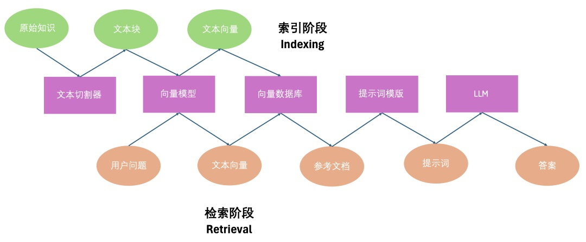
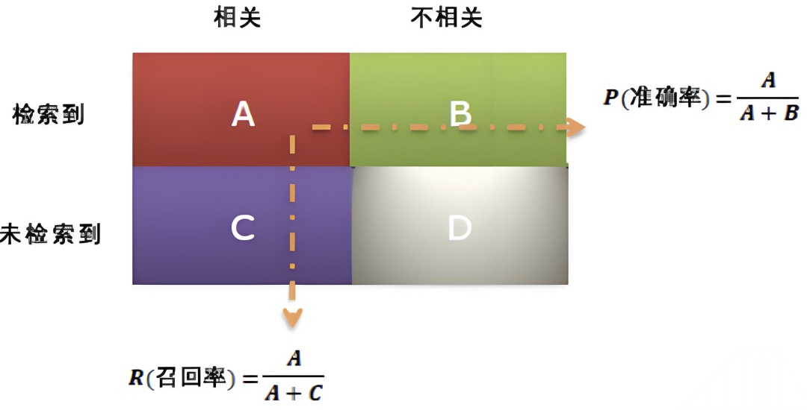

# RAG基础概念

Retrieval Augmented Generation，检索增强生成。 RAG = 检索技术（Search）+ LLM 提示。其主要目的是通过从外部检索与输入问题相关的相关信息，然后利用这些信息来引导生成过程，从而提高生成文本的相关性、准确性和多样性。具体可以参照下图：



RAG技术包括三个核心部分：索引（Indexing）、检索（Retrieval）和生成（Generation）。

- 首先，系统会对原始知识先进行分割切片，然后利用向量模型（Embedding Model）进行编码并存储在向量数据库中。

- 其次，当用户提出问题时，会使用检索算法（如BM25、DPR、ColBERT等）从向量数据库中找到最相关的信息。

- 最后，这些检索到的信息被整合到原始问题（提示词Prompt）中作为上下文输入到一个生成模型，最终生成更准确且符合上下文的答案。

# RAG评估指标

在评估的过程中，我们会特别关注几个关键的方面，首先是对最终结果准确性的考量，其次是聚焦于大模型的能力，最后是如何评估检索阶段的效果。

- **准确率**：简单解释就是站在用户的角度，评判答案是否符合实际的需求。因为无论中间过程多复杂，对用户来说是不关心的，只关心最终的结果是否符合他们的希望，这是最直观，也是我认为最重要的一个评估指标。
- **忠实度**：这个主要指大模型层面，看生成的内容是否忠实于所提供的上下文信息。简单理解，我们精准找到了相关的参考文档，并把这些文档内容和原始问题一起给到大模型之后，模型的回答是不是基于所提供的这个参考文档来给出的。如果回答能够准确反映文档中的信息，那我们就说它的忠实度高，反之就说明忠实度不足。如果发现忠实度不达标，可能就需要考虑一下换一个模型了。因为在这种情况下，问题不在于检索到的信息，而是在于大模型不能有效利用这些信息来给出满意的答复。

下面这三个指标主要是用于评估检索阶段的有效性：

- **召回率**（Recall）：关注的是信息找的全不全，确保没有遗漏相关的信息。
- **精确度**（Precision）是你的信息找的准不准，确保找的信息都是有用的。
- **F值**：是召回率和精确率的平衡点，是一个综合指标。

具体详细解释下，这其中蕴含着计算公式，参照下图：



> 例如我现在想从知识库中查询有关药的书籍，正确的应该有10本。但我查询后，查询出了15本，其中有9本是正确的跟药有关的书籍，另外6本不是。那此时：
>
> 召回率：9 / 10 = 90%（检索到了15本，9本相关的有，有1本是相关的但是在15本中未检索到）
>
> 精确度：9 / 15 = 60%（检索到了15本，9本是相关的，6本是不相关的）
>
> F值：（2 * 60% * 90%） / （60% + 90%） = 72%

那么在实际的应用中，我们应该更关注哪一个指标呢？我个人认为，倾向于更加重视**召回率**。因为现在大模型对于噪声数据有着比较高的容忍度，即使包含了一些错误或者噪声数据。一般情况下。大模型也能够过滤掉没用的部分，提炼出准确的答案。所以在条件允许的情况下，比如说GPU资源充足，系统性能足够强大，我会建议尽可能的优化召回率。这样做不仅能确保我们不会错过任何重要的信息，也能够让我们的模型啊，在面对复杂问题的时候，更加的稳健。

# RAG评估方法

现在RAG的评估方法，一般分为两大类，**人工评估**和模型**自动评估**。

- **人工评估**

首先，我们需要准备一些样本数据，这些样本就包含了问题及其对应的标准答案，还有针对每个回答设定的评分标准。其次，我们就可以把这些问题输入到你的RAG系统中，去获取最后运行后的结果。最后，也就是最关键的一步，需要评估人员对RAG系统的回答进行交叉检查并评分来确保每个回答是否准确或给予相应的分数。

通过这种方式。我们就可以直接衡量RAG系统回答的准确性，或者得到一个综合的评分来反映整体的表现。

- **自动评估**

自动评估同样也需要预先准备包含问题和标准答案的测试样本集，然后把这些问题交给RAG系统来获得作答结果。在自动评估的过程中，介绍两种主要的技术路径：

第一种方法是把问题和系统的作答结果输入到Cross-Encoder模型，得到它们之间的相关性作为得分。

第二种方法是计算标准答案和系统输出之间的文本相似度，以此作为评分的基础。

理论上，如果两者的相似度越高，那么模型回答的准确性也就越高。

值得我们注意的是，在第一种方法中，即使没有标准答案，也可以通过对问题和系统回答的相关性分析来进行初步的评分，这对于早期阶段的快速迭代特别有用。

最后，我们还要充分利用工具的力量。人工评估虽然比较精准，但确实非常耗时耗力，我们不妨用一些三方平台提供的强大评估工具和服务（例如LangSmith平台和Langfuse平台），当我们运行RAG服务时，这些平台不仅能够帮助我们追踪整个过程，从找到什么样的上下文，到最终的检索和生成的效果，还能够提供一站式的全面评估服务，这样一来，我们就可以轻松的掌握各个环节的表现，确保评估结果的准确性和可靠性。

---

# 具体方式

1. 从文件a中，让ai给你推导出 10～20 个关键词/问题句子，并且确定答案分块；
2. 找一个文件数大于等于20个文件的知识库（存在文件A的）。使用这10～20个关键词/问题句子，分别测试以下rag接口（不用看ai分析结果）。

使用ai或者自己根据步骤1/2 的答案分块，确定检索范围是否

考评如下：

1. 单文件rag检索场景下，这三类，这些关键词/问题句子的命中切片率
2. 知识库多文件rag检索场景下，这三类，这些关键词/问题句子，命中/文件/切片率。


# 指标计算

 # RAG 性能评估：精度百分比测试指南

RAG 系统的评估分为 **检索端** 和 **生成端** 两个层面，最终精度百分比取决于你关注的指标。以下是完整的测试方案：

## 一、明确你要测的"精度"是什么

| 评估层面     | 核心指标               | 含义                     | 输出形式 |
| ------------ | ---------------------- | ------------------------ | -------- |
| **检索质量** | Precision@K / Recall@K | 检索到的文档是否包含答案 | 百分比   |
| **检索质量** | MRR / NDCG             | 正确答案的排名位置       | 0~1 分数 |
| **生成质量** | 答案准确率             | 生成答案是否正确         | 百分比   |
| **生成质量** | 忠实度 (Faithfulness)  | 答案是否忠于检索内容     | 百分比   |
| **端到端**   | 综合评分               | 检索+生成的整体表现      | 百分比   |

## 二、构建测试数据集

### 1. 数据格式（Q-A 对 + 黄金文档）
```json
{
  "question": "公司2025年的营收是多少？",
  "ground_truth_answer": "120亿元",
  "ground_truth_doc_ids": ["doc_2025_annual_report.pdf#page=15"],
  "category": "财务数据"
}
```
- 建议至少 **50-100 条** 测试用例，覆盖不同难度
- 包含：直接检索型、推理型、多文档综合型、负例（无答案）

### 2. 数据集划分
- **简单题**（答案在单文档中直接出现）: 30%
- **中等题**（需要跨段落/多文档整合）: 50%
- **困难题**（需要推理或负例）: 20%

## 三、==检索端==精度测试（搜索推荐评价指标）

### 核心指标计算

**Precision@K**（前K个检索结果的**精确率**）

```
Precision@K = (前K个结果中相关文档数) / K
```

**Recall@K**（前K个检索结果的**召回率**）

```
Recall@K = (前K个结果中相关文档数) / (所有相关文档总数)
```

**MRR**（平均倒数排名，关注第一个正确答案的位置）

```
MRR = (1/N) * Σ(1/rank_i)   // rank_i 是第i个查询的第一个正确答案排名
```

#### 推荐指标在 RAG 中的适用性对照

| 推荐指标                  | RAG 适用性 | 说明                                                         |
| :------------------------ | :--------- | :----------------------------------------------------------- |
| **Precision@K**           | ✅ 直接用   | 前 K 个检索块中有多少包含答案                                |
| **Recall@K**              | ✅ 直接用   | 前 K 个检索块覆盖了多少答案来源                              |
| **MRR**                   | ✅ 直接用   | 第一个包含答案的文档块排第几                                 |
| **MAP**                   | ✅ 直接用   | 多个查询的平均精确率，RAG 回测标准指标                       |
| **NDCG**                  | ⚠️ 需调整   | 推荐常用 1-5 级评分；RAG 通常是二元（相关/不相关），此时 NDCG 退化为类似 MAP 的效果，但仍可用 |
| **Hit Ratio@K**           | ✅ 直接用   | 等价于 Recall@K 在单相关项时的特例                           |
| **Coverage**              | ❌ 不适用   | 推荐关心长尾覆盖；RAG 只关心 query 是否被回答                |
| **Diversity**             | ⚠️ 慎用     | 推荐需要多样性避免信息茧房；RAG 中如果问题需要多角度答案， diversity 有参考价值，但多数情况下**精确性优先于多样性** |
| **Novelty / Serendipity** | ❌ 不适用   | RAG 不需要"惊喜感"，只需要准确                               |
| **AUC / ROC**             | ⚠️ 不推荐   | 推荐中常用，但 RAG 更关注 top-k 排序质量而非全局分类能力；MAP/NDCG 更敏感 |

#### 关键差异：套用时的 4 个注意点

##### 1. 相关性定义不同

- **推荐**：隐式反馈（用户是否点击、停留时长），相关性是概率性的
- **RAG**：通常是显式标注（文档块是否包含答案），相关性是确定性的

**实践建议**：RAG 中相关性标注更严格，建议采用二元标注（1=包含答案，0=不包含），必要时可加入「部分相关」（0.5=包含部分信息）。

##### 2. 多答案 vs 单答案

- **推荐**：用户可能喜欢多个商品， relevant items 数量通常不固定
- **RAG**：一个问题可能对应**多个**包含答案的文档块（尤其是长文档被切分后）

**实践建议**：RAG 的 Recall@K 分母是「所有包含答案的文档块总数」，而不是 1。如果只用 Hit@1，会低估多文档场景。

##### 3. 位置敏感性

- **推荐**：第 1 位和第 3 位差异巨大（用户很少往下翻）
- **RAG**：LLM 的 context window 通常能容纳 top-5~top-10 个文档块，**位置敏感性比推荐弱**

**实践建议**：RAG 中 Recall@5/10 往往比 Precision@1 更有参考价值，因为 LLM 可以从多个文档块中综合答案。

##### 4. 负例测试

- **推荐**：很少测试"用户什么都不喜欢"的场景
- **RAG**：必须测试**知识库中无答案**的情况（拒答能力）

**实践建议**：RAG 回测数据集应包含 10-20% 的负例（unanswerable），此时 Precision@K 应该接近 0，如果检索出了"看似相关"的文档块，说明存在假阳性风险。

### 测试代码示例（Python）

```python
from typing import List, Dict
import numpy as np

def evaluate_retrieval(
    queries: List[Dict],
    retriever_func,
    k_values=[1, 3, 5, 10]
):
    """
    queries: [{"question": "...", "ground_truth_doc_ids": ["doc1", "doc2"]}]
    retriever_func: 你的检索函数，返回 (doc_ids, scores)
    """
    results = {k: {"precision": [], "recall": [], "hit": []} for k in k_values}
    mrr_scores = []
    
    for q in queries:
        retrieved_ids, _ = retriever_func(q["question"], top_k=max(k_values))
        gt_ids = set(q["ground_truth_doc_ids"])
        
        # MRR
        first_relevant_rank = None
        for idx, doc_id in enumerate(retrieved_ids, 1):
            if doc_id in gt_ids:
                first_relevant_rank = idx
                break
        mrr_scores.append(1/first_relevant_rank if first_relevant_rank else 0)
        
        # Precision@K / Recall@K / Hit@K
        for k in k_values:
            retrieved_k = set(retrieved_ids[:k])
            relevant_in_k = len(retrieved_k & gt_ids)
            
            precision = relevant_in_k / k
            recall = relevant_in_k / len(gt_ids) if gt_ids else 0
            hit = 1 if relevant_in_k > 0 else 0
            
            results[k]["precision"].append(precision)
            results[k]["recall"].append(recall)
            results[k]["hit"].append(hit)
    
    # 输出百分比
    print("=" * 50)
    print("检索性能评估结果")
    print("=" * 50)
    for k in k_values:
        p = np.mean(results[k]["precision"]) * 100
        r = np.mean(results[k]["recall"]) * 100
        h = np.mean(results[k]["hit"]) * 100
        print(f"Precision@{k}: {p:.1f}%")
        print(f"Recall@{k}:    {r:.1f}%")
        print(f"Hit@{k}:       {h:.1f}%")
        print("-" * 50)
    
    mrr = np.mean(mrr_scores) * 100
    print(f"MRR: {mrr:.1f}%")
    
    return results
```

## 四、==生成端==精度测试

### 1. 自动评估指标

| 指标            | 适用场景       | 计算方式                             |
| --------------- | -------------- | ------------------------------------ |
| **Exact Match** | 短答案、事实型 | 生成答案与标准答案完全匹配的比例     |
| **F1 Score**    | 短答案         | 基于词级别的精确率和召回率的调和平均 |
| **BLEU/ROUGE**  | 长文本生成     | N-gram 重叠度                        |
| **BERTScore**   | 语义相似度     | 基于预训练模型的语义匹配             |

### 2. LLM-as-Judge（推荐用于复杂场景）

用更强的模型（如 GPT-4）作为裁判，输出 **0-100 分** 或 **是/否**：

```python
JUDGE_PROMPT = """
你是一个严格的评估专家。请判断以下生成答案是否准确回答了问题。

问题：{question}
标准答案：{ground_truth}
生成答案：{generated_answer}

请按以下维度评分（0-100）：
1. 准确性：答案内容是否正确
2. 完整性：是否覆盖标准答案的所有要点
3. 忠实度：是否严格基于检索内容，没有幻觉

只输出JSON格式：
{
  "accuracy": 85,
  "completeness": 70,
  "faithfulness": 90,
  "overall": 82,
  "reasoning": "..."
}
"""
```

### 3. 生成端评估代码

```python
import json
from openai import OpenAI

def evaluate_generation(
    queries: List[Dict],
    rag_pipeline_func,  # 你的完整RAG流程
    judge_model="gpt-4"
):
    client = OpenAI()
    scores = {"accuracy": [], "completeness": [], "faithfulness": [], "overall": []}
    
    for q in queries:
        # 运行RAG
        generated = rag_pipeline_func(q["question"])
        
        # LLM评估
        prompt = JUDGE_PROMPT.format(
            question=q["question"],
            ground_truth=q["ground_truth_answer"],
            generated_answer=generated
        )
        
        response = client.chat.completions.create(
            model=judge_model,
            messages=[{"role": "user", "content": prompt}],
            response_format={"type": "json_object"}
        )
        
        result = json.loads(response.choices[0].message.content)
        for key in scores:
            scores[key].append(result.get(key, 0))
    
    print("=" * 50)
    print("生成质量评估结果")
    print("=" * 50)
    for key, vals in scores.items():
        avg = np.mean(vals)
        print(f"{key.capitalize()}: {avg:.1f}%")
    
    return scores
```

## 五、==端到端==综合精度

如果你需要一个 **总体的精度百分比**，可以设计加权公式：

```python
def overall_accuracy(retrieval_scores, generation_scores, weights=None):
    """
    综合精度 = 检索权重 * 检索分 + 生成权重 * 生成分
    """
    if weights is None:
        weights = {"retrieval": 0.4, "generation": 0.6}
    
    retrieval_avg = np.mean([
        retrieval_scores[5]["precision"],  # Precision@5
        retrieval_scores[5]["recall"]
    ]) * 100
    
    generation_avg = generation_scores["overall"]
    
    total = (
        weights["retrieval"] * retrieval_avg +
        weights["generation"] * generation_avg
    )
    
    return total

# 示例输出
# 综合RAG精度: 78.5%
```

## 六、推荐工具库

| 工具                      | 用途          | 特点                                       |
| ------------------------- | ------------- | ------------------------------------------ |
| **RAGAS**                 | 端到端RAG评估 | 内置忠实度、答案相关性、上下文精确率等指标 |
| **DeepEval**              | LLM评估框架   | 支持多种指标，集成方便                     |
| **Arize Phoenix**         | 可观测性+评估 | 可视化追踪检索和生成过程                   |
| **LangSmith**             | 调试与评估    | LangChain生态，适合迭代优化                |
| **LlamaIndex Evaluation** | 检索+生成评估 | 与LlamaIndex深度集成                       |

### RAGAS 快速示例

```python
from ragas import evaluate
from ragas.metrics import faithfulness, answer_relevancy, context_precision

result = evaluate(
    dataset=your_test_dataset,
    metrics=[faithfulness, answer_relevancy, context_precision]
)
# 直接输出 0-1 的分数，乘以100即百分比
print(result)
```

## 七、测试报告模板

```
RAG 性能测试报告
==================
测试时间: 2026-07-30
测试样本: 100条Q-A对

【检索性能】
Precision@1:  65.0%
Precision@5:  82.0%
Recall@5:     75.0%
MRR:          72.0%

【生成性能】
Exact Match:  45.0%
F1 Score:     68.0%
LLM评分-准确性: 78.0%
LLM评分-忠实度: 85.0%

【端到端综合】
综合精度: 76.5%
```

