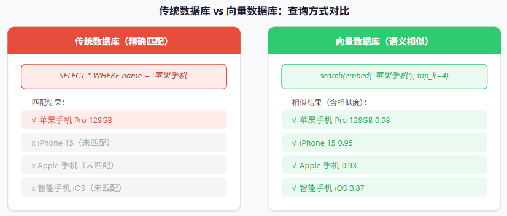
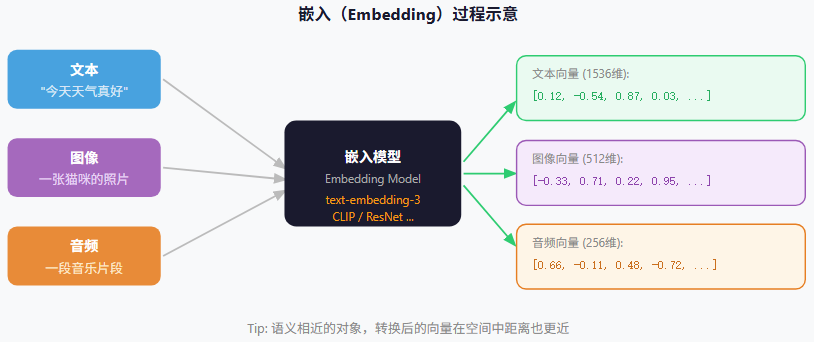
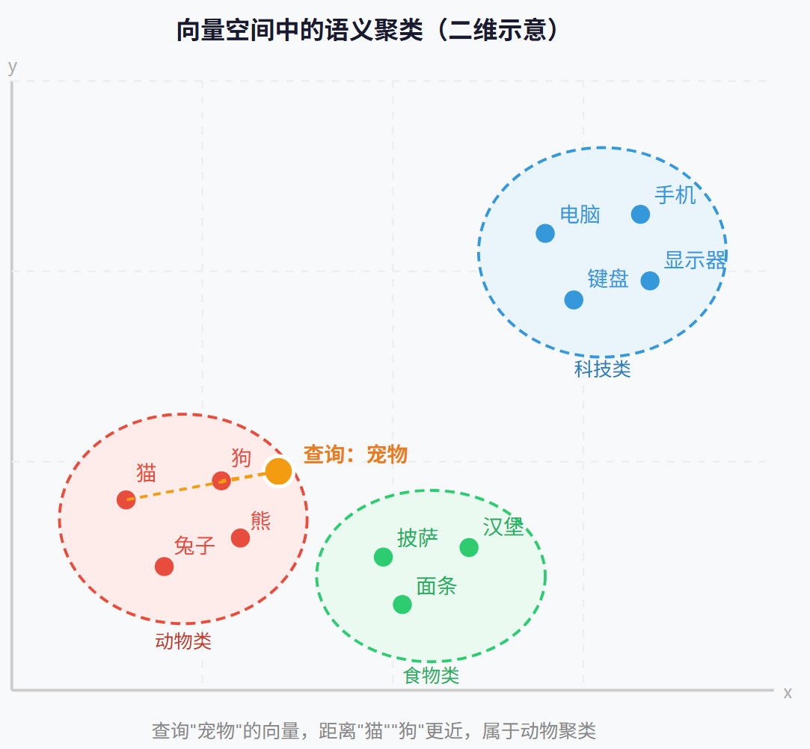
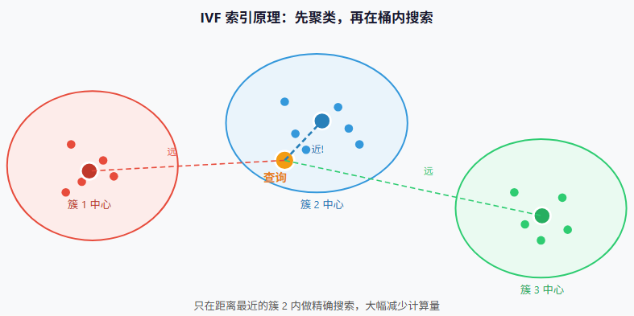
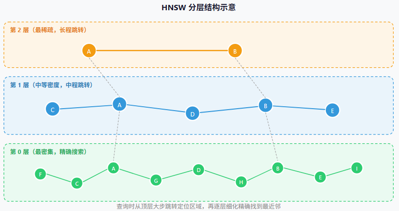

# 向量数据库（Vector Database）

向量数据库（Vector Database）是一种专门用于存储、索引和检索高维向量数据的数据库系统。

你可以把它理解为：把意思相近的东西存在一起，并能快速找到和这个最像的那些东西。

与传统数据库通过精确匹配来查询（**WHERE name = 'Alice'**）不同，向量数据库通过**相似度**来查询（找到和这张图最相似的 10 张图）。

想象一个图书馆的场景：

| 数据库类型 | 检索方式             | 类比                                 |
| :--------- | :------------------- | :----------------------------------- |
| 传统数据库 | 按书号、书名精确检索 | 找一本指定编号的书                   |
| 向量数据库 | 按内容相关性检索     | 找"所有和《三体》风格类似的科幻小说" |

这种语义上的相似，正是向量数据库解决的核心问题。

## 向量数据库与传统数据库

在深入技术细节之前，我们先理解向量数据库解决了什么问题。

### 传统数据库的局限

传统关系型数据库（MySQL、PostgreSQL）非常擅长处理结构化数据，但在面对以下需求时力不从心：

- 图片搜索（找出视觉相似的图片）
- 语义搜索（用户搜"苹果手机"，能找到"iPhone"的相关内容）
- 推荐系统（找到"和你喜欢的歌曲风格类似的歌"）
- 异常检测（找到"和正常行为差异最大的日志"）

这些问题的共同特征是：需要理解内容的"含义"，而不是做字面匹配。

```
用 LIKE '%苹果%' 搜索	→ 找不到 "iPhone"、"Apple"
```

### 对比示意图

下面的图表直观展示了传统数据库和向量数据库在查询方式上的根本差异。




## 向量与嵌入

这是向量数据库的**核心概念**。

### 向量（Vector）

在数学上，向量就是一组有序的数字。

```
[0.12, -0.54, 0.87, 0.03, ..., 0.61]   ← 这就是一个向量
```

在机器学习中，这组数字代表某个对象的**语义特征**，维度通常在 128 到 4096 之间。

### 嵌入（Embedding）

嵌入（Embedding）是将现实世界的对象（文字、图片、音频等）转换成向量的过程和结果。

这个转换由嵌入模型完成，其核心思想是：语义相近的对象，其向量在空间中的距离也更近。




### 语义近则向量近

向量空间中距离近的两个向量，其原始内容在语义上也更相近。这是向量数据库所有能力的基础。

用一个 2D 简化示例来理解（实际是几百至几千维）：




## 相似度计算方法

找到"最相似的向量"的核心是计算两个向量的距离或相似度。以下是三种最常用的方法。

### 余弦相似度（Cosine Similarity）

余弦相似度衡量两个向量的方向角，忽略长度。这是最常用的方法，尤其适合文本场景。

公式：cosine_similarity(A, B) = (A · B) / (|A| · |B|)

- 结果范围：-1 到 1，值越大越相似
- 适用场景：文本语义搜索、文档相似度

### 欧氏距离（Euclidean Distance）

欧氏距离衡量两点之间的直线距离，距离越小越相似。

公式：d(A, B) = sqrt(Σ(A_i - B_i)^2)

- 结果范围：0 到 ∞，值越小越相似
- 适用场景：图像检索、地理位置相关应用

### 点积（Dot Product）

点积是向量相乘求和，结合了方向和长度信息。

公式：A · B = Σ A_i × B_i

- 适用场景：推荐系统（向量已归一化时等价于余弦相似度）


### 三种方法对比

三种相似度计算方法对比

| 方法           | 原理                                         | 结果含义                   | 推荐场景             |
| -------------- | -------------------------------------------- | -------------------------- | -------------------- |
| **余弦相似度** | 计算两向量夹角的余弦值<br>关注方向，忽略大小 | \[-1, 1]，越接近 1 越相似  | 文本搜索、NLP 首选   |
| **欧氏距离**   | 两点之间的直线距离<br>关注绝对位置差异       | \[0, ∞)，越接近 0 越相似   | 图像检索、坐标系数据 |
| **点积**       | 向量各分量乘积之和<br>方向+长度综合考量      | 值越大越相似（无固定范围） | 推荐系统、归一化场景 |


## 向量索引算法

数据量大时（百万、亿级），对每一条数据做相似度计算（暴力检索）太慢。向量数据库使用专门的索引算法来加速查询。

### 暴力检索（Flat / Brute-force）

暴力检索遍历所有向量，逐一计算相似度。

| 维度 | 说明                             |
| :--- | :------------------------------- |
| 原理 | 遍历所有向量，逐一计算相似度     |
| 优点 | 结果 100% 精确                   |
| 缺点 | 数据量大时极慢，O(n) 复杂度      |
| 适用 | 数据量小于 10 万，对精度要求极高 |

### IVF（倒排文件索引）



IVF 执行步骤：

1. 训练阶段：用 K-Means 将所有向量聚成 N 个簇，记录每个簇的中心
2. 查询阶段：先找出距离最近的几个簇的中心，再只在这些簇内做精确搜索

### HNSW（分层导航小世界图）

HNSW 是目前最主流的向量索引算法，兼顾速度和精度。



HNSW 分层结构示意第 2 层（最稀疏，长程跳转）AB第 1 层（中等密度，中程跳转）CADBE第 0 层（最密集，精确搜索）FCAGDHBEI查询时从顶层大步跳转定位区域，再逐层细化精确找到最近邻

HNSW 核心思路：

- 构建多层图结构，顶层稀疏，底层密集
- 查询时从顶层入口开始，做"跳格游戏"：每层贪心地往更近的节点跳，再下探到下一层
- 大幅减少需要比较的节点数，时间复杂度近似 O(log n)

### 其他常用索引

| 索引类型     | 特点                       | 适用场景           |
| :----------- | :------------------------- | :----------------- |
| Flat（暴力） | 精确但慢                   | 小数据集、精度优先 |
| IVF_Flat     | 聚类后精确搜索，速度快     | 中大规模，内存充足 |
| IVF_PQ       | 量化压缩，节省内存         | 超大规模，内存受限 |
| HNSW         | 速度快、精度高，内存占用高 | 最常用，推荐首选   |
| ScaNN        | Google 出品，优化吞吐量    | 高并发生产环境     |

------

## 主流向量数据库对比

以下是当前最主流的向量数据库横向对比，帮助你在不同场景下做出选择。

| 数据库                     | 类型       | 部署方式                      | 特点                                           | 适用场景                 | 难度 |
| -------------------------- | ---------- | ----------------------------- | ---------------------------------------------- | ------------------------ | ---- |
| **Chroma**<<br>开源免费    | 纯向量DB   | 本地 / 云端<br>嵌入式优先     | 极简 API，Python 原生<br>集成 LangChain 最方便 | RAG 原型、AI 应用开发    | 入门 |
| **Qdrant**<<br>开源免费    | 纯向量DB   | 本地 / Docker<br>云服务       | Rust 实现，性能强劲<br>支持过滤+向量混合检索   | 生产级推荐，性能优先     | 中级 |
| **Weaviate**<<br>开源免费  | 多模态DB   | 本地 / 云端<br>SaaS           | GraphQL API，内置向量化<br>多模态（文本+图像） | 多模态检索，知识图谱     | 中级 |
| **Milvus**<<br>开源免费    | 纯向量DB   | 分布式部署<br>Kubernetes      | LF AI 基金会项目<br>大规模分布式，功能全面     | 亿级数据，企业大规模     | 进阶 |
| **Pinecone**<<br>商业 SaaS | 托管向量DB | 纯云端<br>全托管服务          | 零运维，开箱即用<br>免费套餐可用               | 快速上线，无运维能力团队 | 入门 |
| **pgvector**<<br>开源插件  | PG 扩展    | 已有 PostgreSQL<br>环境直接用 | 复用已有 PG 基础设施<br>SQL 接口，上手最快     | 已用 PG 的项目，轻量接入 | 入门 |

