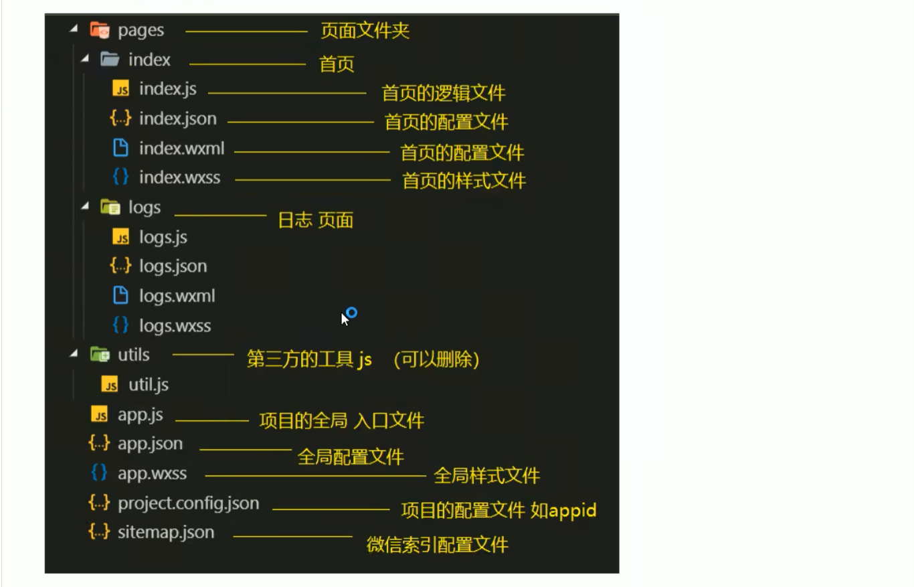
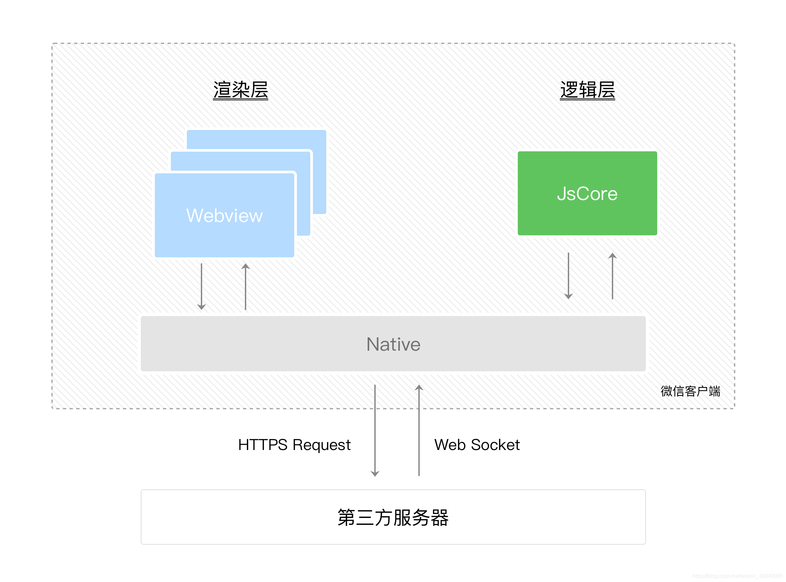
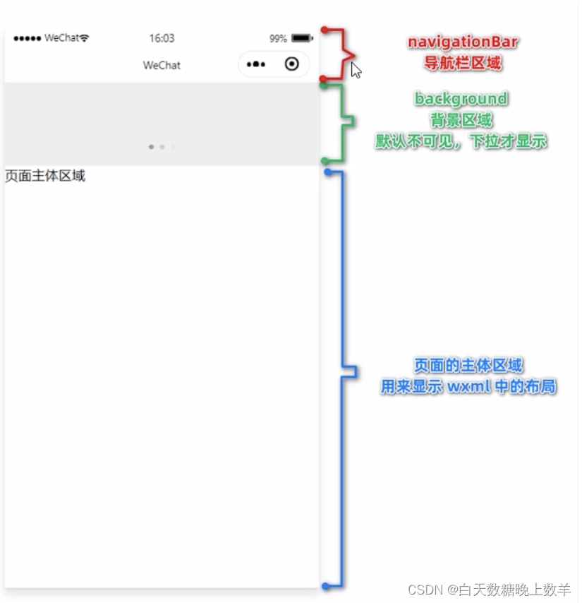
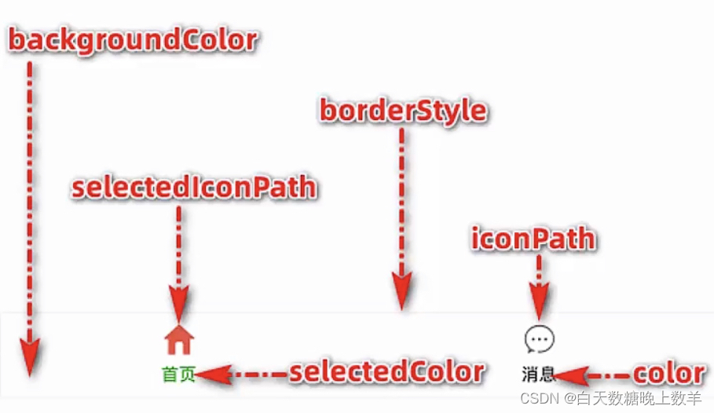

# 一、小程序基本

[教程 | 《小程序开发指南》](https://developers.weixin.qq.com/ebook?action=get_post_info&docid=0008aeea9a8978ab0086a685851c0a)

## 小程序与普通网页开发的区别

1. 运行环境不同

   - 网页运行在浏览器环境中。

   - 小程序运行在微信环境中。

2. API不同

   - 由于运行环境的不同，所以小程序中无法调用 DOM 和 BOM 的 API。

   - 但是，小程序中可以调用微信环境提供的各种 API，例如：地理定位、扫码、支付。

3. 开发模式不同

- 网页的开发模式：浏览器+代码编辑器
- 小程序有自己的一套标准开发模式：
  1. 申请小程序开发账号；
  2. 安装小程序开发者工具；
  3. 创建和配置小程序项目。

---

小程序管理后台：https://mp.weixin.qq.com/

[微信开放文档 / 开发](https://developers.weixin.qq.com/miniprogram/dev/framework/)

开发工具下载：[下载](https://developers.weixin.qq.com/miniprogram/dev/devtools/download.html)

---

## 项目结构



- **pages 用来存放所有小程序的页面**
- utils 用来存放工具性质的模块（例如:格式化时间的自定义模块）
- **app.js 小程序项目的入口文件**
- **app.json 小程序项目的全局配置文件**
- app.wxss 小程序项目的全局样式文件
- project.config.json 项目的配置文件
- sitemap.json 用来配置小程序及其页面是否允许被微信索引

## 页面组成

其中，每个页面由 4个基本文件组成，它们分别是:

- `.js` 文件(页面的脚本文件，存放页面的数据、事件处理函数等)
- `.json` 文件(当前页面的配置文件，配置窗口的外观、表现等)
- `.wxml`文件(页面的模板结构文件)
- `.wxss` 文件(当前页面的样式表文件)

## 项目配置json

### app.json

[小程序配置 / 全局配置](https://developers.weixin.qq.com/miniprogram/dev/reference/configuration/app.html)

`app.json` 内的配置项：

- **pages**:用来记录当前小程序所有页面的路径
  - 一开始有两行，就有两个页面。
  - 在`app.json` 中新增界面，会**自动创建**新的节目文件夹在pages中。
  - 只需要调整 app.json ->pages 数组中页面路径的前后顺序，即可修改项目的**首页**。小程序会把排在第一位的页面，当作项目首页进行渲染。
- **window**:全局定义小程序所有页面的背景色、文字颜色等。
  - 小程序中的每一个页面，可以使用.json文件来对本页面的窗口外观进行配置，**页面中的配置项会覆盖app.json的window中相同的配置项**。

- **tabBar**：设置小程序底部的tabBar效果。
- **style**:全局定义小程序组件所使用的样式版本。


### project.config.json

`project.config.json` 是项目配置文件，用来记录我们对小程序开发工具所做的个性化配置，例如:

- **setting** 中保存了编译相关的配置。
- **projectname** 中保存的是项目名称。
- **appid** 中保存的是小程序的账号 ID。


### sitemap.json

`sitemap.json` 文件用来配置小程序页面是否允许**微信索引**。微信现已开放小程序内搜索，效果类似于 PC网页的 SE0。

当开发者允许微信索引时，微信会通过爬虫的形式，为小程序的页面内容建立索引。当用户的搜索关键字和页面的索引匹配成功的时候，小程序的页面将可能展示在搜索结果中。

【注意】sitemap 的索引提示是默认开启的。如需要关闭 sitemap 的索引提示，可在小程序项目配置文件 project.config.json 的 setting 中配置字段 checkSiteMap 为 false

```json
"checkSiteMap": false,
```


## Js文件

小程序中的 JS 文件分为三大类，分别是：

- app.js
  是整个小程序项目的入口文件，通过调用 App()函数来启动整个小程序
- 页面的 .js 文件
  是页面的入口文件，通过调用 Page()函数来创建并运行页面
- 普通的 .js 文件
  是普通的功能模块文件，用来封装公共的函数或属性供页面使用


## WXML模板（HTML）

- 标签名称不同

```
HTML(div,span,img,a)
WXML(view,text,image, navigator)
```

view对应div，text对应span。。。

- 属性节点不同

```
<a href="#">超链接</a>
<navigator url="/pages/home/home"></navigator>
```

- 提供了类似于 Vue 中的模板语法

数据绑定
列表渲染
条件渲染


## WXSS样式（CSS）

- 新增了 rpx 尺寸单位
  - CSS 中需要手动进行像素单位换算，例如rem。
  - WXSS 在底层支持新的尺寸单位rpx，在不同大小的屏幕上小程序会自动进行换算。
- 提供了全局的样式和局部样式
  - 项目根目录中的 app.wxss 会作用于所有小程序页面。
  - 局部页面的.wxss 样式仅对当前页面生效。
- WXSS 仅支持部分 CSS 选择器
  - `.class` 和 `#id`
  - element
  - 并集选择器、后代选择器
  - `::after`和`::before`等伪类选择器


## 宿主环境

宿主环境(host environment)指的是程序运行所必须的依赖环境。例如：

Android 系统和 i0S 系统是两个不同的宿主环境。安卓版的微信 App 是不能在 i0S 环境下运行的，所以 Android 是安卓软件的宿主环境，脱离了宿主环境的软件是没有任何意义的。

**微信小程序**的宿主环境就是 微信。


小程序的运行环境分成**渲染层**和**逻辑层**，其中 WXML 模板和 WXSS 样式工作在渲染层，JS 脚本工作在逻辑层。

小程序的渲染层和逻辑层分别由 2 个线程管理：

- 渲染层的界面使用了 WebView 进行渲染；一个小程序存在多个界面，所以渲染层存在多个 WebView 线程。

- 逻辑层采用 JsCore 线程运行 JS 脚本。


Native 中转： 这两个线程的通信会经由微信客户端（下文中也会采用 Native 来代指微信客户端）做中转，逻辑层发送网络请求也经由 Native 转发，小程序的通信模型下图所示：




### 小程序启动的过程

1. 把小程序的代码包下载到本地
2. 解析 app.json 全局配置文件
3. 执行 app.js 小程序入口文件，调用 App()创建小程序实例
4. 渲染小程序首页
5. 小程序启动完成

### 页面渲染的过程

1. 加载解析页面的 .json 配置文件
2. 加载页面的.wxml模板和 .wxss 样式
3. 执行页面的 .js 文件，调用 Page()创建页面实例
4. 页面渲染完成


## 小程序API

小程序中的API是由宿主环境提供的，开发者可以调用微信提供的能力，如：获取用户信息、本地存储、支付功能等。

小程序官方把API分为3大类：

1. 事件监听API

特点：以on开头，用来监听某些事件的触发

如：`wx.onWindowResize(function callback)`监听窗口尺寸变化的事件

2. 同步API

特点1：以Sync结尾的API都是同步API
特点2：同步API的执行结果，可以通过函数返回值直接获取，如果执行出错会抛出异常

如：`wx.setStorageSync('key','value')`向本地存储中写入内容

3. 异步API

特点：类似于jQuery中的`$.ajax(option)`函数，需要通过success、fail、complete接收调用的结果。

如:`wx.request()`发起网络数据请求，通过success回调函数接收数据。


# 二、数据绑定（类Vue）

在 data 中定义数据，
在 WXML 中使用数据。

1. 在页面对应的`.js` 文件中，把数据定义到 data 对象中即可。

```js
Page({
  data: {
	info: "init data",	//字符串
	msgList: [{msg: 'hello'}, {msg: 'world'}],	//数组
  	randomNum: Math.random() *10  //十以内随机数
  }
}
```

2. 把data中的数据绑定到页面`wxml`中渲染，但使用 **Mustache 语法**(双大括号)将变量包起来即可。

```html
<view>{{info}}</view>
<view>{{randomNum >=5 ? '数字大于或等于5':'数字小于5'}}</view>
```


Mustache 语法有 3 个应用场景

- 绑定内容 data
- 绑定属性
- 运算(三元运算、算术运算等)


# 三、事件绑定

**事件**是**渲染层到逻辑层的通讯方式**。通过事件可以将用户在渲染层产生的行为，反馈到逻辑层进行业务的处理。

常用事件如：tap，input，change...

| 类型   | 绑定方式                 | 事件描述                                    |
| ------ | ------------------------ | ------------------------------------------- |
| tap    | bindtap或bind：tap       | 手指触摸后马上离开，类似于HTML中的click事件 |
| inpput | bindinput或bind：input   | 文本框的输入事件                            |
| change | bindchange或bind：change | 状态改变时触发                              |

### 事件对象的回调列表

当事件回调触发的时候，会收到一个事件对象event，它的详细属性如下表：

| 属性           | 类型    | 说明                                         |
| -------------- | ------- | -------------------------------------------- |
| type           | String  | 事件类型                                     |
| timeStamp      | Integer | 页面打开到触发事件所经过的毫秒数             |
| target         | Object  | 触发事件的组件的一些属性值集合               |
| currentTarget  | Object  | 当前组件的一些属性值集合                     |
| detail         | Object  | 额外的信息                                   |
| touches        | Array   | 触摸事件，当前提留在屏幕中的触摸点信息的数组 |
| changedTouches | Array   | 触摸事件，当前变化的触摸点信息的数组         |

target和detail较为重要

**target**和**currentTarget**的区别：target是触发该事件的源头组件，而currentTarget则是当前事件所绑定的组件。

### bindtap的语法格式

在小程序中，不存在HTML中的onclick鼠标点击事件，而是通过tap事件来响应用户的触摸行为。

使用步骤：

步骤1:通过bindtap，可以为组件绑定tap触摸事件，语法如下：

```html
<button type="primary" bindtap="btnTapHandler">按钮</button>
```

步骤2:在页面的.js文件中定义对应的事件处理函数，事件参数通过形参event（一般写出e）来接受：

```js
Page({
    btnTapHandler(e){   //按钮的tap事件处理函数
        console.log(e)	  //事件参数对象e
    }
})
```

### 在事件处理函数中为data中的数据赋值

通过调用`this.setData(dataObject)`方法，可以给页面data中的数据重新赋值。

### 事件传参

小程序中的事件传参比较特殊，不能在绑定事件的同时为事件处理函数传递参数。

可以为组件提供data-自定义属性传参，其中代表的是参数的名字，如：

```html
<button bindtap="btnHandler" data-info="{{2}}">事件传参</button>
//最终info会被解析为参数的名字，数值2会被解析为参数的值
```

在事件处理函数中，通过event.target.dataset.参数名即可获取到具体参数的值，示例如下：

```js
btnHandler(event){
	//dataset是一个对象，包含了所有通过data-*传递过来的参数项
	console.log(event.targer.dataset)
	//通过dataset可以访问到具体参数的值
	console.log(event.target.dataset.info)
}
```

### 实现文本框和data之间的数据同步

实现步骤：1）定义数据 2）渲染结构 3）美化样式 4）绑定input事件处理函数


# 四、逻辑结构（条件逻辑、列表渲染）

## 4.1 条件逻辑

### wx:if

在小程序中，使用wx:if="{{condition}}"来判断是否需要渲染该代码块:

```html
<view wx:if="{{condition}}">True</view>
```

也可以用wx:elif和wx:else来添加else判断：

```html
<view wx:if="{{type === 1}}">男</view>
<view wx:elif="{{type === 2}}">女</view>
<view wx:else>保密</view>
```

### 结合`<block>`使用wx:if

如果要一次性控制多个组件的展示与隐藏，可以使用一个`<block></block>`标签将多个组件包装起来，并在`<block>`标签上使用`wx:if`控制属性

```html
<block wx:if="{{true}}">
	<view> view1 </view>
    <view> view2 </view>
</block>
```

注意：`<block>`并不是一个组件，它只是一个包裹性质的容器，不会再页面中做任何渲染

### hidden

在小程序中，直接使用hidden=“{{condition}}”也能控制元素的显示与隐藏：

```html
<view hidden="{{condition}}">条件为true隐藏，条件为false显示</view>
```


## 4.2 列表渲染

### wx:for

通过wx：for可以根据指定的数值，循环渲染重复的组件结构，如：

```html
<view wx:for="{{array}}">
	索引是：{{index}} 当前项是{{item}}
</view>
```

默认情况当前循环项的索引用index表示；当前循环项用item表示。

例子：

```html
data: {
    arr: [1,2,3,4]
}

<view wx:for="{{arr}}">索引是自带的属性{{index}}，{{item}}</view>
```


### wx:key的使用

类似于Vue列表渲染中的`:key`，小程序在实现列表渲染时，也建议为渲染出来的列表项指定唯一的key值，从而提高渲染效率，如：

```html
<view wx:for="{{userlist}}" wx:key="id">{{item.name}}</view>
```

例子：

```html
data: {
	msgList: [
		{id: 1, msg: 'hello'}, 
		{id: 2, msg: 'world'}
	]
}

<view wx:for="{{msgList}}" wx:key="id">{{item.msg}}</view>
```


# 五、WXSS模板样式（CSS）

WXSS与Web开发中的CSS类似。为了更适合小程序开发，WXSS对CSS做了一些补充以及修改。

## 5.1 rpx单位

rpx是微信小程序独有的，用来解决屏适配的尺寸单位。

rpx 的实现原理非常简单：鉴于不同设备屏幕的大小不同，为了实现屏幕的自动适配，rpx 把所有设备的屏幕，在宽度上等分为 750 份（即：当前屏幕的总宽度为 750rpx）。


## 5.2 样式导入

使用WXSS提供的`@import`语法，可以导入外联的样式表。

`@import`后跟需要导入的外联样式表的相对路径，用；表示语句结束，如：

```
@import "common.WXSS";
```

### 5.2.1全局样式

定义在`app.wxss`中的样式为全局样式，作用于每一个页面。

### 5.2.2局部样式

在页面的`.wxss`文件中定义的样式为局部样式，只作用于当前页面。


# 六、全局配置app.json

[小程序配置 / 全局配置](https://developers.weixin.qq.com/miniprogram/dev/reference/configuration/app.html)

`app.json` 内的配置项：

- **pages**：用来记录当前小程序所有页面的路径。
  - 一开始有两行，就有两个页面。
  - 在`app.json` 中新增界面，会**自动创建**新的节目文件夹在pages中。
  - 只需要调整 app.json ->pages 数组中页面路径的前后顺序，即可修改项目的**首页**。小程序会把排在第一位的页面，当作项目首页进行渲染。
- **window**：全局定义小程序所有页面的背景色、文字颜色等。
  - 小程序中的每一个页面，可以使用.json文件来对本页面的窗口外观进行配置，**页面中的配置项会覆盖app.json的window中相同的配置项**。

- **tabBar**：设置小程序底部的tabBar效果。
- **style**：全局定义小程序组件所使用的样式版本。



## 6.1 window节点常用的配置项

| 属性名                       | 类型     | 默认值  | 说明                                             |
| ---------------------------- | -------- | ------- | ------------------------------------------------ |
| navigationBarBackgroundColor | HexColor | #000000 | 导航栏背景颜色，如#000000                        |
| navigationBarTitleText       | String   | 字符串  | 导航栏标题文字内容                               |
| navigationBarTextStyle       | String   | white   | 导航栏标题颜色，仅支持black/white                |
| backgroundColor              | HexColor | #ffffff | 窗口的背景色                                     |
| backgroundTextStyle          | String   | dark    | 下拉loading的样式，仅支持dark/light              |
| enablePullDowerRefresh       | Bollean  | flase   | 是否全局开启下拉刷新                             |
| onReachBottomDistance        | Number   | 50      | 页面上拉触底事件触发时距页面底部的距离，单位为px |

## 6.2 tabBar

tabBar是移动端应用常见的页面效果，用于实现多页面的快速切换。小程序中通常将其分为：**底部tabBar和顶部tabBar**。

例：

```json
"tabBar": {
    "list": [
        {
            "pagePath": "pages/index/index",
            "text": "text",
            "iconPath": "iconPath",//可以没有
            "selectedIconPath": "selectedIconPath"//可以没有
    	}
    ]
}
```

注意：

1. tabBar中只能配置最少2个，最多5个tab页签；
2. 当渲染顶部tabBar时，不显示icon，只显示文本。

tabBar的6个组成部分：



1. backgroundColor：tabBar的背景色
2. selectedIconPath：选中时的图片路径
3. boederStyle：tabBar上边框的颜色
4. iconPath：未选中时的图片路径
5. selectedColor：tabBar上的文字选中时的颜色
6. color：tabBar上文字的默认（未选中）颜色

### tarBar的配置项

[14.全局配置 - tabBar_哔哩哔哩_bilibili](https://www.bilibili.com/video/BV1834y1676P?spm_id_from=333.788.player.switch&vd_source=9d3c5a863c7c6dbd5152dd7c4e9dc492&p=32)

| 属性            | 类型     | 必填 | 默认值 | 描述                                  |
| --------------- | -------- | ---- | ------ | ------------------------------------- |
| position        | String   | 否   | bottom | tabBar的位置，仅支持bottom/top        |
| borderStyle     | String   | 否   | black  | tabBar上边框的颜色，仅支持black/white |
| color           | HexColor | 否   |        | tab上文字的默认（未选择）颜色         |
| selectedColor   | HexColor | 否   |        | tab上的文字选中时的颜色               |
| backgroundColor | HexColor | 否   |        | tabBar的背景色                        |
| list            | Array    | 是   |        | tab页签的列表，最少2个、最多5个tab    |

每个tab项的配置选项：

| 属性             | 类型   | 必填   | 描述                                              |
| ---------------- | ------ | ------ | ------------------------------------------------- |
| **pagePath**     | String | **是** | 页面路径，页面必须在pages中预先定义               |
| **text**         | String | **是** | tab上显示的文字                                   |
| iconPath         | String | 否     | 未选中时的图标路径；当position为top时，不显示icon |
| selectedIconPath | String | 否     | 选中时的图标路径；当position为top时，不显示icon   |

阿里图标库可以下载icon图标，tabBar的相关页面必须放到“pages”的最前面的位置！不然无法显示！


# 七、网络数据请求

小程序官方对数据接口的请求做了两个限制：

1. 只能请求HTTPS类型的接口；
2. 必须将接口的域名添加到信任列表中。


## 7.1 配置request合法域名

配置步骤：登录微信小程序管理后台->开发->开发设置->服务器域名->修改request合法域名。

注意事项：

1. 域名只支持https协议；
2. 域名不能使用IP地址或localhost；
3. 域名必须经过ICP备案；
4. 服务器域名一个月最多可申请修改5次；

## 7.2 发起GET和POST请求

调用微信小程序提供的`wx.request()`方法，可以发起GET数据请求。

调用微信小程序提供的`wx.request()`方法，可以发起POST数据请求。

## 7.3 在页面刚加载时请求数据

需要在页面刚加载的时候，自动请求一些初始化的数据。此时需要在页面的onLoad事件中调用获取数据的函数。如：

```
onLoad:function(options){
	this.getSwiperList()
	this.getGridList()
}
```


关于跨域和 Ajax 的说明：

跨域问题只存在于基于浏览器的web开发中。由于小程序的宿主环境不是浏览器，而是微信客户端，所以小程序中不存在跨域的问题。

Ajax技术的核心是依赖于浏览器中的XMLHttpRequest这个对象，由于小程序的宿主环境是微信客户端，所以小程序中不能叫做“发起Ajax请求” ，而是叫做“发起网络数据请求”。


# 八、页面导航

页面导航指的是页面之间的相互跳转。如浏览器中实现页面导航的方式有<a>链接和location.herf

小程序中实现页面导航的两种方式：

1. 声明式导航
   - 在页面上声明一个`<navigator>`导航组件。
   - 通过点击`<navigator>`组件实现页面跳转。
2. 编程式导航
   - 调用小程序的导航API，实现页面的跳转。

## 8.1声明式导航

导航到tabBar页面：

```
导航到tabBar页面：
	tabBar页面指的是被配置为tabBar的页面。
	在使用<navigator>组件跳转到指定的tabBar页面时，需要指定url属性和open-type属性，其中：
		1）url表示要跳转的页面的地址，必须以/开头；
		2）open-type表示跳转的方式，必须为switchTab
如：<navigator url="/pages/message/message" open-type="switchTab">导航到消息页面</navigator>
```

导航到非tabBar页面：

```
导航到非tabBar页面：
	非tabBar页面指的是没有被配置为tabBar的页面。
	在使用<navigator>组件跳转到指定的非tabBar页面时，需要指定url属性和open-type属性，其中：
		1）url表示要跳转的页面的地址，必须以/开头；
		2）open-type表示跳转的方式，必须为naviagte
如：<navigator url="/pages/info/info" open-type="navigate">导航到消息页面</navigator>
```

注意：为了简便，在导航到feitabBar页面时，open-type=“naviagte”属性可以省略。

后退导航

```
后退导航：
	如果要后退到上一页或多级页面，则需要指定open-type属性和delta属性，其中：
		1）open-type的值必须是navigateBack，表示要进行后退导航
		2）delta的值必须是数字，表示要后退的层级
如:<naviagtor open-type="navigateBack" delta="1">返回上一页</naviagtor>
注意：如果只是后退到上一页，则可以省略delta属性，因为其默认值就是1
```

## 8.2 编程式导航

8.2.1导航到tabBar页面

调用wx.switchTab(Object object)方法，可以跳转到tabBar页面。其中Object参数对象的属性列表如下：

| 属性     | 类型     | 是否必选 | 说明                                             |
| -------- | -------- | -------- | ------------------------------------------------ |
| url      | string   | 是       | 需要跳转的tabBar页面的路径，路径后不能带参数     |
| success  | function | 否       | 接口调用成功的回调函数                           |
| fail     | function | 否       | 接口调用失败的回调函数                           |
| complete | function | 否       | 接口调用结束的回调函数（调用成功、失败都会执行） |


8.2.2导航到非tabBar页面

调用wx.navigateTo(Object object)方法，可以跳转到非tabBar的页面。其中Object参数对象的属性列表如下：

| 属性     | 类型     | 是否必选 | 说明                                             |
| -------- | -------- | -------- | ------------------------------------------------ |
| url      | string   | 是       | 需要跳转的tabBar页面的路径，路径后**可以带参数** |
| success  | function | 否       | 接口调用成功的回调函数                           |
| fail     | function | 否       | 接口调用失败的回调函数                           |
| complete | function | 否       | 接口调用结束的回调函数（调用成功、失败都会执行） |

8.2.3 后退导航

调用wx.navigateBack(Object object)方法，可以返回上一页面或多级页面。其中Object参数对象可选的属性如下：

| 属性     | 类型     | 默认值 | 是否必选 | 说明                                                |
| -------- | -------- | ------ | -------- | --------------------------------------------------- |
| delta    | number   | 1      | 否       | 返回的页面数，如果delta大于现有页面数，则返回到首页 |
| success  | function |        | 否       | 接口调用成功的回调函数                              |
| fail     | function |        | 否       | 接口调用失败的回调函数                              |
| complete | function |        | 否       | 接口调用结束的回调函数（调用失败、成功都会执行）    |


十四、导航传参

14.1 声明式导航传参

```
navigator组件的url属性用来指定将要跳转到的页面的路径。同时，路径的后面还可以携带参数：
1）参数与路径之间使用？分隔；
2）参数键与参数值用=相连
3）不同参数用&分隔
如：<naviagtor url="/pages/info/info?name=zs&age=20">跳转到info页面</naviagtor>
```

14.2 编程式导航传参

```
调用wx.navigateTo(Object onject)方法跳转页面时，也可以携带参数，如：
	//页面结构 .wxhm
	<button bindtap="gotoinfo2">跳转到info页面</button>
	//通过编程式导航，跳转到info页面，并携带参数 .js
gotoinfo2(){
	wx.navigateTo({
		url:'/pages/info/info?name=ls&gender=男'
})
}
```

14.3 在onLoad中接收导航参数

```
通过声明式导航传参或编程式导航传参所携带的参数，可以直接在onLoad事件中直接获取到如：

//.js文件
onLoad:function(options){
	console.log(options)
},
```


# 组件

[微信开放文档 / 组件](https://developers.weixin.qq.com/miniprogram/dev/component/)

## 1.常用视图容器组件

1. view
   普通视图区域
   类似于HTML中的div，是一个块级元素
   常用来实现页面的布局效果
2. scroll-view
   可滚动的视图区域
   常用来实现滚动列表效果
3. swiper和swiper-item
   轮播图容器组件和轮播图item组件

swiper组件的常用属性：

| 属性                   | 类型    | 默认值           | 说明                 |
| ---------------------- | ------- | ---------------- | -------------------- |
| indicator-dots         | boolean | false            | 是否显示面板指示点   |
| indicator-color        | color   | rgba（0,0,0,.3） | 指示点颜色           |
| indicator-active-color | color   | #000000          | 当前选中的指示点颜色 |
| autoplay               | boolean | false            | 是否自动切换         |
| interval               | number  | 5000             | 自动切换时间间隔     |
| circular               | boolean | false            | 是否采用衔接滑动     |

## 2.采用基础内容组件

1. text
   文本组件
   类似于HTML中的span标签，是一个行内元素
2. rich-text
   富文本组件
   支持把HTML字符串渲染为WXML结构

## 3.其他采用组件

1. button
   按钮组件
   功能比HTML中的button按钮丰富
   通过open-type属性可以调用微信提供的各种功能（客服、转发、获取用户权限、获取用户信息等）
2. image
   图片组件
   image组件默认宽度约300px、高度240px

image组件的mode属性用来指定图片的裁剪和缩放模式，常用的mode属性值如下：

| mode值      | 说明                                                         |
| ----------- | ------------------------------------------------------------ |
| scaleToFill | （默认值）缩放模式，不保持纵横比缩放图片，使图片的宽高完全拉伸至填满image元素 |
| aspectFit   | 缩放模式，保存纵横比缩放图片，使图片的长边能完全显示出来。也就是说，可以完整地将图片显示出来。 |
| aspectFill  | 缩放模式，保存纵横比缩放图片，使图片的短边能完全显示出来。也就是说，图片通常只在水平或垂直方向是完整的，另一个方向将会发生截取。 |
| widthFix    | 缩放模式，宽度不变，高度自动变化，保持原图宽高比不变。       |
| heightFix   | 缩放模式，高度不变，宽度自动变化，保持原图宽高比不变。       |

3. naviagtor
   页面导航组件
   类似于HTML中的a链接


# 云开发

[云开发 - 介绍](https://developers.weixin.qq.com/miniprogram/dev/wxcloudservice/wxcloud/basis/getting-started.html)

[开发指引 / 基础能力 / 云函数 / 我的第一个云函数](https://developers.weixin.qq.com/miniprogram/dev/wxcloudservice/wxcloud/guide/functions/getting-started.html)

需要 有一个云开发的文件夹，例如创建一个：`cloud`。

那么就要在`project.config.json`把这个文件夹和云端进行配置：

```json
"cloudfunctionRoot": "cloud/",
```


[开发指引 / 基础能力 / 初始化](https://developers.weixin.qq.com/miniprogram/dev/wxcloudservice/wxcloud/guide/init.html)

修改`app.js`，配置环境ID（KEY）：

```js
// app.js
App({
  onLaunch() {
   wx.cloud.init({
	   env:'KEY',
	   traceUser: true
   })
  }
})
```

`traceUser: true`：将用户信息保存到用户管理。


如果**云函数调用失败**，就在那个云函数下面打开终端：

```
npm install wx-server-sdk@latest
```

