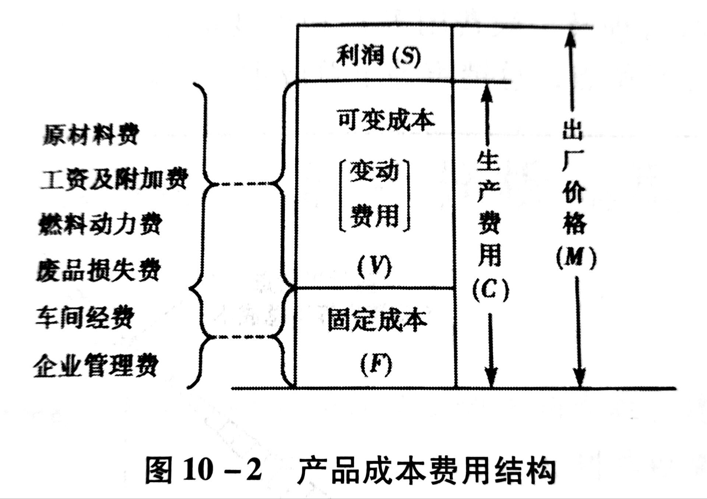

## 成本

工业产品的成本费用可划分为：原材料、燃料动力费、工资及附加费、废品损失费、车间费用和企业管理费**六项**。

### 成本分类

#### 根据其与产品产量（或业务量）的关系分为固定费用和变动费用

- **固定成本**：在一定时期内不随企业产量的增减而变化。
  - 预付成本：有所提供生产力决定的。
  - 计划成本：管理部门认为要达到预期目标所必需的费用。

- **可变成本**：随着企业产品产量的增减而变化。

成本方程为： 
$$
C = F + V =(Fc + Fp)+V
$$

- C 为总成本或生产费用
- V 为可变成本
- F 为固定成本或称固定费用
- Fc 为预付成本，把在全部销售量上保持不变
- Fp 为计划成本，它随销售量而波动

#### 根据回收后归属不同分为显性成本和隐性成本

- **显性成本（会计成本）**：企业在成产要素市场中购买或租用索要的生产要素的实际支出。
- **隐性成本（机会成本）**：形式上没有支付义务的。

在会计上起支配作用的是隐性成本。

判断资源是否得到最优使用的是：机会成本。

- **增量成本**：某项决策而产生的相关成本，总成本的增量。
- **沉没成本**：在短期中，固定成本就是沉没成本。

